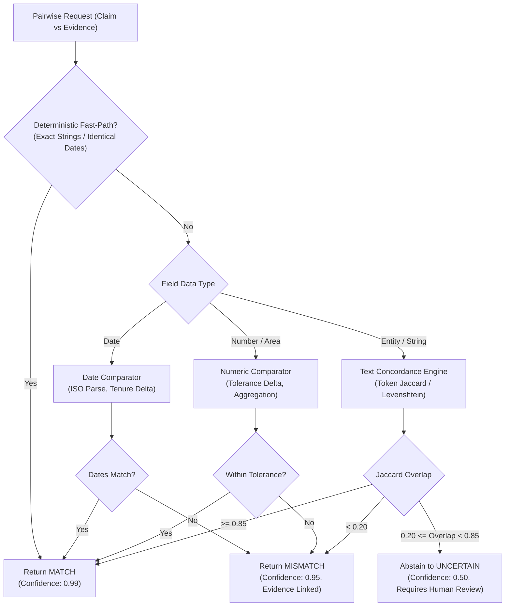

# Pairwise Field Mismatch Classifier Specification

## 1. Pipeline Overview

The Pairwise Classifier is the core intelligence engine responsible for comparing an applicant's claim with verified supporting document evidence. It operates via a hybrid architecture combining a high-throughput deterministic fast-path with multi-feature semantic similarity scoring and an explicit human-in-the-loop abstention policy.

## 2. Five-Way Classification Taxonomy

The classifier outputs one of five discrete classification states:

1. **`MATCH`**
   - **Definition:** The claimed parameter and evidence parameter represent concordant statutory information within defined tolerances.
   - **Confidence:** $\ge 0.85$ (typically $\ge 0.99$ for exact fast-path).
   - **Action:** Does not require human intervention; automatically clears compliance check.

2. **`MISMATCH`**
   - **Definition:** Clear statutory contradiction between claim and evidence (e.g., claimed unexpired lease of 35 years vs evidence lease of 15 years; or completely distinct registered society names).
   - **Confidence:** $\ge 0.85$.
   - **Action:** Flags `requiresHumanReview: true`, attaches exact page number and snippet, and generates a discrepancy finding.

3. **`MISSING`**
   - **Definition:** The claimed field or required supporting document is completely absent from the application package.
   - **Confidence:** $1.00$.
   - **Action:** Triggers missing document defect rule and routes to human reviewer.

4. **`UNCERTAIN`**
   - **Definition:** Ambiguous semantic overlap (0.20 to 0.80) or model confidence below 0.85. Often caused by optical character noise in scanned deeds, compound legal entity names, or non-standard date phrasings.
   - **Confidence:** $< 0.85$.
   - **Action:** Mandatory human review (`requiresHumanReview: true`). System abstains from asserting either match or mismatch.

5. **`NOT_COMPARABLE`**
   - **Definition:** Claim and evidence fields possess incompatible data types, disjoint semantic domains, or unaligned statutory definitions.
   - **Confidence:** $1.00$.
   - **Action:** Disregarded from verification score calculations.

## 3. Abstention Policy & Safety Principles

1. **Conservative Thresholding:** The confidence threshold is hard-set at **$0.85$**. Any prediction falling below this boundary must return `UNCERTAIN`.
2. **Human Prerogative:** The system functions exclusively as an assistant to statutory scrutiny officers. It never independently revokes an institution's license, accuses applicants of fraud, or renders a final rejection decision.
3. **Objective Explanations:** Classification rationale must use objective administrative terms (*"variance"*, *"discrepancy"*, *"tenure deficit"*), avoiding accusatory phrasing (*"fraud"*, *"fake"*, *"forged"*).

