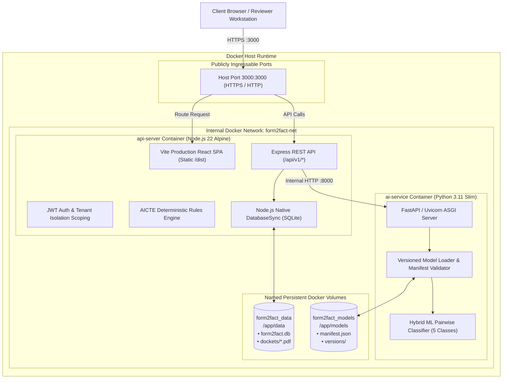
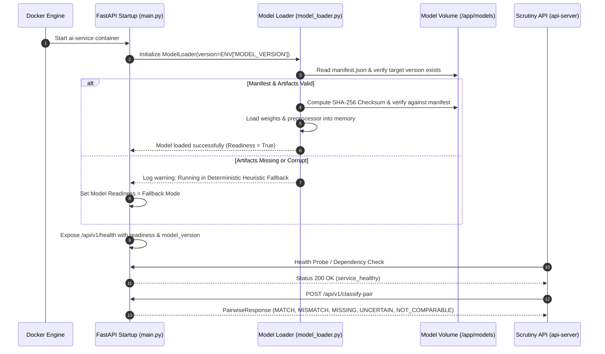

# FORM2FACT — PRODUCTION & DEVELOPMENT DEPLOYMENT ARCHITECTURE

**Document Reference:** F2F-ARCH-DEPLOY-2026  
**Status:** Approved Deployment Architecture  
**Author:** Person 6 (Senior DevOps & MLOps Engineer)  
**Target Environment:** Local Docker Compose / Single-Node Container Engine / On-Premise & Cloud Container Services

---

## 1. ARCHITECTURAL OVERVIEW

Form2Fact uses an evidence-first, dual-container architecture designed for low operational complexity, high reliability, and data confidentiality:

1. **`api-server` Container (Node.js 22 + React 19 SPA):**
   - Serves the compiled production React single-page application (`dist/`).
   - Executes the core REST API (`/api/v1/*`), authentication, and multi-tenant scoping.
   - Evaluates deterministic regulatory rules (AICTE Handbook norms).
   - Manages SQLite persistence and secure document filesystem storage.
2. **`ai-service` Container (Python 3.11/3.13 + FastAPI + Uvicorn):**
   - Isolated internal microservice dedicated to pairwise field mismatch classification.
   - Hosts versioned model artifacts and pre-processing pipelines.
   - Exposes internal REST endpoints (`/api/v1/classify-pair`, `/api/v1/batch-classify`).
   - Does NOT expose public ports; communicates exclusively with `api-server` across an isolated internal Docker bridge network.
3. **Persistent Storage Layer (`form2fact_data` & `form2fact_models` volumes):**
   - `form2fact_data`: Mounted to `/app/data` in `api-server` to persist `form2fact.db` (SQLite) and `dockets/` (PDF files).
   - `form2fact_models`: Mounted to `/app/models` in `ai-service` for versioned ML model checkpoints and manifests.

---

## 2. CONTAINER TOPOLOGY & NETWORK BOUNDARIES



### Network Isolation Guarantees:
- **Zero Public Exposure of AI Microservice:** The `ai-service` container is attached only to `form2fact-net`. Port 8000 is **not** published to the host machine in production.
- **Air-Gapped In-Network Processing:** Document verification, OCR analysis, and field comparison execute within the internal container boundary without outbound internet dependencies.
- **Single Point of Ingress:** Only `api-server` (Port 3000) accepts incoming connections, ensuring all requests pass through JWT verification, rate limiting, and tenant scoping.

---

## 3. SERVICE RESPONSIBILITIES & RESOURCE ALLOCATION

| Service | Technology Stack | Base Image | CPU / Mem Limits (Prod Recommended) | Exposed Ports | Health Check Probe |
|---|---|---|:---:|:---:|---|
| **`api-server`** | Node.js 22, Express, React 19, SQLite | `node:22-alpine` | 2.0 Cores / 2 GB RAM | `3000:3000` | `GET http://localhost:3000/api/v1/health` |
| **`ai-service`** | Python 3.11/3.13, FastAPI, Uvicorn | `python:3.11-slim` | 2.0 Cores / 3 GB RAM | *Internal Only* (`8000`) | `GET http://localhost:8000/api/v1/health` |

---

## 4. STORAGE ARCHITECTURE & PERSISTENCE

### 4.1 SQLite Relational Persistence
- **File Location:** `/app/data/form2fact.db`
- **Driver:** Native `DatabaseSync` (`node:sqlite`).
- **Initialization:** Automated migrations executed on startup by `server/db.ts`.
- **Volume Mount:**
  ```yaml
  volumes:
    - form2fact_data:/app/data
  ```
- **Durability Guarantee:** Data persists across container restarts, image updates, and host reboots.

### 4.2 Document Docket Storage
- **File Location:** `/app/data/dockets/`
- **Contents:** Statutory applicant PDF dockets (Lease Deeds, Fire NOCs, Building Certificates).
- **Security:** Files are accessed exclusively via authenticated streaming endpoints with path traversal neutralization (`..` stripped, basename enforcement).

### 4.3 Versioned ML Model Artifacts
- **File Location:** `/app/models/` in `ai-service`.
- **Structure:**
  ```
  models/
  ├── manifest.json
  └── versions/
      └── v1.0.0/
          ├── metadata.json
          ├── weights.bin / model.pt (if applicable)
          └── vocabulary.json
  ```
- **Volume Mount:**
  ```yaml
  volumes:
    - form2fact_models:/app/models
  ```

---

## 5. MODEL LOADING WORKFLOW & MLOPS LIFECYCLE



---

## 6. ENVIRONMENT CONFIGURATION HIERARCHY

The platform resolves configuration through a strict precedence hierarchy:
1. **Container Environment Variables** (highest precedence, set via Docker Compose or Kubernetes config).
2. **`.env` File** (loaded by `dotenv` in Node.js and Pydantic Settings in Python).
3. **Hardened Safe Defaults** (local development fallbacks only; production environment triggers fatal fail-fast if critical secrets are omitted).

### Core Environment Variables

| Variable | Service | Default (Dev) | Production Requirement |
|---|---|---|---|
| `NODE_ENV` | `api-server` | `development` | Must be `production` |
| `PORT` | `api-server` | `3000` | Port for Express API |
| `JWT_SECRET` | `api-server` | Dev fallback string | **MANDATORY:** $\ge 32$ character cryptographically secure secret (fails fast if omitted) |
| `DATABASE_PATH` | `api-server` | `./data/form2fact.db` | Path inside container: `/app/data/form2fact.db` |
| `DOCKET_STORAGE_PATH`| `api-server` | `./data/dockets` | Path inside container: `/app/data/dockets` |
| `AI_SERVICE_URL` | `api-server` | `http://localhost:8000` | In Docker Compose: `http://ai-service:8000` |
| `MODEL_VERSION` | `ai-service` | `v1.0.0` | Target model version in `models/` |
| `MODEL_PATH` | `ai-service` | `./models` | Path inside container: `/app/models` |
| `LOG_LEVEL` | Both | `INFO` | `DEBUG`, `INFO`, `WARN`, `ERROR` |

---

## 7. DEPLOYMENT LIFECYCLE & ZERO-DOWNTIME RESTART

1. **Pre-Flight Validation:** CI pipeline validates TypeScript, runs 22 regression test suites, compiles Python modules, and performs Docker build checks.
2. **Container Launch:**
   - `ai-service` starts first, loads model artifacts, and establishes healthcheck.
   - `api-server` awaits `ai-service` healthy state (`depends_on: { ai-service: { condition: service_healthy } }`).
3. **Graceful Shutdown:**
   - Both containers trap `SIGTERM` and `SIGINT`.
   - In-flight requests are allowed 10 seconds to drain before socket closure.
   - SQLite write-ahead-log (WAL) checkpoints are committed before process termination.
