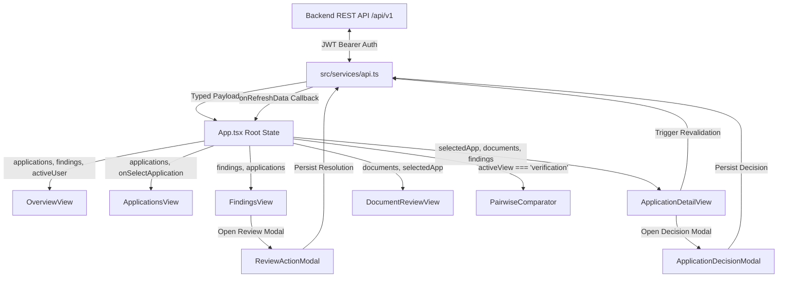

# Form2Fact — Frontend Component Architecture Specification

**Project:** Form2Fact — Evidence-First Institutional Document Intelligence & Regulatory Cross-Verification Platform  
**Problem Statement ID:** Smart India Hackathon (SIH) 26262  
**Owner:** Person 7 (Senior Frontend Architect & UI/UX Lead)  
**Status:** Production Ready & Verified (Phase 1 Baseline)  

---

## 1. Architectural Overview & Design Philosophy

The Form2Fact frontend is designed as an enterprise regulatory intelligence cockpit. Rather than a generic administrative template, it functions as an **evidence-first decision support system** for AICTE scrutiny officers, regional coordinators, and institutional compliance directors.

### Core Architectural Tenets
1. **Evidence-First Information Hierarchy:** Every discrepancy, rule violation, and classification finding is directly linked to documentary proof (document name, page number, cited text).
2. **5-Class Pairwise Classification Taxonomy:** Native UI visual treatment for all five classification outcomes (`MATCH`, `MISMATCH`, `MISSING`, `UNCERTAIN`, `NOT_COMPARABLE`), preventing ambiguous binary simplifications.
3. **Statutory Adjudicative Authority:** Machine intelligence provides confidence scores, feature citations, and suggested actions, while human officers retain full legal adjudication authority.
4. **Resilient Network & Security Boundary:** All client network communication routes through a centralized typed API layer (`src/services/api.ts`) with mandatory JWT Bearer token injection and role-based persona simulation.
5. **Zero Layout Shift & Deterministic Density:** Sub-second transitions, sticky headers, keyboard-accessible modals, and high-density data grids suited for regulatory workflows.

---

## 2. Component Tree Hierarchy

```
App.tsx (Root State, User Session, Network Error Boundary)
├── Header.tsx (Global Search, Breadcrumbs, Tenant Status, User Persona Switcher)
├── Sidebar.tsx (Primary Navigation, System Health Status, Collapsed State)
└── Main Content Container
    ├── [view === 'overview']
    │   └── OverviewView.tsx
    │       ├── Metric Cards (Total, Pending, Confirmed Discrepancies, Auto-Approved)
    │       ├── VerificationTaxonomyCard (5-Class Live Matrix: MATCH, MISMATCH, etc.)
    │       ├── Priority Action Queue (Attention-Required Items)
    │       └── Recent Audit Activity Feed
    │
    ├── [view === 'applications']
    │   └── ApplicationsView.tsx
    │       ├── Filter Bar (Search, Status Filter, Region Filter)
    │       ├── DataTable.tsx (Sortable, Paginated Grid)
    │       │   ├── StatusBadge.tsx (Standardized Approval & Review Statuses)
    │       │   └── Inline Actions (View Details, Scrutiny Quickview)
    │       └── EmptyState.tsx (Filter Reset Trigger)
    │
    ├── [view === 'application_detail']
    │   └── ApplicationDetailView.tsx
    │       ├── Header & Stat Bar (Institutional Metadata, Region, Scrutiny Status)
    │       ├── Tabbed Navigation ('all' | 'findings' | 'comparator' | 'documents' | 'audit')
    │       ├── Action Buttons (Run Scrutiny, Deep Scrutiny Synthesis, Record Decision)
    │       ├── PairwiseComparator.tsx (Embedded Interactive Field Comparator)
    │       ├── Findings Summary & Evidence Cards
    │       └── Audit Trail Timeline
    │
    ├── [view === 'findings']
    │   └── FindingsView.tsx
    │       ├── Domain Category Pills (Land & Tenancy, Safety, Trust, Approvals)
    │       ├── Dual Filter Bar (Search Input, Severity Dropdown, Status Dropdown)
    │       ├── Finding Cards
    │       │   ├── StatusBadge.tsx (5-Class + Severity Badges)
    │       │   ├── Comparison Grid (Declared Claim vs Document Evidence)
    │       │   ├── Evidence Citation Panel (Page links, source excerpts)
    │       │   └── Action Bar (Open Application, Record Decision)
    │       └── EmptyState.tsx (Dynamic Filter Reset)
    │
    ├── [view === 'documents']
    │   └── DocumentReviewView.tsx
    │       ├── Document Metadata & Upload Tray
    │       ├── Document List with Status Badges
    │       ├── PDF Download Action (Streams authorized binary files)
    │       └── Split-Pane Document Viewer & Field Citation Inspector
    │
    ├── [view === 'verification']
    │   └── PairwiseComparator.tsx (Standalone Workbench)
    │       ├── Preset Quick-Loaders (5 Core Scenarios)
    │       ├── Claim vs Evidence Input Panes
    │       ├── Comparison Type Selector (text | date | numeric | entity_name)
    │       ├── Live Classification Result Card (5-Class Badge, Confidence, Rationale)
    │       └── Human Review Routing Indicator
    │
    └── Modals & Overlays
        ├── ApplicationDecisionModal.tsx (Formal Approval / Rejection / Deficit Call)
        ├── ReviewActionModal.tsx (Discrepancy Confirmation / Dismissal with Notes)
        └── FieldCorrectionModal.tsx (OCR Correction & Human Overwrite Audit)
```

---

## 3. State Management & Data Flow

Form2Fact utilizes a clean **unidirectional data flow** with hoisted application state in `App.tsx` and distributed local feature state in individual views:



### Key State Hoisting Invariants:
1. **Single Source of Truth:** `applications`, `findings`, and `activeUser` reside in `App.tsx` and are updated atomically via `refreshData()`.
2. **Pessimistic UI Updates with Toast/Banner Fallback:** Mutation operations (upload document, record decision, correct field) await backend persistence before triggering data reloads.
3. **Resilient Network Failure Handling:** If backend connectivity drops, `apiError` state is set and a prominent dismissible retry banner is rendered at the top of the viewport.

---

## 4. Shared Component Catalog

Located in `src/shared/components/`:

### 4.1 `StatusBadge.tsx`
Renders standardized visual badges for all application statuses and pairwise verification outcomes:
- **`MATCH`:** Emerald theme (`#ECFDF5`, `#065F46`, `#A7F3D0`), `CheckCircle2` icon.
- **`MISMATCH`:** Rose theme (`#FFF1F2`, `#9F1239`, `#FECDD3`), `XCircle` icon.
- **`MISSING`:** Amber theme (`#FFFBEB`, `#92400E`, `#FDE68A`), `AlertTriangle` icon.
- **`UNCERTAIN`:** Indigo theme (`#EEF2FF`, `#4F46E5`, `#C7D2FE`), `HelpCircle` icon.
- **`NOT_COMPARABLE`:** Slate theme (`#F8FAFC`, `#64748B`, `#CBD5E1`), `MinusCircle` icon.

### 4.2 `EmptyState.tsx`
Provides clean, distraction-free empty state messaging with optional primary action buttons (e.g., "Reset Filters", "Upload Document").

### 4.3 `DataTable.tsx`
Provides a generic sortable, paginated, and accessible table wrapper with sticky headers, keyboard navigation, and responsive overflow containers.

### 4.4 `EvidencePanel.tsx`
Displays documentary evidence citations with document name, page number, verbatim citation excerpt in monospace font with `select-all` capability, and a deep-link trigger to inspect the exact PDF page.

### 4.5 `LoadingState.tsx`
Standardized spinning loader with contextual status text ("Loading scrutiny workspace...", "Analyzing cross-document citations...").

### 4.6 `ErrorBoundary.tsx`
React class component that catches client runtime errors, presents a graceful recovery UI, and prevents application crashing.

---

## 5. Accessibility & WCAG 2.2 AA Conformance

- **Color Contrast:** All body text meets 4.5:1 minimum contrast ratio against `#FFFFFF` and `#F8FAFC` backgrounds; badge labels meet 3:1 against badge backgrounds.
- **Form Controls:** All `<select>` and `<input>` elements carry explicit `aria-label` or `<label>` associations.
- **Keyboard Navigation:** Modals trap focus and support `Escape` key dismissal. All interactive buttons have visible `:focus-visible` rings.
- **Screen Reader Announcements:** Dynamic state changes (validation running, uploads completing) announce status via semantic ARIA live regions.
