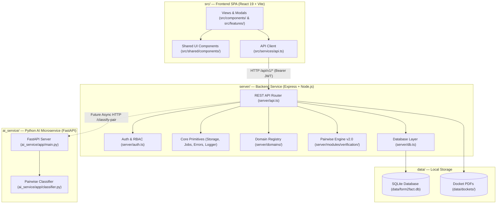
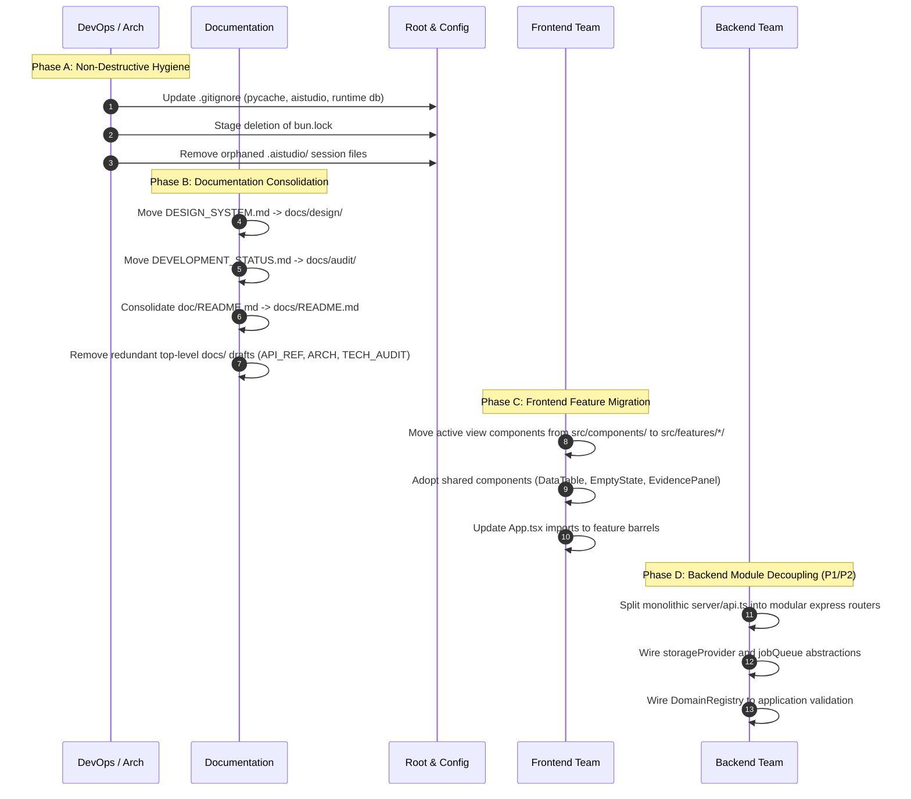

# FORM2FACT — TEAM-ORIENTED REPOSITORY ARCHITECTURE

**Document Reference:** F2F-ARCH-REPO-2026  
**Audience:** Software Architects, Full-Stack Engineers, ML Specialists, DevOps Engineers, and Security Evaluators  
**Scope:** Target directory architecture, modular boundary specifications, and phased transition plan for Form2Fact.

---

## 1. ARCHITECTURAL PHILOSOPHY & OBJECTIVES

Form2Fact is an enterprise evidence-first document intelligence platform. To enable independent multidisciplinary teams (Frontend, Backend, Document AI, Machine Learning, and DevOps) to contribute simultaneously without merge conflicts or cross-boundary coupling, the repository adopts a **Domain-Centric Modular Monolith with Decoupled AI Microservice** architecture.

### Core Architectural Axioms
1. **Separation of Concerns:** Feature code lives together (components, hooks, tests, types). Monolithic catch-all directories (`src/components/`, `server/api.ts`) are progressively organized into cohesive functional modules.
2. **Deterministic Security Perimeter:** Core security, authentication, and multi-tenant isolation remain centralized in `server/core/auth/` and `server/core/security/`, inaccessible to unauthorized modification.
3. **Decoupled AI Development:** The Machine Learning microservice (`ai_service/`) maintains its own container, dependencies, model artifacts, and evaluation datasets, integrating with the Node.js backend solely via authenticated HTTP contracts.
4. **Data Privacy & Governance:** Local runtime databases (`data/*.db`), uploaded institutional dockets (`data/dockets/`), and private institutional records are strictly segregated from public test fixtures and barred from Git.
5. **Preservation of Verified Baseline:** Working implementations—including the 22 passing test suites, SQLite persistent storage, and AICTE deterministic rules—are strictly preserved during structural refactoring.

---

## 2. TARGET REPOSITORY DIRECTORY MAP

```
form2fact/
├── .env.example                              # Environment configuration template
├── .gitignore                                # Global git ignore rules (node_modules, data, dist, pycache)
├── Dockerfile                                # Root container build for Express backend & Vite SPA
├── index.html                                # SPA HTML document root
├── package.json                              # Project dependencies, scripts, and engine specifications
├── package-lock.json                         # Deterministic npm dependency lockfile
├── server.ts                                 # Express application bootstrapper (entry point)
├── tsconfig.json                             # Root TypeScript compiler options
├── vite.config.ts                            # Vite frontend build pipeline configuration
│
├── ai_service/                               # Python Machine Learning Microservice
│   ├── Dockerfile                            # Python 3.13 FastAPI container definition
│   ├── requirements.txt                      # Microservice dependencies
│   ├── app/                                  # Serving layer
│   │   ├── main.py                           # FastAPI application & route registration
│   │   ├── schemas.py                        # Pydantic request / response contracts
│   │   ├── classifier.py                     # Python hybrid pairwise classifier
│   │   └── dataset.py                        # Benchmark evaluation datasets
│   ├── ml/                                   # ML Engineering (future neural models)
│   │   ├── data/                             # Anonymized training & validation splits
│   │   ├── preprocessing/                    # Tokenization, text normalization, sentence splitting
│   │   ├── models/                           # Cross-encoder transformer inference pipelines
│   │   ├── evaluation/                       # Confusion matrices, accuracy, macro-F1 benchmarks
│   │   └── experiments/                      # Experiment tracking and hyperparameter logs
│   └── ocr/                                  # Optical Character Recognition modules
│       ├── tesseract_adapter.py              # OCR engine wrapper for scanned documents
│       └── preprocessing.py                  # Deskewing, binarization, noise filtering
│
├── data/                                     # Local Runtime Storage (Strictly Git-Ignored)
│   ├── README.md                             # Storage directory guidelines and confidentiality policy
│   ├── form2fact.db                          # Active local SQLite database (untracked)
│   └── dockets/                              # Uploaded PDF binaries organized by appId (untracked)
│
├── docs/                                     # Master Documentation Knowledge Base
│   ├── README.md                             # Documentation table of contents & index
│   ├── DEVELOPER_GUIDE.md                    # Contributor onboarding, local setup & testing
│   ├── ai-models/                            # Machine learning & NLP architecture docs
│   │   ├── pairwise-classifier.md            # Classifier mathematics & hybrid taxonomy
│   │   ├── benchmark-dataset.md              # Dataset distribution & evaluation methodology
│   │   └── roadmap.md                        # Document intelligence & VLM roadmap
│   ├── api/                                  # API contracts & interface documentation
│   │   ├── rest-endpoints.md                 # Complete Express API endpoint catalog
│   │   └── ai-service-contracts.md           # FastAPI request/response JSON schemas
│   ├── architecture/                         # System architecture specifications
│   │   ├── system-architecture.md            # Master C4 architectural overview
│   │   ├── data-flow.md                      # Verification & adjudication data flow diagrams
│   │   ├── domain-packs.md                   # Dynamic domain registration architecture
│   │   └── background-jobs.md                # Job queue & worker architecture
│   ├── audit/                                # Audit, gap matrix & remediation reports
│   │   ├── MASTER_AUDIT_REPORT.md            # Complete 14-section forensic audit report
│   │   ├── IMPLEMENTATION_GAP_MATRIX.md      # 22-item gap matrix tracking remediation status
│   │   ├── PRIORITIZED_CORRECTION_PLAN.md    # Phased P0-P3 implementation roadmap
│   │   ├── P0_REMEDIATION_REPORT.md          # Formal proof of P0 security & classification resolution
│   │   ├── REPOSITORY_INVENTORY.md           # Complete file-by-file inventory
│   │   ├── DUPLICATE_AND_UNUSED_FILES.md     # Reference analysis of duplicate & unused candidates
│   │   └── REPOSITORY_CLEANUP_REPORT.md      # Final cleanup & migration log
│   ├── database/                             # Relational schema & migration documentation
│   │   ├── schema.md                         # Relational data models & ER diagrams
│   │   └── migrations.md                     # SQLite to PostgreSQL 16 migration guide
│   ├── decisions/                            # Architecture Decision Records (ADRs)
│   │   ├── ADR-001-modular-monolith-and-ai-service.md
│   │   ├── ADR-002-domain-pack-architecture.md
│   │   ├── ADR-003-pairwise-classification-hybrid-inference.md
│   │   ├── ADR-004-postgresql-and-sqlite-compatibility.md
│   │   └── ADR-005-storage-and-job-queue-abstractions.md
│   ├── deployment/                           # DevOps, containerization & deployment guides
│   │   ├── docker-guide.md                   # Multi-container orchestration with Docker Compose
│   │   └── production-checklist.md           # Production go-live readiness checklist
│   ├── design/                               # Design system & frontend UI tokens
│   │   └── DESIGN_SYSTEM.md                  # Colors, typography, spacing, component guidelines
│   ├── domain-configuration/                 # Regulatory domain authoring & compliance specs
│   │   ├── aicte-reference.md                # Statutory AICTE regulatory norm definitions
│   │   └── authoring-guide.md                # Guide for authoring new regulatory domain packs
│   ├── security/                             # Application security & compliance
│   │   ├── threat-model.md                   # Threat model & attack surface analysis
│   │   └── tenant-isolation.md               # Regional organization multi-tenant security
│   └── team/                                 # Team coordination & engineering governance
│       └── TEAM_OWNERSHIP.md                 # Departmental ownership boundaries & code review rules
│
├── infrastructure/                           # Infrastructure-as-Code & DevOps Orchestration
│   ├── docker-compose.yml                    # Multi-service composition (pg, redis, minio, api, ai)
│   ├── db/                                   # Database provisioning & migrations
│   │   ├── init.sql                          # PostgreSQL 16 relational initialization script
│   │   └── migrate_sqlite_to_pg.ts           # SQLite to PostgreSQL data migration utility
│   └── scripts/                              # Deployment, backup, and health check scripts
│
├── server/                                   # Backend Express REST API Service
│   ├── api.ts                                # Master Express router (route registration)
│   ├── auth.ts                               # JWT authentication, secret resolution & RBAC middleware
│   ├── db.ts                                 # SQLite database interface & multi-tenant queries
│   ├── extraction.ts                         # PDF text extraction & regex field parsing
│   ├── rulesEngine.ts                        # AICTE compliance rules & text/date normalizers
│   ├── test-runner.ts                        # Master automated test suite (22 suites, 117 tests)
│   ├── core/                                 # Centralized platform primitives
│   │   ├── errors/                           # AppError & centralized errorHandler
│   │   ├── jobs/                             # Background job queue abstraction
│   │   ├── logger/                           # Structured JSON logging service
│   │   ├── storage/                          # Storage provider abstraction (IStorageProvider)
│   │   └── validation/                       # Zod request validation middleware
│   ├── domains/                              # Regulatory domain packs & registry
│   │   ├── index.ts                          # Domain barrel export
│   │   ├── registry.ts                       # DomainRegistry service
│   │   ├── types.ts                          # DomainPack interfaces
│   │   └── aicte/                            # AICTE domain pack definition
│   │       └── index.ts                      # AICTE statutory rules, relationships, doc types
│   └── modules/                              # Business domain sub-modules
│       ├── organizations/                    # Regional directorate organization service
│       │   └── organization.service.ts
│       └── verification/                     # Pairwise mismatch classification engine
│           └── pairwiseEngine.ts             # 5-class pairwise classifier (v2.0)
│
└── src/                                      # Frontend Single Page Application (React 19 + TypeScript)
    ├── App.tsx                               # Master application container & global view state
    ├── index.css                             # Tailwind CSS v4 design system styles
    ├── main.tsx                              # React DOM mount point
    ├── components/                           # Existing active UI views & modals
    │   ├── ApplicationDecisionModal.tsx      # Docket sign-off modal
    │   ├── ApplicationDetailView.tsx         # Application dossier inspector
    │   ├── ApplicationsView.tsx              # Application docket table view
    │   ├── AuditLogView.tsx                  # Audit log ledger view
    │   ├── CorrectionModal.tsx               # Extracted field correction modal
    │   ├── DocumentReviewView.tsx            # Document inspection & page viewer
    │   ├── FindingsView.tsx                  # Discrepancy findings matrix view
    │   ├── Header.tsx                        # Top header bar & persona switcher
    │   ├── NewApplicationModal.tsx           # Application creation wizard
    │   ├── OverviewView.tsx                  # Executive dashboard overview
    │   ├── ReportsView.tsx                   # Statutory scrutiny report view
    │   ├── ReviewActionModal.tsx             # Finding review action modal
    │   ├── RulesView.tsx                     # Compliance rules catalog view
    │   ├── SettingsView.tsx                  # Administrative settings view
    │   └── Sidebar.tsx                       # Left sidebar navigation
    ├── features/                             # Modular feature architecture
    │   ├── administration/                   # Settings & audit views
    │   ├── applications/                     # Application management views
    │   ├── documents/                        # Document viewer components
    │   ├── findings/                         # Discrepancies & findings
    │   ├── reports/                          # Report generation
    │   ├── reviews/                          # Review & adjudication actions
    │   ├── rules/                            # Regulatory rule catalog
    │   └── verification/                     # Pairwise field comparator
    │       ├── index.ts                      # Barrel export
    │       └── PairwiseComparator.tsx        # Interactive pairwise UI widget
    ├── services/                             # Frontend API clients
    │   └── api.ts                            # REST API communication client
    ├── shared/                               # Enterprise shared component library
    │   └── components/
    │       ├── DataTable.tsx                 # Paginated/sortable data table
    │       ├── EmptyState.tsx                # Empty state visual placeholder
    │       ├── ErrorBoundary.tsx             # Top-level React error boundary
    │       ├── EvidencePanel.tsx             # Evidence citation card
    │       ├── LoadingState.tsx              # Loading spinner container
    │       └── StatusBadge.tsx               # 5-class verification status badge
    └── types/                                # Frontend TypeScript interfaces
        └── index.ts                          # Application, Document, Finding, Rule, User contracts
```

---

## 3. COMPONENT & BOUNDARY RESPONSIBILITIES



---

## 4. PHASED REFACTORING & MIGRATION SEQUENCE

To prevent regressions in the working application, restructuring must occur in carefully bounded, reversible increments:



