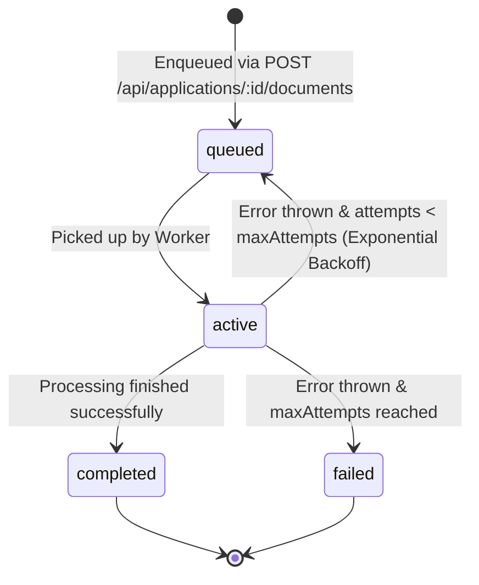

# Background Job Architecture & Asynchronous Processing

## 1. Asynchronous Architecture Rationale

High-volume institutional scrutiny requires parsing large multi-page PDF documents (50–200 pages each, containing scanned lease deeds, structural engineer stability certificates, and cadastral maps) and executing computationally expensive pairwise machine learning inference.

Running these operations synchronously within Node.js Express request handlers causes:
- HTTP socket timeouts on slow client connections.
- Node.js event-loop starvation during intensive string normalization or OCR decoding.
- Inability to retry intermittent failures gracefully.

To solve this, Form2Fact decouples heavy computation into background worker queues.

## 2. Job Queue Interface Contract (`server/core/jobs/index.ts`)

```typescript
export interface Job<T = any> {
  id: string;                     // Unique job identifier (e.g., job-uuid)
  type: string;                   // Task type (e.g., 'document-processing', 'batch-verification')
  data: T;                        // Job payload
  status: 'queued' | 'active' | 'completed' | 'failed';
  progress: number;               // 0 to 100 percentage
  result?: any;                   // Output payload upon completion
  error?: string;                 // Error message upon failure
  attempts: number;               // Current retry attempt
  maxAttempts: number;            // Retry ceiling (default: 3)
  createdAt: string;              // ISO-8601 creation timestamp
  updatedAt: string;              // ISO-8601 state change timestamp
}

export interface IJobQueue {
  enqueue<T>(type: string, data: T, options?: JobOptions): Promise<Job<T>>;
  getJob(id: string): Promise<Job | null>;
  registerHandler(type: string, handler: JobHandler): void;
}
```

## 3. Pluggable Queue Implementations

### 3.1 InMemoryJobQueue (Development & Test Default)
- **Engine:** Internal event loop with micro-task queue scheduling.
- **Retries:** Configurable exponential backoff retries (100ms base * $2^{\text{attempt}}$).
- **Persistence:** In-memory state tracking. Ideal for zero-dependency unit tests and local CLI runners.

### 3.2 BullMQRedisJobQueue (Production Target)
- **Engine:** Redis 7-backed distributed FIFO queues using BullMQ.
- **Workers:** Independent Node.js worker processes consuming from Redis streams.
- **Features:** Concurrency limits per worker, dead-letter queues (DLQ) for malformed PDFs, atomic state transitions via Redis Lua scripts, and progress streaming via WebSockets.

## 4. Job State Transitions



## 5. Client Integration Pattern

When uploading documents or requesting batch verification:
1. Client POSTs payload to API.
2. API writes raw file to Storage, creates database record with status `uploaded`, enqueues task, and responds with `HTTP 202 Accepted` containing `jobId`.
3. Client polls `GET /api/v1/jobs/:jobId` (or listens on a WebSocket topic) until `status === 'completed'`.
4. Client refreshes the application document list or findings matrix.

