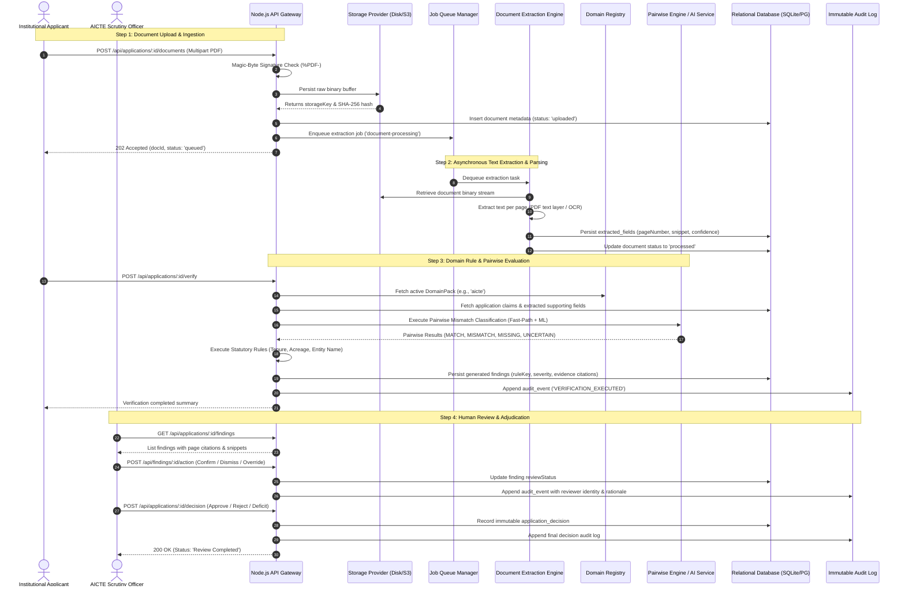

# End-to-End Data Flow Specification

## 1. Complete Scrutiny Lifecycle

The verification lifecycle traces a multi-stage path from initial document intake to final regulatory determination:

## 2. Evidence Citation Guarantee

At every point during classification:
1. **Source Document Preservation:** The source document's binary stream is never modified or stripped.
2. **Page Number Attribution:** Extracted fields and finding citations are strictly stamped with an integer `pageNumber` corresponding to the original document page index.
3. **Citation Snippet Snipping:** Snippets contain the exact text surrounding the extracted value (±100 characters) to facilitate instant visual verification by human reviewers.
4. **Non-Destructive Overrides:** If a human reviewer overrides an extracted value (e.g., correcting an OCR typo in a survey number), the original extracted value is preserved alongside `isCorrected: true`, `correctedValue`, and the reviewer's user ID.

