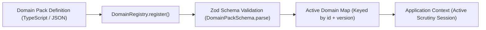

# Domain Pack Specification and Architecture

## 1. Domain Pack Overview

A **Domain Pack** is a self-contained, versioned schema and rule bundle that configures Form2Fact to audit institutional compliance for a specific regulatory body or industry domain.

The core Form2Fact engine contains **zero hardcoded references** to specific regulatory entities. All domain specifics—including mandatory document types, key metadata fields, pairwise comparison pairs, and statutory logic—are encapsulated within the Domain Pack.

## 2. Formal Schema Contract

Domain Packs must validate against the Zod schema `DomainPackSchema` (`server/domains/types.ts`):

```typescript
export interface DomainPack {
  id: string;                      // Unique slug (e.g., 'aicte', 'naac', 'nabh')
  name: string;                    // Human-readable title
  version: string;                 // Semantic version (e.g., '1.2.0')
  description: string;             // Detailed domain scope
  regulatoryAuthority: string;     // Statutory governing body
  documentDefinitions: DocumentDefinition[];
  fieldDefinitions: FieldDefinition[];
  comparisonRelationships: ComparisonRelationship[];
  rules: DomainRule[];
}
```

### 2.1 Document Definitions (`DocumentDefinition`)
Specifies the universe of documents expected by the regulatory framework:
- `code`: Unique document code (e.g., `DOC-LAND-LEASE`, `DOC-FIRE-NOC`, `DOC-SOCIETY-REG`).
- `name`: Official title of the document.
- `category`: Grouping (e.g., `Land & Building`, `Statutory Safety`, `Legal Entity`).
- `required`: Boolean indicating whether the document is mandatory for application submission.
- `allowedMimeTypes`: Enforced array of MIME types (typically `['application/pdf']`).
- `retentionYears`: Regulatory document archival requirement (e.g., 30 years for land titles).

### 2.2 Field Definitions (`FieldDefinition`)
Specifies data points to be extracted from documents or application declarations:
- `key`: Normalized field identifier (e.g., `lease_expiry_date`, `land_area_acres`, `sponsoring_trust_name`).
- `label`: Human-readable label displayed in UI.
- `dataType`: Primitive data type (`string`, `number`, `date`, `boolean`, `currency`).
- `normalization`: Directives for parsing (`iso_date`, `numeric_float`, `alphanumeric_clean`).

### 2.3 Comparison Relationships (`ComparisonRelationship`)
Defines the pairwise verification directed graph:
- `claimFieldKey`: Source parameter declared by applicant (e.g., `declared_lease_expiry`).
- `evidenceFieldKey`: Supporting parameter extracted from verified document (e.g., `extracted_deed_expiry`).
- `expectedRelationship`: Comparator (`EQUAL`, `GREATER_OR_EQUAL`, `CONCORDANT_NAME`).
- `tolerance`: Acceptable numerical or date variance (e.g., `0` days, or `0.05` acres).
- `confidenceThreshold`: Minimum classifier confidence (typically `0.85`) below which the system must abstain to `UNCERTAIN`.

### 2.4 Domain Rules (`DomainRule`)
Configurable statutory compliance policies:
- `ruleKey`: Statutory rule identifier (e.g., `RULE-TEN-01`, `RULE-AREA-03`).
- `title`: Short title of the rule.
- `description`: Explains statutory requirement.
- `category`: Compliance category (`Tenure`, `Infrastructure`, `Identity`, `Safety`).
- `severity`: Default severity upon violation (`Critical Deficit`, `Material Discrepancy`, `Administrative Variance`).
- `evaluator`: Pure deterministic logic evaluating extracted parameters without modifying state.

## 3. Dynamic Registration Lifecycle



