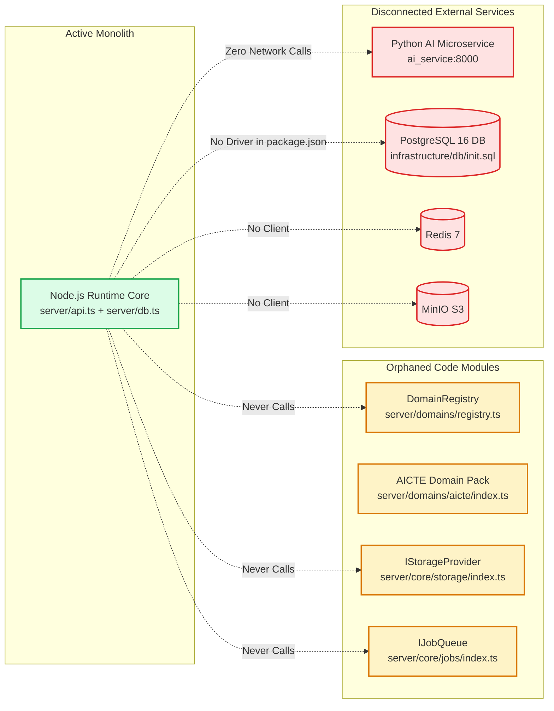
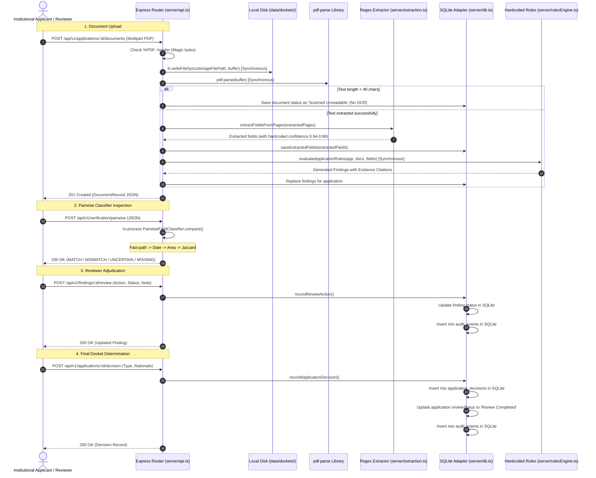

# FORM2FACT: ARCHITECTURE VERIFICATION REPORT
**Forensic Contrast: Implemented vs. Proposed Architectural Reality**

**Audit Date:** November 2026  
**Auditor:** Principal Software Architect & Technical Project Evaluator  
**Repository:** `d:\projects\form2fact`

---

## 1. Executive Contrast: Proposed Architecture vs. Actual Implementation

| Architectural Dimension | Proposed / Documented Architecture | Actual Implemented Code Reality | Verification Status |
|---|---|---|:---:|
| **Overall Topology** | Decoupled Polyglot Microservices (Node.js API + Python AI Service + PostgreSQL + Redis + MinIO) | **Single Node.js Monolith with Local SQLite**. Python AI, PostgreSQL, Redis, and MinIO exist in Docker Compose, but are completely unused by the runtime application. | **DIVERGENT** |
| **Domain Independence** | Declarative Domain Packs dynamically registered via `DomainRegistry` with zero core engine coupling | `DomainRegistry` exists as an auxiliary module, but **the core validation runner hardcodes 6 AICTE statutory rules** in `server/rulesEngine.ts`. | **PARTIALLY DIVERGENT** |
| **Pairwise Mismatch Classification** | 5-way hybrid neural classification with calibrated confidence probabilities | **Regex & Token Jaccard heuristics**. Low lexical overlap ($\le 0.20$) is incorrectly classified as a proven `MISMATCH`. Uncalibrated confidence formulas. | **PARTIALLY DIVERGENT** |
| **AI / ML Integration** | Python FastAPI service with PyTorch / HuggingFace Transformers for semantic cross-encoding | `ai_service/` contains **zero PyTorch / Transformers**. Duplicates regex/Jaccard heuristics in Python. **Never invoked by Node.js backend**. | **DIVERGENT** |
| **Document Processing** | Digital PDF parsing + Scanned Document OCR + Spatial Bounding Box Citations | **`pdf-parse` only**. Scanned photocopies are marked `Scanned Unreadable` with zero OCR. Spatial bounding boxes are never extracted. | **PARTIALLY DIVERGENT** |
| **Persistence Layer** | Dual-compatible database (SQLite local + PostgreSQL 16 enterprise with automated ETL migration) | **Hardcoded to `node:sqlite`**. No PostgreSQL driver installed in `package.json`. Migration script only counts SQLite rows. `init.sql` lacks `rules` table. | **DIVERGENT** |
| **Binary Storage** | Pluggable `IStorageProvider` supporting local disk and MinIO/S3 object storage | `IStorageProvider` defined, but **bypassed by `server/api.ts`** (which uses raw `fs.writeFileSync`). | **DIVERGENT** |
| **Asynchronous Processing** | Background worker queues via `IJobQueue` (InMemory / BullMQ Redis) | `IJobQueue` defined, but **all document ingestion and rule evaluations execute synchronously** in the HTTP request handler. | **DIVERGENT** |
| **Frontend Architecture** | Feature-sliced modular architecture (`src/features/*`) with reusable shared components | **Monolithic view components in `src/components/*`**. Feature folders are simple barrel re-exports. Shared components are implemented and functional. | **PARTIALLY DIVERGENT** |
| **Security & RBAC** | Production JWT authentication with multi-tenant organization isolation | Global `optionalAuth` leaves **all GET routes unauthenticated**. `POST /api/v1/user` permits arbitrary privilege self-escalation. Fallback JWT secret. | **CRITICAL DEFECT** |

---

## 2. Actual Implemented Architecture

```mermaid
graph TB
    subgraph Client [Browser / React 19 Frontend]
        ViteSPA[Vite Single Page Application]
        Views[Monolithic Views in src/components/<br/>Overview, Docket, Detail, Review, Findings, Rules, Reports]
        SandboxUI[PairwiseComparator.tsx<br/>Preset Dropdown Sandbox]
    end

    subgraph Server [Node.js 22 LTS Express Server]
        HTTPRouter[Express HTTP Router (server/api.ts)]
        
        subgraph SecurityLayer [Security & Middleware]
            OptAuth[optionalAuth Middleware<br/>Permits unauthenticated calls]
            RoleGuard[requireRole Middleware<br/>Protects mutating routes only]
        end

        subgraph IngestionEngine [Document Ingestion]
            MagicCheck[Magic-Byte Header Check (%PDF-)]
            DirectDisk[Direct Synchronous Disk Write<br/>fs.writeFileSync to data/dockets/]
            PDFParse[pdf-parse Synchronous Text Extractor]
            RegexExtract[Regex Field Extractor (server/extraction.ts)]
        end

        subgraph VerificationCore [Verification & Rules]
            HardcodedEngine[Monolithic Rules Engine (server/rulesEngine.ts)<br/>6 Hardcoded AICTE if/else checks]
            LocalPairwise[PairwiseFieldClassifier (server/modules/verification/)<br/>In-Process TS Regex + Jaccard Heuristic]
        end

        subgraph DataAccess [Data Persistence Layer]
            SQLiteDB[DatabaseSync Adapter (server/db.ts)]
            AuditLog[Immutable Audit Events Table]
        end
    end

    subgraph StorageFiles [Local Storage Files]
        DBFile[(SQLite: data/form2fact.db)]
        DocketsDir[Local Files: data/dockets/]
    end

    ViteSPA -->|HTTP / JSON| HTTPRouter
    HTTPRouter --> OptAuth
    OptAuth --> RoleGuard
    
    HTTPRouter --> MagicCheck
    MagicCheck --> DirectDisk --> DocketsDir
    MagicCheck --> PDFParse --> RegexExtract
    
    HTTPRouter --> LocalPairwise
    HTTPRouter --> SQLiteDB
    SQLiteDB --> DBFile
    SQLiteDB --> HardcodedEngine
    SQLiteDB --> AuditLog
```

---

## 3. Disconnected / Dormant Architecture (Implemented But Unused)

The following components exist in the repository source code, but are **not connected to the runtime data flow**:



---

## 4. End-to-End Data Flow (Actual Implemented Path)



---

## 5. Human Review and Adjudication Flow

The human-in-the-loop adjudication flow is one of the **best-implemented and most functional parts of Form2Fact**:

1. **Evidence Grounding:** Every finding contains `declaredValue`, `evidenceValue`, `pageNumber`, and a text `snippet`.
2. **Review Actions (`review_actions` table):**
   - Reviewer actions: `Confirm Discrepancy`, `Dismiss Discrepancy`, or `Unable to Determine`.
   - Mandatory written rationale note is enforced on `POST /api/v1/findings/:id/review`.
3. **Manual Field Overrides (`extracted_fields` table):**
   - Reviewers can correct any extracted field via `PATCH /api/v1/fields/:id`.
   - The system preserves original `rawValue`, sets `isCorrected = true`, stores `correctedValue`, stamps the reviewer's user ID, and automatically triggers re-evaluation of dependent rules via `db.runValidation()`.
4. **Docket Decision (`application_decisions` table):**
   - Authorized reviewers record official statutory determinations (`Approved`, `Rejected`, `Clarification Required`) with required written rationale.
   - Persisted durably to SQLite with immutability guarantees.

---

## 6. Target Production Architecture (Recommended Blueprint)

To align the implementation with its architectural commitments, the target architecture should transition from the current state to the integrated model:

```mermaid
graph TB
    subgraph Client [React 19 SPA]
        SPA[Modular Features: applications, documents, verification, findings, reviews]
    end

    subgraph Gateway [Node.js Express API]
        AuthGuard[Mandatory JWT AuthGuard + Tenant Org Isolation]
        JobProducer[Job Queue Producer (BullMQ / Redis)]
        DBRepository[Repository Layer (IDatabaseAdapter)]
    end

    subgraph Workers [Async Worker Pool]
        DocWorker[Document Processing Worker]
        OCRWorker[OCR Engine (Tesseract / Document AI)]
        VerifyWorker[Verification Runner]
    end

    subgraph DomainLayer [Domain Pack Subsystem]
        Registry[DomainRegistry]
        AICTE[AICTE Pack]
        NAAC[NAAC Pack]
        NABH[NABH Pack]
    end

    subgraph AIService [Python AI Service]
        FastAPIEndpoint[FastAPI REST API]
        NeuralClassifier[Cross-Encoder / Transformer Pipeline]
    end

    subgraph EnterpriseStorage [Production Storage]
        PostgresCluster[(PostgreSQL 16 Primary)]
        RedisQueue[(Redis 7)]
        MinIOBucket[(MinIO / S3 Bucket)]
    end

    SPA -->|HTTPS + JWT| AuthGuard
    AuthGuard --> JobProducer
    JobProducer --> RedisQueue
    RedisQueue --> Workers
    
    Workers --> MinIOBucket
    Workers --> OCRWorker
    Workers --> Registry
    Registry --> AICTE
    Registry --> NAAC
    Registry --> NABH
    
    Workers -->|HTTP Batch Classify| FastAPIEndpoint
    FastAPIEndpoint --> NeuralClassifier
    
    Workers --> DBRepository
    DBRepository --> PostgresCluster
```

