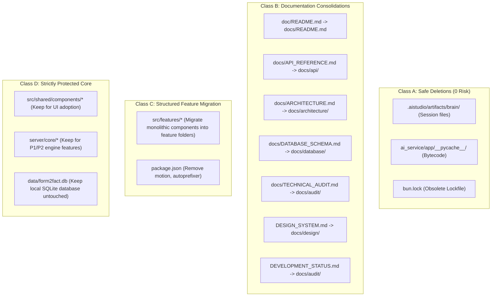

# FORM2FACT: DUPLICATE AND UNUSED FILES ANALYSIS

**Audit Date:** November 6, 2026  
**Evaluation Standard:** Forensic reference graph analysis across all codebase imports, route tables, package scripts, runtime configurations, and documentation links.  
**Execution Phase:** Audit & Discovery (Zero files modified or deleted during this phase).

---

## 1. CLASSIFICATION TAXONOMY

Every evaluated file is categorized into one of five rigorous engineering classes:

- **Class A (Safe to Delete):** Confirmed dead code, orphaned build/session artifacts, or obsolete files with zero active references.
- **Class B (Safe to Consolidate):** Duplicate documentation or redundant stubs where content should be merged into an authoritative target file.
- **Class C (Requires Modification Before Removal):** Files where references or dependencies exist and must be updated/redirected before the file can be safely removed.
- **Class D (Must Retain):** Valid building blocks, test fixtures, or interfaces that appear unused today but are required for ongoing platform capabilities.
- **Class E (Requires Human Decision):** Items involving product policy, package manager choice, or deployment preference requiring explicit stakeholder direction.

---

## 2. DETAILED CANDIDATE INVENTORY & REFERENCE MAPPING

### 2.1 Class A: Confirmed Safe to Delete

| Candidate File Path | Purpose | References Found | Reason for Classification | Proposed Action | Risk Level |
|---|---|---|---|---|:---:|
| `.aistudio/artifacts/brain/7256a2b1-eb7c-4f84-b27f-26ad8decb33e/implementation_plan.md` | Temporary AI Studio session artifact | Zero code or test references | Historical interactive chat artifact accidentally committed to git | Remove from repository; add `.aistudio/` to `.gitignore` | **ZERO** |
| `.aistudio/artifacts/brain/7256a2b1-eb7c-4f84-b27f-26ad8decb33e/implementation_plan.md.metadata.json` | Metadata for AI Studio session artifact | Zero code or test references | Associated metadata for the session artifact above | Remove from repository | **ZERO** |
| `ai_service/app/__pycache__/*.pyc` (3 files) | Compiled Python CPython bytecode cache | Python runtime only | Machine-specific build bytecode; should never be committed to git | Delete bytecode files; add `__pycache__/` and `*.pyc` to root and `ai_service/.gitignore` | **ZERO** |
| `bun.lock` | Legacy Bun lockfile (currently deleted in working tree) | Zero (npm is the active package manager) | Residual lockfile from previous environment | Stage deletion in git (`git rm bun.lock`) | **ZERO** |

---

### 2.2 Class B: Safe to Consolidate

| Candidate File Path | Purpose | References Found | Reason for Classification | Proposed Action | Risk Level |
|---|---|---|---|---|:---:|
| `doc/README.md` | 13-line pointer to `docs/` | None outside user prompt | Redundant directory name (`doc/` vs `docs/`) causing repository confusion | Delete `doc/README.md` and remove directory `doc/`; consolidate all documentation under `docs/` | **LOW** |
| `docs/API_REFERENCE.md` | Legacy monolithic API documentation (6.3 KB) | Links in `docs/README.md`, `doc/README.md` | Superseded by structured documentation in `docs/api/rest-endpoints.md` (4.2 KB) and `docs/api/ai-service-contracts.md` (2.4 KB) | Archive or merge any unique endpoint notes into `docs/api/rest-endpoints.md`, then remove | **LOW** |
| `docs/ARCHITECTURE.md` | Legacy monolithic architecture overview (12.2 KB) | Links in `docs/README.md`, `doc/README.md` | Superseded by modern modular documents in `docs/architecture/system-architecture.md`, `data-flow.md`, `domain-packs.md` | Merge unique sections into `docs/architecture/` and redirect links | **LOW** |
| `docs/DATABASE_SCHEMA.md` | Legacy SQLite schema document (9.8 KB) | Links in `docs/README.md`, `doc/README.md` | Superseded by `docs/database/schema.md` (6.7 KB) and `docs/database/migrations.md` (2.9 KB) | Merge multi-tenancy updates into `docs/database/schema.md` and remove | **LOW** |
| `docs/TECHNICAL_AUDIT.md` | Preliminary technical audit draft (6.8 KB) | Links in `docs/README.md`, `doc/README.md` | Fully superseded by `docs/audit/MASTER_AUDIT_REPORT.md` (37.8 KB) and `IMPLEMENTATION_GAP_MATRIX.md` (12.1 KB) | Remove draft; link directly to `MASTER_AUDIT_REPORT.md` | **LOW** |
| `DESIGN_SYSTEM.md` | Master UI/UX design tokens and design principles (20.8 KB) | Referenced in development prompts | Misplaced in root directory; cluttering project top-level | Move to `docs/design/DESIGN_SYSTEM.md` | **LOW** |
| `DEVELOPMENT_STATUS.md` | Progress report from October refactor (10.9 KB) | None in application code | Misplaced in root directory; belongs with audit deliverables | Move to `docs/audit/DEVELOPMENT_STATUS.md` | **LOW** |

---

### 2.3 Class C: Requires Modification Before Removal / Consolidation

| Candidate File Path | Purpose | References Found | Reason for Classification | Proposed Action | Risk Level |
|---|---|---|---|---|:---:|
| `src/features/administration/index.ts` | Barrel re-export for `SettingsView`, `AuditLogView` | Zero active imports | Hollow barrel export. The views live in `src/components/`. | Either complete feature migration (move components to `src/features/administration/`) or delete hollow barrels. | **MEDIUM** |
| `src/features/applications/index.ts` | Barrel re-export for `ApplicationsView`, `ApplicationDetailView`, etc. | Zero active imports | Hollow barrel export. `App.tsx` imports directly from `src/components/`. | Migrate components to `src/features/applications/` and update `App.tsx` imports. | **MEDIUM** |
| `src/features/documents/index.ts` | Barrel re-export for `DocumentReviewView` | Zero active imports | Hollow barrel export. `App.tsx` imports from `src/components/`. | Migrate component to `src/features/documents/` and update `App.tsx`. | **MEDIUM** |
| `src/features/findings/index.ts` | Barrel re-export for `FindingsView` | Zero active imports | Hollow barrel export. `App.tsx` imports from `src/components/`. | Migrate component to `src/features/findings/` and update `App.tsx`. | **MEDIUM** |
| `src/features/reports/index.ts` | Barrel re-export for `ReportsView` | Zero active imports | Hollow barrel export. `App.tsx` imports from `src/components/`. | Migrate component to `src/features/reports/` and update `App.tsx`. | **MEDIUM** |
| `src/features/reviews/index.ts` | Barrel re-export for `ReviewActionModal`, `CorrectionModal` | Zero active imports | Hollow barrel export. `App.tsx` imports from `src/components/`. | Migrate components to `src/features/reviews/` and update `App.tsx`. | **MEDIUM** |
| `src/features/rules/index.ts` | Barrel re-export for `RulesView` | Zero active imports | Hollow barrel export. `App.tsx` imports from `src/components/`. | Migrate component to `src/features/rules/` and update `App.tsx`. | **MEDIUM** |
| `src/features/verification/index.ts` | Barrel re-export for `PairwiseComparator` | Imported by `src/components/ApplicationDetailView.tsx` line 21 | Active barrel export. Cannot be removed without updating `ApplicationDetailView.tsx`. | Update import in `ApplicationDetailView.tsx` if refactored. | **MEDIUM** |
| `package.json` dependencies: `motion`, `autoprefixer` | Unused npm packages | Zero imports in `src/` or `server/` | Unused runtime and dev dependencies bloating `node_modules` | Run `npm uninstall motion autoprefixer` after stakeholder approval. | **LOW** |

---

### 2.4 Class D: Must Retain (Valuable Building Blocks & Shared Infrastructure)

| Candidate File Path | Purpose | References Found | Reason for Classification | Proposed Action | Risk Level |
|---|---|---|---|---|:---:|
| `src/shared/components/DataTable.tsx` | Reusable sortable/paginated data table | Currently 0 imports | Enterprise table component created for future tabular views (applications, findings). High code quality. | **Must retain.** Integrate into `ApplicationsView.tsx` and `FindingsView.tsx` during component decomposition. | **NONE** |
| `src/shared/components/EmptyState.tsx` | Standardized empty state container | Currently 0 imports | Enterprise visual component for empty searches, zero findings, etc. | **Must retain.** Integrate into view states. | **NONE** |
| `src/shared/components/EvidencePanel.tsx` | Evidence inspection card with document link | Currently 0 imports | Domain-specific component for displaying citations. | **Must retain.** Integrate into `ApplicationDetailView.tsx` evidence drawer. | **NONE** |
| `src/shared/components/LoadingState.tsx` | Standardized loading spinner container | Currently 0 imports | Consistent loading UI container across views. | **Must retain.** Integrate into asynchronous view states. | **NONE** |
| `server/core/storage/index.ts` | Storage provider abstraction (`IStorageProvider`) | Suite [17] tests | Essential for future S3/MinIO cloud deployments. | **Must retain.** Wire into `server/api.ts` in P1. | **NONE** |
| `server/core/jobs/index.ts` | Asynchronous job queue | Suite [17] tests | Essential for non-blocking multi-page PDF processing. | **Must retain.** Wire into document upload in P2. | **NONE** |
| `server/core/logger/index.ts` | Structured JSON logger | Imported in core | Standard logging framework for production telemetry. | **Must retain.** | **NONE** |
| `infrastructure/db/migrate_sqlite_to_pg.ts` | Database ETL migration script | Database documentation | Essential migration utility for PostgreSQL 16 transition. | **Must retain.** Complete ETL writes in P1. | **NONE** |

---

### 2.5 Class E: Items Requiring Human Decision

| Item | Context | Trade-Off Analysis | Recommendation |
|---|---|---|---|
| **Package Name in `package.json`** | Currently `"name": "react-example"` | Retaining `"react-example"` looks amateurish for an enterprise platform; changing to `"form2fact"` requires updating lockfile. | Change to `"form2fact"`. |
| **Monolithic Component Decomposition** | `ApplicationDetailView.tsx` (42 KB), `OverviewView.tsx` (36 KB) | Breaking these into feature sub-components is great for team scalability, but touches working UI code. | Plan as a dedicated sprint (Phase 6 / P3); do not rush during file cleanup. |
| **`metadata.json` in Root** | Google AI Studio extension configuration | Required if the user uses AI Studio extensions; unnecessary for standalone Docker/Vite deployment. | Keep in root to avoid breaking AI Studio workflows. |
| **Vite `dist/` Directory** | Currently committed or present locally (~436 KB) | `dist/` is generated on `npm run build` and is in `.gitignore`. | Run `npm run clean` to remove local build artifacts from developer workspace. |

---

## 3. SUMMARY OF DELETION & CONSOLIDATION CANDIDATES

