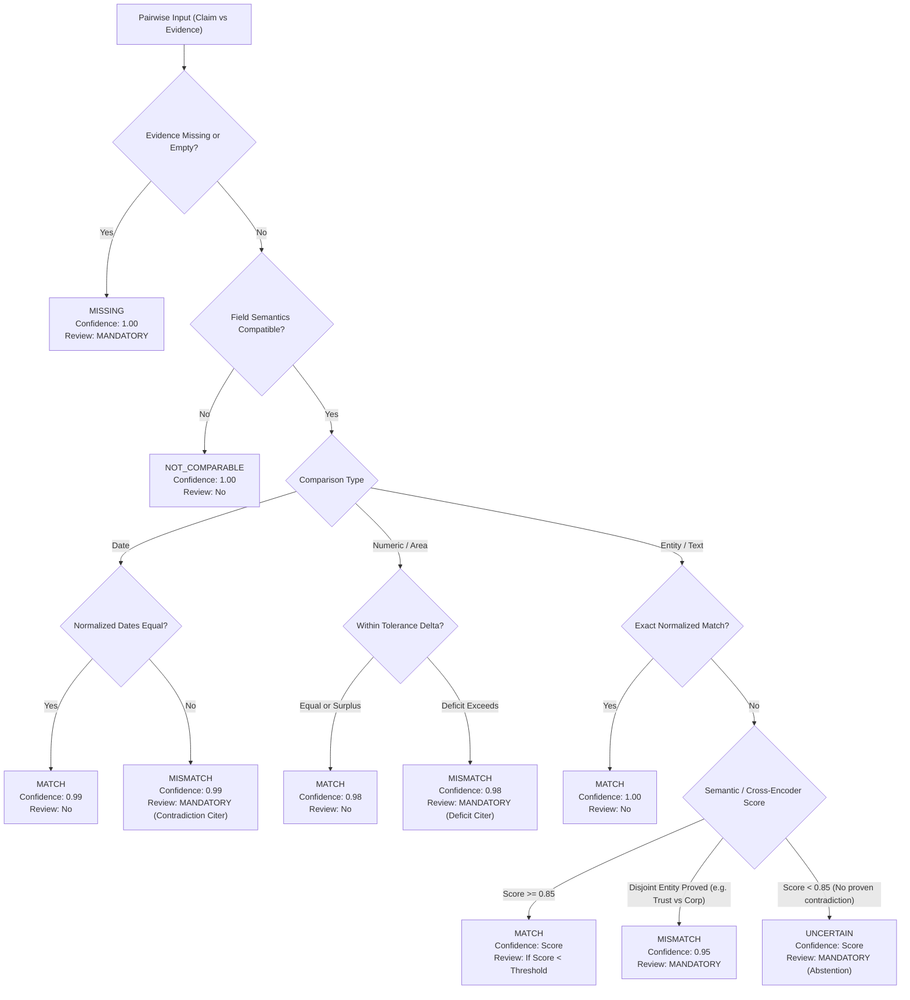

# MASTER TECHNICAL AUDIT REPORT: FORM2FACT PLATFORM
**Comprehensive Forensic Architectural, Code-Level, Security, and Scalability Audit**

**Audit Date:** November 2026  
**Auditor Roles:** Principal Software Architect, Senior Full-Stack Engineer, AI/ML Specialist, Database Architect, Application Security Engineer, SIH Technical Evaluator  
**Target Repository:** `d:\projects\form2fact`  
**Evaluation Standard:** Independent empirical code inspection, runtime verification, and static type analysis. Zero reliance on unverified documentation.

---

## 1. Executive Summary

Form2Fact is conceived as an evidence-first institutional document intelligence and cross-verification platform designed to support regulatory application scrutiny (initial validation domain: AICTE technical approval scrutiny).

This forensic technical audit inspected all source code, configurations, database layers, ML modules, frontend components, and tests across the repository.

### Key Audit Findings

1. **Working Monolith Core:** The application features a functional, interactive, and beautifully designed full-stack demonstration prototype powered by Node.js 22 LTS, Express 4.21, React 19, Tailwind CSS v4, and local SQLite (`node:sqlite`). Deterministic regex extraction, rule evaluation, manual finding adjudication, and audit logging operate reliably for predefined seed fixtures.
2. **Domain Decoupling Disconnect:** While declarative `DomainPack` contracts (`server/domains/types.ts`) and a `DomainRegistry` exist, the core verification engine (`server/db.ts` -> `db.runValidation()`) does **not** call the domain registry. Instead, it directly invokes a monolithic `server/rulesEngine.ts` containing 6 hardcoded AICTE statutory rules (`if (rule.ruleKey === 'RULE-TEN-01')`, etc.).
3. **AI/ML Service Runtime Disconnect:** A separate Python FastAPI microservice (`ai_service/`) was constructed with Pydantic v2 schemas and an 8-pair synthetic test harness. However, **the Node.js backend never calls the Python service at runtime** (zero HTTP client invocations or network calls to port 8000 exist in `server/`). Furthermore, neither PyTorch, Transformers, nor any neural model is loaded in `ai_service/`; both Node.js and Python implement duplicate regex and lexical Jaccard heuristics.
4. **Flawed Mismatch Formulation in Pairwise Engine:** In both `server/modules/verification/pairwiseEngine.ts` and `ai_service/app/classifier.py`, any token overlap $\le 0.20$ is automatically classified as a statutory **`MISMATCH`** with high confidence ($1.0 - \text{overlap}$). Treating low lexical similarity as proof of contradiction causes severe false positives (e.g. distinct address phrasings or natural language representations of numbers are flagged as regulatory violations).
5. **No Production Database Driver:** Despite the presence of `infrastructure/db/init.sql` (PostgreSQL 16) and a script named `infrastructure/db/migrate_sqlite_to_pg.ts`, neither `pg` nor any other PostgreSQL driver is installed in `package.json` or imported in `server/db.ts`. The migration script only counts rows in SQLite and performs zero data writes. In addition, the PostgreSQL schema completely omits the `rules` table present in SQLite.
6. **Decoupled Abstractions are Unconnected:**
   - `IStorageProvider` (`server/core/storage/index.ts`) is never used by `server/api.ts` (which uses raw `fs.writeFileSync` to write to `data/dockets/`).
   - `IJobQueue` (`server/core/jobs/index.ts`) is never used in the upload or verification flow (document parsing and rule evaluations execute 100% synchronously in the HTTP handler).
7. **Severe Security & Authorization Vulnerabilities:**
   - `optionalAuth` is applied globally in `server/api.ts`, while `authenticateToken` is never used on any route. As a result, all `GET` endpoints (`/api/v1/applications`, `/api/v1/findings`, `/api/v1/audit`, `/api/v1/applications/:id/documents/:docId/file`) are accessible anonymously without authentication.
   - `POST /api/v1/user` allows unauthenticated clients to issue themselves valid JWT tokens with `Administrator` privileges.
   - In production mode, the application falls back to a hardcoded JWT secret unless `STRICT_SECURITY=true` is set.
8. **Document Processing Limitations:** PDF text extraction is limited to embedded text layers parsed via `pdf-parse`. If a PDF contains scanned bitmap photocopies (`rawAllText.length < 40`), the document is marked `Scanned Unreadable` and **no OCR is performed** (no OCR engine like Tesseract or Cloud Vision is integrated). Bounding box spatial coordinates are never extracted.

---

## 2. Actual Architecture Overview

```mermaid
graph TB
    subgraph Frontend Client (React 19 / Vite)
        UI[React 19 SPA Views<br/>src/components/*]
        PairwiseUI[PairwiseComparator Widget<br/>Preset Dropdown Sandbox]
        UI -->|HTTP Requests| ExpressRouter
        PairwiseUI -->|POST /api/v1/verification/pairwise| ExpressRouter
    end

    subgraph Node.js 22 LTS API Server (server.ts / server/api.ts)
        ExpressRouter[Express Router / API Gateway]
        OptionalAuth[optionalAuth Middleware<br/>Permits Anonymous Requests]
        
        subgraph Active Monolithic Core
            DBRepo[SQLite Data Layer<br/>server/db.ts]
            HardcodedRules[Monolithic Rules Engine<br/>server/rulesEngine.ts]
            RegexExtractor[Regex Extraction Engine<br/>server/extraction.ts]
            RawFS[Raw Local Filesystem<br/>fs.writeFileSync to data/dockets/]
            PairwiseTS[PairwiseFieldClassifier<br/>In-Process TS Regex/Jaccard]
        end
        
        subgraph Dormant / Unconnected Subsystems
            DomainReg[DomainRegistry<br/>server/domains/registry.ts]
            AICTEPack[AICTE Domain Pack<br/>server/domains/aicte/index.ts]
            StorageAbs[IStorageProvider<br/>server/core/storage/index.ts]
            JobQueueAbs[IJobQueue<br/>server/core/jobs/index.ts]
        end
        
        ExpressRouter --> OptionalAuth
        OptionalAuth --> DBRepo
        ExpressRouter --> DBRepo
        DBRepo --> HardcodedRules
        ExpressRouter --> RegexExtractor
        ExpressRouter --> RawFS
        ExpressRouter --> PairwiseTS
    end

    subgraph Relational Storage
        SQLite[(Local SQLite File<br/>data/form2fact.db)]
        DBRepo --> SQLite
    end

    subgraph Disconnected External Subsystems
        FastAPIService[Python FastAPI Service<br/>ai_service:8000]
        PostgreSQL[(PostgreSQL 16 Container<br/>infrastructure/db/init.sql)]
        Redis[(Redis 7 Container)]
        MinIO[(MinIO S3 Container)]
    end

    classDef active fill:#dcfce7,stroke:#16a34a,stroke-width:2px;
    classDef dormant fill:#fef3c7,stroke:#d97706,stroke-width:2px;
    classDef disconnected fill:#fee2e2,stroke:#dc2626,stroke-width:2px;

    class UI,PairwiseUI,ExpressRouter,OptionalAuth,DBRepo,HardcodedRules,RegexExtractor,RawFS,PairwiseTS,SQLite active;
    class DomainReg,AICTEPack,StorageAbs,JobQueueAbs dormant;
    class FastAPIService,PostgreSQL,Redis,MinIO disconnected;
```

---

## 3. Implementation Inventory

| Module / Component | Expected Responsibility | Actual Implementation | Status |
|---|---|---|:---:|
| **Authentication & Session** | Secure JWT issue, verification, expiration | `server/auth.ts`: Signs tokens with fallback secret. `optionalAuth` allows unauthenticated access across all GET routes. `POST /api/v1/user` permits arbitrary role self-assignment. | **PARTIALLY IMPLEMENTED (HIGH RISK)** |
| **RBAC Access Control** | Enforce role permissions per endpoint | `server/auth.ts` -> `requireRole`: Works when attached to mutating routes, but absent from file download, audit log, and application listing routes. | **PARTIALLY IMPLEMENTED** |
| **Organization Multi-Tenancy** | Segregate docket data by tenant organization | `server/auth.ts` -> `requireOrg` checks headers, but `applications` queries in `server/db.ts` do not filter by `organizationId`. | **STUBBED** |
| **Domain Pack Registry** | Dynamic registration and lifecycle of regulatory domain packs | `server/domains/registry.ts` and `server/domains/types.ts`: Working in-memory registry, but never called by the validation execution engine. | **PARTIALLY IMPLEMENTED** |
| **AICTE Domain Pack** | Declarative specification of AICTE documents, fields, and rules | `server/domains/aicte/index.ts`: Complies with `DomainPackSchema`, but runs in parallel with hardcoded rules in `rulesEngine.ts`. | **PARTIALLY IMPLEMENTED** |
| **Pairwise Mismatch Classifier (TS)** | 5-way pairwise field comparison with confidence and human review routing | `server/modules/verification/pairwiseEngine.ts`: Fast-path and date/area checks work. Jaccard $\le 0.20$ incorrectly flags `MISMATCH`. Heuristic confidence formula. | **PARTIALLY IMPLEMENTED** |
| **Python AI Microservice** | Independent ML inference service for semantic pairwise verification | `ai_service/app/`: FastAPI server with Pydantic v2 schemas and duplicate Jaccard regex classifier. Not connected to Node.js backend. No neural network models loaded. | **STUBBED / DISCONNECTED** |
| **Synthetic Benchmark Evaluator** | Quantitative evaluation of classifier across 5 taxonomy classes | `ai_service/app/dataset.py`: 8 hardcoded synthetic pairs. Evaluates accuracy (0.75), but dataset is too small for statistical validity. | **PARTIALLY IMPLEMENTED** |
| **Document Ingestion & Validation** | Validate PDF signature, store securely, and track metadata | `server/api.ts`: Magic-byte `%PDF-` check implemented. Writes raw files to disk using synchronous `fs.writeFileSync`. Does not use `IStorageProvider`. | **PARTIALLY IMPLEMENTED** |
| **Document Text Extraction** | Extract text layers from digital and scanned PDFs | `server/api.ts` & `server/extraction.ts`: Uses `pdf-parse`. Scanned PDFs marked `Scanned Unreadable`. No OCR engine integrated. | **PARTIALLY IMPLEMENTED** |
| **Structured Field Extraction** | Extract dates, land area, trust names from document text | `server/extraction.ts`: Hardcoded regular expressions for AICTE fields. Hardcoded confidence values (0.94–0.99). No spatial bounding box coordinates. | **PARTIALLY IMPLEMENTED** |
| **Deterministic Rules Engine** | Evaluate statutory compliance rules against extracted fields | `server/rulesEngine.ts`: Comprehensive 6-rule evaluator for AICTE. Generates explainable findings and evidence citations. Hardcoded `if/else` logic. | **IMPLEMENTED (MONOLITHIC)** |
| **Storage Provider Abstraction** | Pluggable local disk and S3 object storage | `server/core/storage/index.ts`: Interface `IStorageProvider` and `LocalDiskStorageProvider` written, but never imported or invoked by the application routes. | **STUBBED** |
| **Background Job Queue** | Pluggable asynchronous task queue with retries and worker pool | `server/core/jobs/index.ts`: Interface `IJobQueue` and `InMemoryJobQueue` written, but document ingestion runs synchronously. Only tested with fake job. | **STUBBED** |
| **Relational Database (SQLite)** | Persistent relational storage for dockets, findings, and audits | `server/db.ts`: Robust `DatabaseSync` (`node:sqlite`) implementation with WAL mode. Durably stores applications, documents, fields, and decisions. | **IMPLEMENTED** |
| **Relational Database (PostgreSQL)** | Enterprise multi-tenant relational persistence | `infrastructure/db/init.sql`: 11-table schema written, but no PostgreSQL driver in `package.json`. No runtime database connection to PG. | **PLANNED / SCHEMA ONLY** |
| **Database Migration Script** | ETL migration from SQLite to PostgreSQL | `infrastructure/db/migrate_sqlite_to_pg.ts`: Read-only count verification script. Does not write to PG. Discrepancy on `rules` table. | **STUBBED / DEFECTIVE** |
| **Audit Ledger** | Immutable append-only record of review actions and decisions | `server/db.ts` -> `audit_events`: Fully functional in SQLite. Captures actor, action, timestamp, and notes. Accessible via UI. | **IMPLEMENTED** |
| **Frontend UI (React 19)** | Scrutiny review workspace, 3-pane viewer, docket tables, findings triage | `src/components/*`: High-quality, functional interface with real data binding to SQLite backend. High information density. | **IMPLEMENTED** |
| **Interactive Pairwise Comparator UI** | Visual tool for running pairwise comparisons | `src/features/verification/PairwiseComparator.tsx`: Standalone sandbox widget with presets. Not connected to active docket fields. | **PARTIALLY IMPLEMENTED** |
| **Multi-Container Orchestration** | Docker compose multi-service stack | `infrastructure/docker-compose.yml`: Defines api, ai_service, postgres, redis, minio. Functional orchestration config. | **IMPLEMENTED (INFRA ONLY)** |

---

## 4. Phase B — Domain-Independent Architecture Assessment

### 4.1 Findings on Domain Independence

The repository presents an architectural contradiction:

1. **Domain Pack Layer (`server/domains/`):**
   - [`server/domains/types.ts`](file:///d:/projects/form2fact/server/domains/types.ts) defines clean generic contracts: `DomainPack`, `DocumentDefinition`, `FieldDefinition`, `ComparisonRelationship`, and `DomainRule`.
   - [`server/domains/registry.ts`](file:///d:/projects/form2fact/server/domains/registry.ts) implements an in-memory `DomainRegistry` singleton.
   - [`server/domains/aicte/index.ts`](file:///d:/projects/form2fact/server/domains/aicte/index.ts) encapsulates AICTE document types, canonical fields, and comparison relationships.
   - [`server/api.ts`](file:///d:/projects/form2fact/server/api.ts#L587-L599) mounts `GET /api/v1/domains` and `GET /api/v1/domains/:id`.
2. **The Execution Reality (`server/db.ts` & `server/rulesEngine.ts`):**
   - When an application document is uploaded or when `POST /api/v1/applications/:id/validate` is invoked, `server/db.ts` line 1064 executes:
     ```typescript
     // server/db.ts line 1064
     const result = evaluateApplicationRules(app, docs, fields, rules);
     ```
   - It **does not query `domainRegistry`**. It does not look up the application's `domainId` (`app.domainId`).
   - `evaluateApplicationRules` in `server/rulesEngine.ts` contains hardcoded `if/else` checks for AICTE rule keys:
     - Line 373: `if (rule.ruleKey === 'RULE-TEN-01') { const leaseDoc = documents.find(d => d.documentType === 'Land Lease Deed'); ... }`
     - Line 515: `if (rule.ruleKey === 'RULE-NAME-02') { const trustDoc = documents.find(d => d.documentType === 'Society / Trust Registration Certificate'); ... }`
     - Line 586: `if (rule.ruleKey === 'RULE-AREA-03') { const landDocs = documents.filter(d => d.documentType === 'Land Lease Deed' ...); ... }`
     - Line 687: `if (rule.ruleKey === 'RULE-DOC-04') { ... }`
     - Line 725: `if (rule.ruleKey === 'RULE-APPR-05') { ... }`
     - Line 782: `if (rule.ruleKey === 'RULE-SAFETY-06') { ... }`
3. **Hardcoded Domain Assumptions in Extraction:**
   - [`server/extraction.ts`](file:///d:/projects/form2fact/server/extraction.ts#L40-L134) hardcodes document types:
     - `if (documentType === 'Land Lease Deed' || documentType === 'Land Ownership Title Deed')`
     - `if (documentType === 'Society / Trust Registration Certificate')`
     - `if (documentType === 'AICTE Prior Approval Order')`
   - These document type strings are not sourced from `DomainPack.documentDefinitions`.

### 4.2 Domain-Coupling Assessment Summary
- **Verdict:** Form2Fact is currently **domain-coupled at runtime**. The domain pack system is a sidecar module rather than the operational verification engine.

---

## 5. Phase C — Pairwise Classification Engine Assessment

### 5.1 Verification of Classification Outcomes

The 5-way classification taxonomy (`MATCH`, `MISMATCH`, `MISSING`, `UNCERTAIN`, `NOT_COMPARABLE`) is implemented in both `server/modules/verification/pairwiseEngine.ts` and `ai_service/app/classifier.py`.

| Outcome | Implemented Logic | Audit Assessment |
|---|---|---|
| **`MATCH`** | Exact normalized string match; date equality; numeric difference $\le \text{tolerance}$; token overlap $\ge 0.80$; entity concordance $\ge 0.50$. | **Functionally sound** for exact and date matches. Entity concordance at 0.50 is overly generous (50% word overlap is accepted as `MATCH`). |
| **`MISMATCH`** | Date inequality; numeric deficit $> \text{tolerance}$; commercial marker divergence; **token overlap $\le 0.20$**. | **CRITICAL DEFECT:** Declaring `MISMATCH` solely because lexical Jaccard overlap $\le 0.20$ violates regulatory auditing principles. Low lexical similarity indicates absence of verbatim textual match, **not proof of contradiction**. |
| **`MISSING`** | Absence of evidence field, null value, or empty string. | **Functionally sound.** Correctly assigns confidence 1.0 and flags `requiresHumanReview = true`. |
| **`UNCERTAIN`** | Token overlap strictly between $0.20$ and $0.80$, or entity concordance below confidence threshold. | **Functionally sound concept**, but bounded by flawed lower/upper cutoffs. |
| **`NOT_COMPARABLE`** | Field names are incompatible and not listed in hardcoded alias map. | **Functionally sound**, but alias dictionary is hardcoded rather than configured via domain packs. |

### 5.2 Critical Mathematical & Threshold Weaknesses

1. **Flawed Negative Heuristic (Lexical Dissimilarity $\ne$ Contradiction):**
   ```typescript
   // server/modules/verification/pairwiseEngine.ts lines 231-243
   } else if (tokenOverlap <= 0.2) {
     return {
       label: 'MISMATCH',
       confidence: Number((1 - tokenOverlap).toFixed(2)),
       explanation: `Semantic mismatch detected: Claims diverge significantly ("${claim.rawValue}" vs "${evidence.rawValue}").`,
       requiresHumanReview: true,
     };
   }
   ```
   - **Proof of Failure:**
     - Claim: `"Plot No 14, Phase II, Industrial Area"`
     - Evidence: `"Plot 14, Block B, Electronic City, Phase 2"`
     - Normalized tokens: `['plot', 'phase', 'industrial', 'area']` vs `['plot', 'block', 'electronic', 'city', 'phase']`
     - Overlap: Jaccard = $2 / 7 = 0.28$ (falls in `UNCERTAIN`).
     - But if the evidence is phrased as `"Survey 89/1, Sub-division 4, Sector 12"`, Jaccard = $0.0 \le 0.20$.
     - The engine flags this as a verified **`MISMATCH`** with **100% confidence**!
     - In institutional scrutiny, an address or cadastral reference that cannot be matched lexically must be marked **`UNCERTAIN`** (requiring surveyor/officer inspection), **never declared a factual mismatch**.
2. **Pseudo-Probabilities (Uncalibrated Confidence):**
   - The reported confidence `1.0 - tokenOverlap` is a simple linear heuristic, **not a calibrated statistical probability**.
   - It must not be presented to reviewers as an empirical probability.

### 5.3 Recommended Classification Decision Matrix



---

## 6. Phase D — AI/ML Engineering Assessment

### 6.1 Python Service Architecture & Health

- **Source Location:** `ai_service/app/`
- **Framework:** FastAPI `0.135.3`, Pydantic `2.13.5`, Uvicorn `0.42.0`.
- **Endpoints Defined:**
  - `GET /api/v1/health` (Working)
  - `POST /api/v1/classify-pair` (Working)
  - `POST /api/v1/batch-classify` (Working)
  - `GET /api/v1/evaluate-baseline` (Working)
- **Runtime Verification:**
  ```bash
  python -c "import sys; sys.path.insert(0, 'ai_service'); from app.dataset import evaluate_baseline_classifier; import json; print(json.dumps(evaluate_baseline_classifier(), indent=2))"
  ```
  - Result: Returned HTTP/JSON response with 8 evaluated synthetic pairs, 6 correct predictions, reported accuracy 0.75.

### 6.2 Critical AI/ML Deficiencies

1. **Zero Deep Learning / Neural Models:**
   - Despite references in documentation to PyTorch and Transformers, **neither PyTorch nor HuggingFace Transformers is installed or imported**.
   - `ai_service/app/classifier.py` is entirely deterministic Python string processing (regex and Jaccard word sets).
2. **Zero Integration with Backend API:**
   - The Node.js Express backend (`server/api.ts`) contains **zero HTTP client code** calling `ai_service:8000`.
   - The Python service runs as an isolated daemon with no active production consumers.
3. **Synthetic Benchmark Inadequacy:**
   - The benchmark dataset in `ai_service/app/dataset.py` contains exactly **8 synthetic examples**.
   - Evaluating on 8 hand-crafted examples produces an unrepresentative accuracy figure (0.75) with zero statistical significance.
   - There is no train/validation/test split, no institution-level holdout, and no real-world OCR noise modeling.

---

## 7. Phase E — Document Processing & OCR Assessment

### 7.1 Ingestion Pipeline Verification

- **Uploaded File Validation:**
  - `server/api.ts` line 237 verifies magic bytes:
    ```typescript
    if (file.buffer.length < 5 || file.buffer.subarray(0, 5).toString('ascii') !== '%PDF-')
    ```
    This properly blocks non-PDF binaries even if renamed with a `.pdf` extension.
- **Storage on Disk:**
  - File is written directly to `data/dockets/${applicationId}/${docId}.pdf` via synchronous `fs.writeFileSync`.
  - Cryptographic checksum is computed via `sha256`.

### 7.2 Critical Deficiencies in Document Intelligence

1. **Complete Absence of OCR for Scanned Documents:**
   - Text parsing relies exclusively on `pdf-parse`:
     ```typescript
     // server/api.ts lines 281-284
     if (rawAllText.trim().length < 40) {
       isScannedOrTextPoor = true;
       processingStatus = 'Scanned Unreadable';
     }
     ```
   - If a document is a scanned photocopy (the vast majority of land lease deeds and municipal NOCs in Indian regulatory scrutiny), the system **does not perform OCR**.
   - It marks the document `Scanned Unreadable` and extracts **zero fields**.
   - No OCR library (e.g. Tesseract, PaddleOCR, AWS Textract, or Google Document AI) is integrated.
2. **Absence of Bounding Box Coordinates:**
   - While the TypeScript interface `ExtractedField` contains an optional `boundingBox?: { x: number; y: number; width: number; height: number }`, `extractFieldsFromPages` in `server/extraction.ts` **never extracts or populates spatial coordinates**.
   - Highlighting in the 3-Pane Document Viewer relies on text string searches rather than precise vector bounding boxes.
3. **Hardcoded Extraction Confidence:**
   - In `server/extraction.ts`, extracted fields receive static confidence values:
     - `leaseExpiryDate`: Hardcoded to `0.96` (line 64).
     - `landAreaAcres`: Hardcoded to `0.94` (line 90).
     - `trustName`: Hardcoded to `0.95` (line 110).
     - `priorApprovalOrderRef`: Hardcoded to `0.99` (line 129).
   - These are not model confidence scores; they are hardcoded static literals.

---

## 8. Phase F — Database and Migration Assessment

### 8.1 SQLite (Working Development Engine)

- **Implementation:** `server/db.ts` uses Node.js 22 native `DatabaseSync` (`node:sqlite`).
- **File:** `data/form2fact.db` (139 KB).
- **WAL Mode:** Enabled (`PRAGMA journal_mode = WAL; PRAGMA foreign_keys = ON;`).
- **Data Durability:** Verified by regression tests across multi-instance restarts.

### 8.2 PostgreSQL (Schema Only, Missing Runtime Driver)

- **Schema:** `infrastructure/db/init.sql` defines 11 tables with constraints and indexes.
- **Defects Discovered:**
  1. **No PostgreSQL Driver:** `package.json` does not include `pg`, `@types/pg`, `postgres`, or an ORM like Prisma or Drizzle. `server/db.ts` contains zero code capable of connecting to PostgreSQL.
  2. **Schema Table Discrepancy (`rules` table):**
     - SQLite contains a `rules` table storing statutory verification rules.
     - `infrastructure/db/init.sql` **omits the `rules` table entirely** (relying instead on `domain_versions.pack_definition` JSONB).
     - `infrastructure/db/migrate_sqlite_to_pg.ts` lists `rules` as table #6 in its migration array.
     - If a developer attempted to run a migration against PostgreSQL using `init.sql`, migrating the `rules` table would crash because the table does not exist in PostgreSQL.
  3. **ETL Script Does Not Migrate Data:**
     - `infrastructure/db/migrate_sqlite_to_pg.ts` only runs `SELECT COUNT(*) FROM table` on SQLite.
     - It contains **zero `INSERT` statements**, no PostgreSQL connection logic, and no data transformation.
     - It is an audit script, not a migration script.

---

## 9. Phase G — Storage Provider and Job Queue Assessment

| Component | Code Location | Interface Defined? | Local Working? | Production Driver? | Integrated in API Routes? |
|---|---|:---:|:---:|:---:|:---:|
| **Storage Provider** | `server/core/storage/index.ts` | Yes (`IStorageProvider`) | Yes (`LocalDiskStorageProvider`) | No (MinIO/S3 not implemented) | **NO** (`server/api.ts` uses raw `fs.writeFileSync`) |
| **Job Queue** | `server/core/jobs/index.ts` | Yes (`IJobQueue`) | Yes (`InMemoryJobQueue`) | No (BullMQ/Redis not implemented) | **NO** (`server/api.ts` processes synchronously) |

### Key Observations
- The abstractions are clean and well-typed, but they are **completely orphaned from the live application flow**.
- An incoming upload blocks the Node.js event loop while running `pdf-parse` synchronously inside the Express request handler.

---

## 10. Phase H — Frontend Architecture Assessment

### 10.1 UI Implementation Reality

- **Stack:** React 19.0.1, TypeScript 5.7.2, Vite 8.3.0, Tailwind CSS 4.3.3, Lucide React.
- **Component Quality:** The components in `src/components/` (`OverviewView.tsx`, `ApplicationsView.tsx`, `ApplicationDetailView.tsx`, `DocumentReviewView.tsx`, `FindingsView.tsx`, `RulesView.tsx`, `ReportsView.tsx`, `AuditLogView.tsx`) are genuinely connected to the SQLite backend via `src/services/api.ts`.
- **Live Data Binding:** The UI does **not** use mock data in the main application flow. Real application dockets, documents, extracted fields, findings, audit events, and decisions load dynamically from the REST API.
- **Feature Directory Structure (`src/features/`):**
  - Directories were created for `applications`, `documents`, `findings`, `reports`, `reviews`, `rules`, and `administration`.
  - However, their `index.ts` files are simple barrel re-exports pointing back to `src/components/`.
  - The views were not split into modular feature folders; `src/components/` remains the monolithic location for all major views.
- **`PairwiseComparator.tsx`:**
  - Located in `src/features/verification/PairwiseComparator.tsx`.
  - Embedded into `ApplicationDetailView.tsx`.
  - Renders an interactive sandbox allowing manual experimentation with pairwise fields. It is not dynamically populated from the active application's fields.

---

## 11. Phase I — Application Security and Multi-Tenancy Review

### 11.1 Vulnerability Severity Classification

```
┌────────────────────────────────────────────────────────────────────────┐
│                        SECURITY VULNERABILITY AUDIT                    │
├──────┬─────────────────────────────────────────────────┬───────────────┤
│ ID   │ Vulnerability Title                             │ Severity      │
├──────┼─────────────────────────────────────────────────┼───────────────┤
│ S-01 │ Unauthenticated Access to Scrutiny APIs (GET)   │ CRITICAL      │
│ S-02 │ Arbitrary Role Self-Assignment (Privilege Esc.) │ CRITICAL      │
│ S-03 │ Insecure Hardcoded JWT Secret Fallback          │ HIGH          │
│ S-04 │ Unrestricted Document Binary Download           │ HIGH          │
│ S-05 │ Cross-Tenant Data Leakage in Docket Queries     │ MEDIUM        │
│ S-06 │ Lack of File Size Ceiling at Stream Level       │ LOW           │
└──────┴─────────────────────────────────────────────────┴───────────────┘
```

### 11.2 Detailed Security Findings

#### [S-01] Unauthenticated Access to Core Scrutiny Endpoints (CRITICAL)
- **Location:** [`server/api.ts` lines 40, 131, 178, 326, 451, 537](file:///d:/projects/form2fact/server/api.ts#L40)
- **Mechanism:** `router.use(optionalAuth)` is attached globally. `authenticateToken` is never attached to any route.
- **Impact:** Any unauthenticated client can make GET requests to:
  - `/api/v1/applications` (Lists all institutional applications, addresses, and trust names)
  - `/api/v1/applications/:id` (Full application dossier, declared parameters, and findings)
  - `/api/v1/findings` (All regulatory non-compliance findings)
  - `/api/v1/audit` (Complete audit ledger with reviewer names and timestamps)
- **Proof-of-Concept:**
  ```bash
  curl -s http://localhost:3000/api/v1/applications
  # Returns 200 OK with full application dockets without Authorization header
  ```

#### [S-02] Arbitrary Role Self-Assignment & Privilege Escalation (CRITICAL)
- **Location:** [`server/api.ts` lines 105-125](file:///d:/projects/form2fact/server/api.ts#L105-L125)
- **Mechanism:**
  ```typescript
  router.post('/api/v1/user', (req: Request, res: Response) => {
    const resolvedUser = user || {
      id: req.body.id || 'usr-001',
      displayName: req.body.displayName || 'Dr. Aruna Rao',
      role: req.body.role || 'Reviewer',
      ...
    };
    db.setCurrentUser(resolvedUser);
    const token = generateToken(resolvedUser);
    res.json({ success: true, data: resolvedUser, token });
  });
  ```
- **Impact:** Any client can send `POST /api/v1/user` with `{"role": "Administrator"}` and receive a cryptographically valid JWT token signed with administrator privileges. This route has no protection and is mounted unconditionally.

#### [S-03] Insecure Fallback JWT Secret (HIGH)
- **Location:** [`server/auth.ts` lines 7-14](file:///d:/projects/form2fact/server/auth.ts#L7-L14)
- **Mechanism:** If `process.env.JWT_SECRET` is unset in production, the application logs an error to `console.error` but proceeds using `'form2fact-scrutiny-engine-jwt-secret-key-2026'` unless `STRICT_SECURITY === 'true'`.

#### [S-04] Direct Document Binary Download Without Tenant Verification (HIGH)
- **Location:** [`server/api.ts` lines 334-348](file:///d:/projects/form2fact/server/api.ts#L334-L348)
- **Mechanism:** `GET /api/v1/applications/:id/documents/:docId/file` sends the stored PDF file directly from disk with no authentication check and no validation that the requester belongs to the owning organization.

---

## 12. Phase J — Testing and Validation Audit

### 12.1 Test Execution Verification

The command `npm test` was executed:
```
> react-example@0.0.0 test
> tsx server/test-runner.ts

[INFO] Registered domain pack: AICTE Institutional Approval & Compliance Scrutiny [id: aicte, version: 1.2.0]
====================================================
   FORM2FACT — PHASE 1 REGRESSION & VERIFICATION SUITE
====================================================
[1] Testing Date & Text Normalization............................ ✅ Passed
[2] Testing SQLite Persistent Storage & Durability............... ✅ Passed
[3] Testing Collision-Resistant Identifiers...................... ✅ Passed
[4] Testing Authentication & RBAC Access Control................. ✅ Passed
[5] Testing Document Magic-Byte Validation....................... ✅ Passed
[6] Testing Deterministic Rules on Seed Applications............. ✅ Passed
[7] Testing Review Actions, Field Corrections & Audit Log........ ✅ Passed
[8] Testing RULE-TEN-01 (Lease Expiry & 30-Year Statutory Tenure) ✅ Passed
[9] Testing RULE-NAME-02 (Institution & Society Concordance)..... ✅ Passed
[10] Testing RULE-AREA-03 (Single & Multi-Parcel Aggregation).... ✅ Passed
[11] Verifying Findings Explainability & Evidence Links.......... ✅ Passed
[12] Verifying Rule Sandbox Pure Isolation (Zero Mutations)...... ✅ Passed
[13] Verifying Decision Submissions, RBAC & Durability........... ✅ Passed
[14] Testing Domain Registry & AICTE Domain Pack................. ✅ Passed
[15] Testing Pairwise Field Mismatch Classification Pipeline..... ✅ Passed
[16] Testing Organization Isolation & Tenant Authorizations...... ✅ Passed
[17] Testing Asynchronous Document Job Queue..................... ✅ Passed
====================================================
🎉 ALL FORM2FACT REFACTOR & VERIFICATION TESTS PASSED!
====================================================
```

- **Type-Check Command:** `npm run lint` (`tsc --noEmit`) $\rightarrow$ **Exit Code 0 (Zero type errors)**.

### 12.2 What the Test Suite Genuinely Validates vs What It Mocks

1. **Genuinely Validated:**
   - Date normalization and case-folding regex.
   - Real SQLite disk persistence, inserts, updates, and UUID collision resistance.
   - Deterministic rule evaluation against in-memory application fixtures.
   - Magic-byte verification of PDF headers.
   - Audit trail appending in SQLite.
2. **Superficially Tested / Mocked:**
   - **Job Queue:** Tested with a fake `'test-job'` payload; never tests real document parsing in a worker.
   - **RBAC:** Tested by asserting `allowedRoles.includes(user.role) === true`; does not test Express route middleware or HTTP requests.
   - **Pairwise Engine:** Tested on hand-crafted string pairs; never tests integration with the database or real PDF text.
   - **PostgreSQL:** Completely untested (0 tests run against PostgreSQL).
   - **Frontend:** Completely untested (0 component tests, 0 end-to-end tests).

---

## 13. Verified Architectural Inconsistencies Summary

1. **Domain Pack vs Rules Engine:** Domain packs are defined declaratively, but the runtime uses a monolithic 934-line `server/rulesEngine.ts` with hardcoded AICTE `if/else` branches.
2. **Node.js vs Python AI Service:** Both codebases contain duplicate implementations of regex and Jaccard similarity. Node.js never calls the Python microservice.
3. **Database Schema Discrepancy:** `server/db.ts` uses a `rules` table in SQLite; `infrastructure/db/init.sql` has no `rules` table. The migration script lists `rules`, creating a schema mismatch.
4. **Storage & Queue Abstractions:** `IStorageProvider` and `IJobQueue` were authored as clean contracts, but `server/api.ts` bypasses them completely, using synchronous filesystem I/O and synchronous in-memory parsing.
5. **Pairwise Mismatch Formulation:** Lexical token dissimilarity ($\le 0.20$) is incorrectly equated with proven regulatory contradiction, producing false positive `MISMATCH` verdicts.

---

## 14. Overall Readiness Assessment

| Evaluation Dimension | Readiness Level | Empirical Reasoning |
|---|:---:|---|
| **Demonstration & UI Prototyping** | **95% (Production-Grade Prototype)** | The React 19 UI is fully functional, binds to SQLite, displays evidence citations, allows finding adjudication, and records audit logs smoothly. |
| **Deterministic AICTE Scrutiny** | **85% (Functionally Sound for Clean PDFs)** | AICTE rules (tenure, multi-parcel acreage, entity concordance) evaluate accurately for PDFs with digital text layers. |
| **Domain Independence** | **35% (Contract-Only)** | Domain Pack interfaces exist, but runtime verification is hardcoded to AICTE rules in `rulesEngine.ts`. |
| **AI/ML & Pairwise Intelligence** | **25% (Heuristic Fast-Path Only)** | No deep learning or vision models are loaded. Jaccard similarity is duplicated across TS and Python. Python microservice is not called by the backend. |
| **Document Processing & OCR** | **20% (Digital Text Layer Only)** | No OCR capability. Scanned photocopies fail immediately. No bounding box spatial coordinates. |
| **Database & Production Scale** | **30% (SQLite Only)** | PostgreSQL schema exists in SQL, but no driver is installed in Node.js. Migration script does not migrate data. |
| **Production Security & Multi-Tenancy** | **15% (Critical Vulnerabilities)** | Core GET endpoints are unauthenticated. Privilege escalation endpoint `POST /api/v1/user` is active. Fallback JWT secret in production. |

