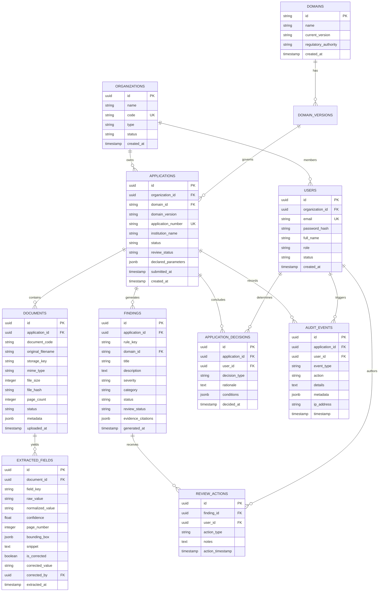

# Database Schema & Entity Relationships

## 1. Dual-Engine Architecture Overview

Form2Fact implements dual database compatibility:
1. **Local Development & Integration Testing:** Native SQLite (`data/form2fact.db`) via Node.js 22's `node:sqlite` module (`server/db.ts`).
2. **Enterprise Production:** PostgreSQL 16 schema (`infrastructure/db/init.sql`) supporting multi-tenancy, connection pooling, JSONB evidence indexing, and row-level security.

## 2. Entity Relationship Model

## 3. Core Relational Tables & Column Details

### 3.1 `organizations`
Multi-tenant isolation boundary for regulatory agencies, regional offices, or institutional groups.
- `id`: Primary key (UUID v4).
- `name`: Human-readable name (e.g., "Western Regional Office - AICTE").
- `code`: Unique statutory identifier (e.g., `RO-WEST-MUMBAI`).
- `status`: Lifecycle state (`active`, `suspended`, `archived`).

### 3.2 `users`
Authenticated scrutiny officers, institutional applicants, and system administrators.
- `role`: Role-based access control enum:
  - `admin`: System configuration, domain management, audit trail inspection.
  - `reviewer`: Scrutiny officer authorized to inspect evidence, adjust findings, and record decisions.
  - `viewer`: Read-only observer (e.g., external ombudsman or audit team).
  - `applicant`: Institutional user submitting applications and uploading documents.

### 3.3 `applications`
Central scrutiny case file representing an institution's application for regulatory approval.
- `application_number`: Unique regulatory reference (e.g., `APP-AICTE-2026-0842`).
- `status`: Ingestion state (`draft`, `submitted`, `verified`, `archived`).
- `review_status`: Human scrutiny state (`Pending Review`, `Under Review`, `Review Completed`).
- `declared_parameters`: JSONB / text map of declared parameters (e.g., declared acreage, trust name, unexpired lease term).

### 3.4 `documents`
Uploaded PDF and TIFF artifacts supporting an application.
- `document_code`: Foreign key to `DocumentDefinition.code` in active Domain Pack (e.g., `DOC-LAND-LEASE`).
- `file_hash`: SHA-256 cryptographic digest ensuring file integrity.
- `storage_key`: Object key in S3 bucket or relative local disk path.

### 3.5 `extracted_fields`
Atomic data points parsed from document text layers or vision/OCR engines.
- `field_key`: Matches `FieldDefinition.key` from Domain Pack.
- `normalized_value`: Standardized string (e.g., ISO-8601 date `2055-03-31` or float `7.50`).
- `page_number`: 1-indexed document page where the value was found.
- `snippet`: Verbatim citation context surrounding the extracted value.
- `is_corrected`: Boolean flag indicating manual human override.
- `corrected_value`: Value supplied by scrutiny officer during manual review.

### 3.6 `findings`
Objective discrepancies, variance warnings, or regulatory deficits identified by the rules engine.
- `severity`: Regulatory impact level:
  - `Critical Deficit`: Violates mandatory minimum statutory criteria.
  - `Material Discrepancy`: Explicit contradiction between claim and evidence.
  - `Administrative Variance`: Non-critical formatting or minor typographical divergence.
- `evidence_citations`: JSONB array of linked evidence items with `documentName`, `pageNumber`, and `snippet`.

### 3.7 `audit_events`
Append-only, immutable regulatory ledger logging every user action, verification run, override, and final decision.
- Never updated or deleted.
- Preserves IP address, user UUID, timestamp, and JSON before/after state snapshots.

