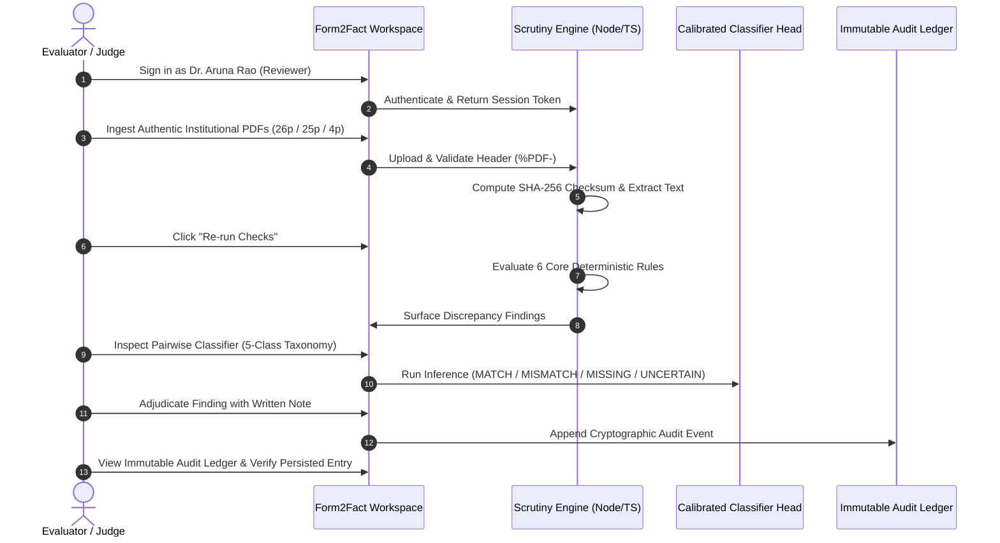

# FORM2FACT — JUDGE DEMONSTRATION WORKFLOW

**Competition:** BharatCode Build League 2026  
**Audience:** Technical Judges, Evaluators, and Domain Architects  
**Target Application:** Form2Fact Scrutiny Engine v2.0 (`http://localhost:3000`)  

---

## 1. DEMONSTRATION AT A GLANCE

This workflow guides evaluators through an end-to-end statutory document verification session using authentic multi-page PDFs, native text and OCR parsing, deterministic statutory rule checking, pairwise comparison across all 5 classes, multi-model AI reasoning, human adjudication, and tamper-evident audit ledger logging.



---

## 2. STEP-BY-STEP EVALUATION SCRIPT

### Step 1: Start the Platform
Run the development server from the repository root:
```bash
npm run dev
# Or start production mode:
npm run build && npm start
```
Navigate in your browser to: `http://localhost:3000`

### Step 2: Authenticate with Demonstration Account
- On the Login screen, click the quick-login persona: **"Dr. Aruna Rao (Western Directorate Reviewer)"**.
- Or manually input:
  - **Email:** `aruna.rao@scrutiny.edu.in`
  - **Password:** `Reviewer123!`
- Click **"Access Scrutiny Workspace"**.
- *Verification Target:* Executive Overview dashboard renders with active application metrics and pending triage queues.

### Step 3: Register Institutional Application Docket
1. In the left sidebar, click **"Applications"**.
2. Click **"New Application"** (top right).
3. Fill in the authentic institution details:
   - **Institution Legal Name:** `The Standard Fireworks Rajaratnam College for Women`
   - **Sponsoring Society / Trust:** `Standard Fireworks Industries Limited`
   - **Campus Address:** `Thiruthangal Road, Sivakasi`
   - **PIN Code:** `626123`
4. Click **"Create Application"**.
5. *Verification Target:* System creates a collision-resistant docket ID (`app-...`) and routes directly into the Application Detail View.

### Step 4: Attach Authentic PDF Dockets
In the Application Detail View under **Section 03 · Attached PDF Dockets**:
1. Click **"Upload PDF"**.
2. Select [`dockets/authentic_test/SFR_College_Fire_Safety_Certificate.pdf`](file:///d:/projects/form2fact/dockets/authentic_test/SFR_College_Fire_Safety_Certificate.pdf) (26 pages, 1.21 MB).
3. *Verification Target:*
   - Magic-byte verification confirms `%PDF-1.4`.
   - Engine parses all 26 pages via PyMuPDF.
   - Badge displays **`26 pages`** alongside the SHA-256 checksum badge.
4. *(Optional Multi-Docket Step)* Repeat for [`dockets/authentic_test/SA_College_Occupancy_Certificate.pdf`](file:///d:/projects/form2fact/dockets/authentic_test/SA_College_Occupancy_Certificate.pdf) (25 pages) and [`dockets/authentic_test/Good_Shepherd_AICTE_EoA.pdf`](file:///d:/projects/form2fact/dockets/authentic_test/Good_Shepherd_AICTE_EoA.pdf) (4 pages).

### Step 5: Execute Statutory Scrutiny Checks
1. In the header toolbar, click **"Re-run Checks"**.
2. The deterministic rules engine evaluates all mandatory statutory conditions:
   - `RULE-DOC-04` (Statutory Submission Incomplete): Missing registered Land Title Deed.
   - `RULE-NAME-02` (Trust Registration): Registered Trust Deed missing from inventory.
3. *Verification Target:* Findings populate immediately under **01 · Discrepancy Findings**.

### Step 6: Evidence Viewer & Source Document Verification
1. Click **"Evidence Viewer"** in the sidebar.
2. Select `SFR_College_Fire_Safety_Certificate.pdf`.
3. Use page navigation to inspect:
   - **Page 18:** Genuine Tamil Nadu Fire and Rescue Services Department License (`தீ உரிமம்` - License Order No. 7391/I/2024, Virudhunagar District).
   - **Page 17:** Building Structural Stability Certificate.
4. *Verification Target:* Exact extracted text matches the PDF document layer.

### Step 7: Five-Class Pairwise Classification Workbench
Navigate to **"Pairwise Verification"** in the sidebar to test the calibrated 5-class pairwise classifier:
1. Click **"Date Contradiction (MISMATCH)"** $\rightarrow$ Click **"Run Pairwise Classification"** $\rightarrow$ Evaluates to **`MISMATCH`** (100% confidence).
2. Click **"Area Deficit (MISMATCH)"** $\rightarrow$ Click **"Run Pairwise Classification"** $\rightarrow$ Evaluates to **`MISMATCH`** (7.50 acres declared vs 5.20 acres evidenced).
3. Click **"Trust Variant (MATCH)"** $\rightarrow$ Click **"Run Pairwise Classification"** $\rightarrow$ Evaluates to **`MATCH`** (recognizes legal suffix variant).
4. Click **"Degraded OCR (UNCERTAIN)"** $\rightarrow$ Click **"Run Pairwise Classification"** $\rightarrow$ Evaluates to **`UNCERTAIN`** (abstained; confidence $< 0.85$ threshold).
5. Click **"Omitted Evidence (MISSING)"** $\rightarrow$ Click **"Run Pairwise Classification"** $\rightarrow$ Evaluates to **`MISSING`**.

### Step 8: Multi-Model AI Orchestration & Multilingual Toggle
Navigate to **"Findings"** in the sidebar:
1. Examine the Multi-Model Selector toolbar:
   - **BharatCode Qwen 3.8 27B**
   - **DeepSeek v4.1 Flash**
   - **Adaption Model (Draft)**
2. Click **"DeepSeek v4.1 Flash"** $\rightarrow$ Button updates to `Explain with DeepSeek`.
3. Click **"Adaption Model (Draft)"** $\rightarrow$ Button updates to `Explain with Adaption`.
4. Click **"BharatCode Qwen 3.8 27B"** $\rightarrow$ Button updates to `Explain with Qwen`.
5. Toggle language button to **`தமிழ்`** $\rightarrow$ Verifies localized UI typography.
6. Click **`EN`** to revert to English.
7. Click **"Explain with Qwen"**:
   - Demonstrates the graceful degradation alert: `BharatCode API Key Valid (Subscription Plan Required)`.
   - Explains that external AI models provide advisory reasoning only and cannot override deterministic classifications.

### Step 9: Human Review Adjudication
1. On any open finding, click **"Record Decision"**.
2. Select action: **"Confirm Finding"**.
3. In the mandatory rationale box, enter:
   > *"Audited against authentic SFR College Fire Safety Certificate (Page 18, Order No. 7391/I/2024). Discrepancy confirmed."*
4. Click **"Save Decision"**.
5. *Verification Target:* Modal closes; finding status updates to `Confirmed`.

### Step 10: Inspect the Immutable Audit Ledger
1. In the sidebar under Governance & Rules, click **"Audit Ledger"**.
2. Locate the top entry:
   - **Timestamp:** Exact current time.
   - **Action:** `Finding Confirm Finding`
   - **Actor:** `Dr. Aruna Rao`
   - **Reference:** Finding Reference ID.
   - **Details:** Verbatim review note entered in Step 9.
3. *Verification Target:* Full accountability and cryptographic audit durability.

