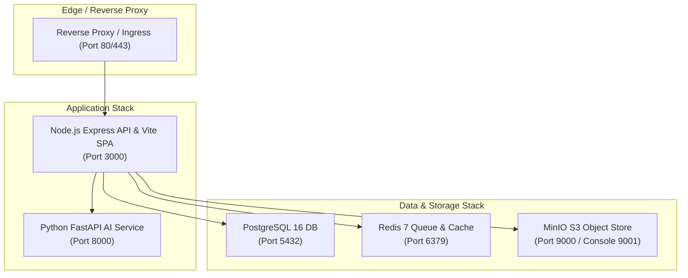

# Docker Architecture & Deployment Guide

## 1. Multi-Container Orchestration (`infrastructure/docker-compose.yml`)

Form2Fact's enterprise stack is defined in `infrastructure/docker-compose.yml`, orchestrating five microservices:



### 1.1 Service Catalog

1. **`api`:** Multi-stage Node.js 22 LTS container (`Dockerfile`) serving compiled Vite frontend assets and Express API endpoints.
2. **`ai_service`:** Python 3.11 container (`ai_service/Dockerfile`) running Uvicorn with FastAPI for pairwise mismatch inference and benchmark evaluations.
3. **`postgres`:** PostgreSQL 16 Alpine container with automatic schema initialization via `infrastructure/db/init.sql`.
4. **`redis`:** Redis 7 Alpine container for BullMQ job queue buffering.
5. **`minio`:** S3-compatible high-performance object storage for institutional document PDFs and OCR page images.

---

## 2. Quickstart Execution

### Step 1: Copy Environment Configuration
```bash
cp .env.example .env
```
Ensure production passwords and JWT secrets are supplied.

### Step 2: Build and Launch Containers
```bash
docker-compose -f infrastructure/docker-compose.yml up --build -d
```

### Step 3: Verify Container Health
```bash
docker-compose -f infrastructure/docker-compose.yml ps
```
All containers should display status `Up (healthy)`.

### Step 4: Verify Service Endpoints
- **Web Dashboard & API:** `http://localhost:3000`
- **AI Microservice Health:** `http://localhost:8000/api/v1/health`
- **MinIO S3 Console:** `http://localhost:9001` (Default credentials in `.env`)
- **PostgreSQL Connection:** `localhost:5432` (`form2fact` database)

---

## 3. Container Resource Allocation Recommendations

| Service | CPU Minimum | CPU Recommended | Memory Minimum | Memory Recommended |
|---|---|---|---|---|
| `api` (Node.js) | 1.0 Core | 2.0 Cores | 1 GB | 2 GB |
| `ai_service` (Python) | 2.0 Cores | 4.0 Cores (or 1x GPU) | 2 GB | 8 GB |
| `postgres` (PostgreSQL) | 1.0 Core | 2.0 Cores | 1 GB | 4 GB |
| `redis` (Redis) | 0.5 Core | 1.0 Core | 256 MB | 1 GB |
| `minio` (S3 Storage) | 0.5 Core | 1.0 Core | 512 MB | 2 GB |

