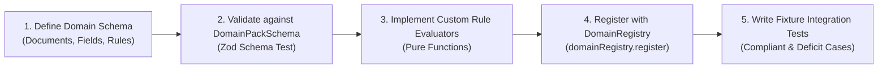

# Domain Pack Authoring Guide

## 1. Introduction

Form2Fact's domain abstraction allows institutions, government agencies, and auditors to configure verification for new regulatory regimes without altering the core codebase.

This guide details how to author, test, and register a new Domain Pack (e.g., NAAC institutional accreditation, NABH healthcare hospital audit, or corporate KYC verification).

## 2. Step-by-Step Authoring Workflow



### Step 1: Create Domain Directory
Under `server/domains/`, create a new folder for the domain:
```
server/domains/
  ├── aicte/                 # Existing AICTE reference pack
  └── naac/                  # New NAAC pack
       ├── index.ts          # DomainPack export
       ├── rules.ts          # Statutory compliance rules
       └── fixtures.ts       # Test cases
```

### Step 2: Define Document Definitions
Specify the mandatory and optional documents:
```typescript
import { DocumentDefinition } from '../types';

export const naacDocuments: DocumentDefinition[] = [
  {
    code: 'DOC-NAAC-SSR',
    name: 'Self Study Report (SSR)',
    category: 'Institutional Report',
    required: true,
    allowedMimeTypes: ['application/pdf'],
    retentionYears: 10,
  },
  {
    code: 'DOC-AUDIT-FIN',
    name: 'Audited Financial Statements (Last 3 Years)',
    category: 'Finance',
    required: true,
    allowedMimeTypes: ['application/pdf'],
    retentionYears: 8,
  }
];
```

### Step 3: Define Extracted Fields & Comparison Directed Graph
```typescript
import { FieldDefinition, ComparisonRelationship } from '../types';

export const naacFields: FieldDefinition[] = [
  {
    key: 'declared_faculty_count',
    label: 'Total Full-Time Faculty Count',
    dataType: 'number',
    normalization: 'integer_count',
  },
  {
    key: 'extracted_payroll_faculty_count',
    label: 'Verified Faculty Count on Payroll',
    dataType: 'number',
    normalization: 'integer_count',
  }
];

export const naacRelationships: ComparisonRelationship[] = [
  {
    claimFieldKey: 'declared_faculty_count',
    evidenceFieldKey: 'extracted_payroll_faculty_count',
    expectedRelationship: 'EQUAL',
    tolerance: 0,
    confidenceThreshold: 0.90,
  }
];
```

### Step 4: Define Regulatory Rules
Rules evaluate extracted data and produce objective findings:
```typescript
import { DomainRule } from '../types';

export const naacRules: DomainRule[] = [
  {
    ruleKey: 'RULE-NAAC-FAC-01',
    title: 'Full-Time Faculty Strength Concordance',
    description: 'Verified faculty on payroll must match or exceed declared faculty count in SSR.',
    category: 'Faculty Resources',
    severity: 'Material Discrepancy',
    evaluator: (claimValue, evidenceValue) => {
      const claim = Number(claimValue);
      const evidence = Number(evidenceValue);
      if (evidence < claim) {
        return {
          status: 'discrepancy',
          explanation: `Verified payroll accounts for ${evidence} faculty, reflecting a deficit of ${claim - evidence} faculty compared to claimed ${claim}.`,
        };
      }
      return { status: 'pass', explanation: 'Faculty count concordant with payroll.' };
    }
  }
];
```

### Step 5: Bundle and Register
Assemble into the `DomainPack` object and register:
```typescript
import { DomainPack } from '../types';
import { domainRegistry } from '../registry';

export const naacDomainPack: DomainPack = {
  id: 'naac',
  name: 'NAAC Higher Education Accreditation',
  version: '1.0.0',
  description: 'National Assessment and Accreditation Council Institutional Scrutiny',
  regulatoryAuthority: 'UGC / NAAC',
  documentDefinitions: naacDocuments,
  fieldDefinitions: naacFields,
  comparisonRelationships: naacRelationships,
  rules: naacRules,
};

// Register into runtime
domainRegistry.register(naacDomainPack);
```

### Step 6: Verify Registration
Execute test runner to verify registration:
```bash
npx tsx server/test-runner.ts
```
The test suite validates schema compliance and ensures all rule evaluators operate as pure, side-effect-free functions.

