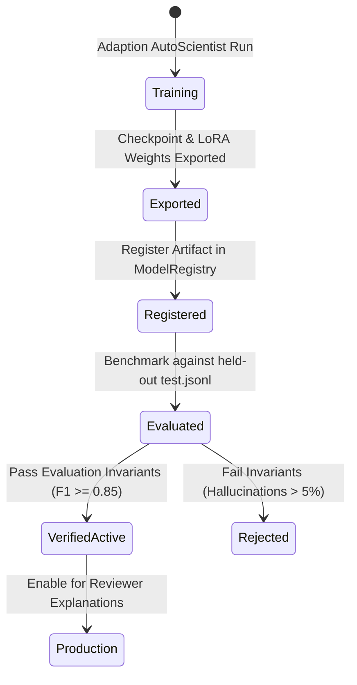

# Form2Fact — Adaption Model Onboarding Guide

**Platform:** Adaption Labs (`adaptionlabs.ai`) / AutoScientist  
**Target Architecture:** Fine-Tuned Domain SFT Checkpoint (`Llama-3.1-8B-Instruct`)  
**Status:** Architecture Ready on `main`; Independent Training in Progress on Adaption Platform  
**Adapter Module:** [`AdaptionProvider`](file:///d:/projects/form2fact/server/modules/ai/providers/adaptionProvider.ts)

---

## 1. Onboarding Principles & Invariants

1. **Independent Training Non-Interference:** AutoScientist jobs running on Adaption Labs must **never** be interrupted, modified, or canceled programmatically.
2. **Zero Premature Activation:** An unexported or unverified checkpoint cannot be activated in production. The provider adapter fails closed with status `'unavailable'` until verified.
3. **Task Scope Discipline:** The dataset prepared for Adaption (`train.jsonl`, $N = 375$) was structured for **evidence-grounded finding explanation**. The resulting fine-tuned model must be onboarded **exclusively for the explanation task**, never to replace the core pairwise classifier or rules engine.
4. **Independent Benchmark Isolation:** Model validation must be conducted on the held-out test split [`test.jsonl`](file:///d:/projects/form2fact/ai_service/ml/data/adaption/test.jsonl) ($N = 83$). This test set was never uploaded to Adaption and has had zero gradient or prompt exposure.

---

## 2. Onboarding Workflow & State Machine



### Registration States
- **`unregistered`:** No endpoint or artifact path is configured in the environment. `AdaptionProvider.isConfigured()` returns `false`.
- **`registered_pending_eval`:** Model endpoint or artifact path is configured, but `ADAPTION_MODEL_VERIFIED=true` has not been set. The provider reports diagnostic status that independent evaluation is required.
- **`verified_active`:** The checkpoint has passed offline benchmarking on `test.jsonl`. The provider is active and selectable in the UI.
- **`retired`:** Deprecated checkpoint replaced by a subsequent version.

---

## 3. Environment Configuration for Live Onboarding

When the AutoScientist training run completes and an inference endpoint (e.g. vLLM, TGI, or Adaption Inference Service) is deployed, configure the following in `.env`:

```bash
# Adaption Model Integration Configuration
ADAPTION_MODEL_ENDPOINT="https://inference.adaptionlabs.ai/v1/models/form2fact-sft-v1.0"
ADAPTION_API_KEY="adaption_sk_live_..."
ADAPTION_MODEL_VERSION="v1.0.0-lora-llama3.1-8b"
ADAPTION_BASE_MODEL="Llama-3.1-8B-Instruct"
ADAPTION_CHECKPOINT_HASH="sha256:4f8a..."
ADAPTION_RUN_ID="adaption-run-20261110-aicte"

# Verification Gate: Must only be set to 'true' after completing benchmark verification
ADAPTION_MODEL_VERIFIED="true"
```

---

## 4. Benchmark Verification Protocol (On `test.jsonl`)

Before setting `ADAPTION_MODEL_VERIFIED="true"`, execute the offline benchmark script against the held-out test split:

```bash
python scripts/ml/evaluate_adaption_checkpoint.py \
  --test-split ai_service/ml/data/adaption/test.jsonl \
  --endpoint "$ADAPTION_MODEL_ENDPOINT" \
  --output docs/ml/adaption/ADAPTION_MODEL_EVALUATION_REPORT.md
```

### Acceptance Thresholds
1. **Label Concordance:** $\ge 90\%$ concordance with authoritative test labels.
2. **Citation Hallucination Rate:** $\le 2\%$ (no invented document names or page numbers).
3. **JSON Schema Compliance:** $100\%$ valid schema emissions matching `ModelExplanationOutputSchema`.
4. **Abstention Integrity:** Ambiguous or OCR-degraded inputs must explicitly list uncertainties rather than asserting definitive conclusions.

---

## 5. Fallback & Safe Failure Handling

If an active Adaption endpoint becomes unreachable during runtime:
1. `AdaptionProvider` captures the error or timeout and reports a controlled status `'unavailable'`.
2. The user interface displays a clean alert: `Adaption API Ready (Inference Server Unreachable). Preserving deterministic finding.`
3. The authoritative Form2Fact finding remains unaffected.

