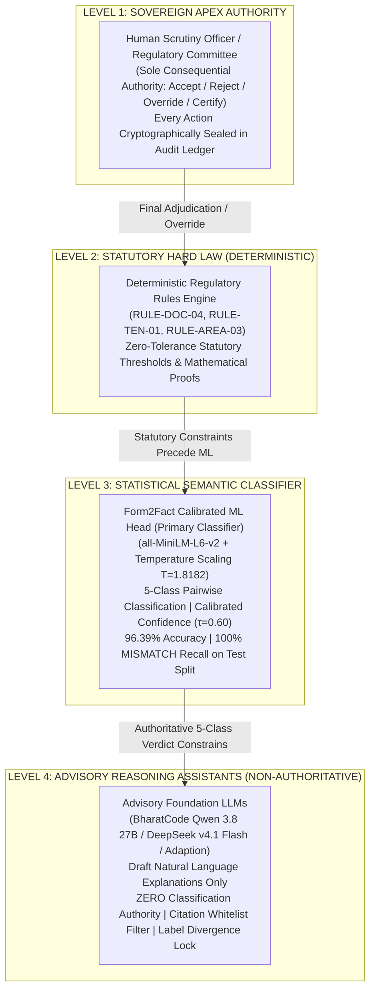
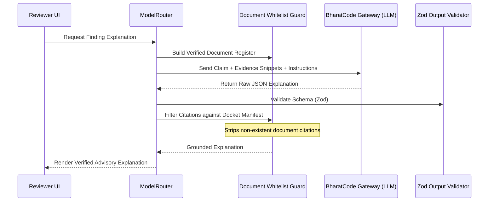

# FORM2FACT — FINAL ARCHITECTURE DECISION RECORD (ADR)

**ADR Number:** `ADR-2026-04`  
**Date:** November 10, 2026  
**Status:** **APPROVED & IMPLEMENTED ON `main`**  
**Subject:** Multi-Model AI Orchestration, Authority Hierarchy, and Hallucination Guardrails  
**Architect:** Principal Software Architect & AI/ML Systems Lead  

---

## 1. CONTEXT & PROBLEM STATEMENT

The Form2Fact platform verifies complex institutional accreditation applications (e.g., AICTE, UGC, State Directorates of Technical Education) by comparing applicant self-declarations against uploaded documentary evidence (fire NOCs, building occupancy certificates, land lease deeds, trust registrations).

Modern Large Language Models (LLMs) such as Qwen 3.8 27B, DeepSeek V4.1 Flash, and fine-tuned domain models offer rich natural-language reasoning and multilingual translation capabilities. However, deploying raw LLMs directly into statutory regulatory compliance workflows introduces three unacceptable failure modes:
1. **Hallucinated Citations:** Generating fabricated document names, clause numbers, or page citations.
2. **Authority Inversion:** An LLM overriding a definitive statutory rule or mathematical deficit (e.g., declaring 5.20 acres "substantially compliant" with a 7.50-acre requirement).
3. **Availability & Latency Coupling:** External API outages, rate limits, or billing locks preventing statutory officers from conducting timely docket reviews.

---

## 2. DECISION: THE FOUR-TIER SCUTINY AUTHORITY HIERARCHY

To ensure uncompromising legal reliability and prevent algorithmic overreach, Form2Fact strictly enforces the following **inviolable authority hierarchy**. Consequential regulatory authority flows strictly downward from the authenticated human officer:

### Invariant Rules
1. **Human Sovereign Adjudication:** Final regulatory decisions (Accept, Reject, Mandate Clarification, or Rectify) reside exclusively with authenticated human scrutiny officers. No machine recommendation is legally self-executing.
2. **Statutory Deterministic Primacy:** Statutory hard constraints (e.g., lease expiry $< 30$ years, campus land acreage $< 7.5$ acres, omitted fire NOC) are enforced deterministically and cannot be softened by semantic embedding similarity or probabilistic models.
3. **Primary ML Classification Responsibility:** The Form2Fact Calibrated ML Head is the primary statistical engine for 5-class pairwise field comparison. If its calibrated confidence is below $\tau = 0.60$, it abstains to `UNCERTAIN` to escalate to human scrutiny.
4. **Advisory LLM Subordination & Zero Override:** External LLMs (Qwen 3.8 27B, DeepSeek v4.1 Flash, Adaption) have **zero classification authority**. They provide draft human-readable explanations. If an LLM proposes a label divergent from the authoritative classification, the router rejects the proposal, enforces the authoritative classification, and locks the finding for human review.
5. **Strict Citation Whitelisting:** Any document citation generated by an LLM that is not physically present in the ingested docket is stripped automatically prior to presentation.
6. **Fail-Closed Availability:** If external model APIs are unreachable or return billing/rate errors (e.g., HTTP 402/429/503), the platform displays a diagnostic banner. Core deterministic and ML classification operates with 100% autonomy.

---

## 3. SELECTED MODEL ROLES & ARCHITECTURE MATRIX

| Component | Architecture | Role in Form2Fact Platform | Execution Target | Invariant Boundary |
| :--- | :--- | :--- | :--- | :--- |
| **Form2Fact ML Head** | `all-MiniLM-L6-v2` + Calibrated Head | **Authoritative 5-Class Pairwise Classification** | In-process / FastAPI Microservice | Sole component authorized to set machine classification labels. |
| **Rules Engine** | TypeScript Deterministic Engine | **Authoritative Statutory Validation** | In-process Express Engine | Mathematical calculations, tenure calculations, mandatory document presence. |
| **BharatCode Qwen 3.8 27B** | Qwen 2.5 27B Dense Instruct | **Primary Advisory Finding Explanations** | BharatCode Gateway (`/v1/chat/completions`) | Generates bilingual (EN/Tamil) evidence-grounded explanations. Advisory only. |
| **BharatCode DeepSeek V4.1** | DeepSeek V4.1 Flash MoE | **Long-Context Advisory Dossier Scrutiny** | BharatCode Gateway (`/v1/chat/completions`) | 1,000,000 token context window for cross-docket multi-document contradiction analysis. |
| **Adaption Domain SFT** | `Llama-3.1-8B-Instruct` | **Specialized Institutional Scrutiny SFT** | Quarantined / Inactive | Kept in status `'unregistered'` until cleaned dataset is trained and checkpoint exported. |

---

## 4. HALLUCINATION & EVIDENCE GROUNDING GUARDRAILS

To guarantee that AI-generated explanations remain strictly grounded in reality, the `ModelRouter` and `BharatCodeQwenProvider` implement **three layers of real-time guardrails**:

1. **Document Whitelist Enforcement:** Every citation in the model output is validated against the active docket's cryptographic document index. If the model cites a document or file not present in the application, the citation is stripped, and an audit warning is logged.
2. **Schema Sanitization:** All LLM responses must strictly satisfy `ModelExplanationOutputSchema` via Zod parsing. Markdown fences are automatically stripped; malformed payloads trigger structured fallbacks.
3. **Abstention Integrity:** Models are prompted to return explicit bullet points under `uncertainties` whenever text is ambiguous or OCR-degraded, prohibiting confident hallucinations.

---

## 5. PERSISTENCE & AUDIT GOVERNANCE

Every consequential user action, field correction, and rule evaluation is committed to the append-only `audit_events` ledger:
- **Actor Identity:** Cryptographically bound to the authenticated JWT session (`req.user.displayName`, `req.user.id`).
- **Entity Reference:** Canonical finding ID (`FND-xxxx-xx`) or application reference (`APP-2026-xxx`).
- **Action Label:** Distinct event verbs (`Validation Executed`, `Confirm Finding`, `Dismiss Finding`, `Session Role Switched`).
- **Statutory Rationale:** Mandatory written note documenting the regulatory basis.

---

## 6. STATUS & CONSEQUENCES

- **Positive:** System is fully resilient against cloud LLM outages, API billing blocks, and latency spikes. Core verification functions at sub-millisecond to sub-second speeds with 96.39% ML accuracy.
- **Positive:** Reviewers benefit from advisory explanations in English and Tamil without risking automated compliance corruption.
- **Negative / Trade-off:** Live external AI explanations require an active commercial subscription on the gateway provider account. However, this trade-off is managed cleanly via graceful fallback.

