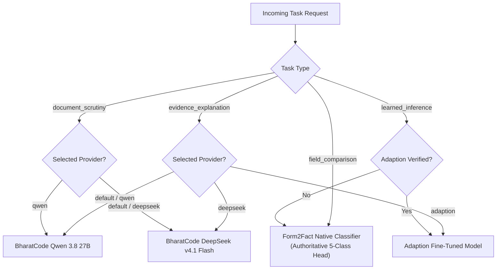

# Form2Fact — Multi-Model AI Architecture Specification

**Architecture Specification:** Version 2.0  
**Target Systems:** BharatCode Build League 2026 & Institutional Pilot Deployment  
**Status:** Implemented & Verified on `main`  
**Module Root:** [`server/modules/ai/providers/`](file:///d:/projects/form2fact/server/modules/ai/providers/)

---

## 1. Architectural Principles & Boundaries

Form2Fact enforces a strict architectural boundary between **Authoritative Verification** and **AI Reasoning Assistance**:

```
+-----------------------------------------------------------------------------------+
|                           FORM2FACT VERIFICATION BOUNDARY                         |
+-----------------------------------------------------------------------------------+
|                                                                                   |
|  [Tier 1: Deterministic Rules Engine]   ──> Statutory AICTE Norms                 |
|  [Tier 2: Calibrated Pairwise ML Head] ──> Temperature-Scaled 5-Class Prediction  |
|  [Tier 3: Authorized Human Reviewer]   ──> Legal Adjudication & Signing           |
|                                                                                   |
|  AUTHORITY STATUS: ABSOLUTE. Overrules any external LLM outputs.                  |
+-----------------------------------------------------------------------------------+
                                        │
                                        ▼ (Context & Finding Handed Off)
+-----------------------------------------------------------------------------------+
|                        MULTI-MODEL AI ORCHESTRATION LAYER                         |
+-----------------------------------------------------------------------------------+
|                                                                                   |
|  [ModelRouter] ── Task-based Routing & Invariant Guards                           |
|       │                                                                           |
|       ├──> BharatCode Qwen 3.8 27B     (Evidence Explanation & Reasoning)         |
|       ├──> BharatCode DeepSeek v4.1     (Long-Context Complex Document Scrutiny)   |
|       └──> Adaption Fine-Tuned Model    (Statutory SFT Domain Specialist)         |
|                                                                                   |
|  AUTHORITY STATUS: ADVISORY ONLY. Grounding guards reject hallucinated citations  |
|  and strip unauthorized label changes.                                            |
+-----------------------------------------------------------------------------------+
```

### Core Invariants
1. **Never Replace Verification:** External LLMs must **never** make compliance, approval, or rejection decisions.
2. **Never Overwrite Labels:** If an LLM suggests a label that contradicts the classifier, the router automatically forces the classifier's label and marks `requires_human_review = true`.
3. **Never Invent Evidence:** Evidence citations returned by an LLM are checked against actual input document names and pages; unverified citations are removed.
4. **Task-Specific Dispatch:** Requests are dispatched to the single designated provider for that task. Models are never called indiscriminately in parallel.
5. **No Blind Ensembling:** Automatic voting between models is prohibited unless validated by empirical calibration benchmarks.

---

## 2. Component Taxonomy & Responsibilities

| Component | Class / Interface | Responsibility | Authoritative? |
| :--- | :--- | :--- | :---: |
| **Model Types** | [`modelTypes.ts`](file:///d:/projects/form2fact/server/modules/ai/providers/modelTypes.ts) | Canonical schemas, task types, error hierarchies, and provider contracts | N/A |
| **Model Registry** | [`ModelRegistry`](file:///d:/projects/form2fact/server/modules/ai/providers/modelRegistry.ts) | Singleton registry managing provider registration, discovery, and health checks | N/A |
| **Model Router** | [`ModelRouter`](file:///d:/projects/form2fact/server/modules/ai/providers/modelRouter.ts) | Task-based dispatcher enforcing timeout, retries, and grounding invariant guards | N/A |
| **Form2Fact Classifier** | [`Form2FactClassifierProvider`](file:///d:/projects/form2fact/server/modules/ai/providers/form2factClassifierProvider.ts) | 5-class pairwise field comparison head with temperature scaling ($T=1.8182$) | **YES** |
| **BharatCode Qwen** | [`BharatCodeQwenProvider`](file:///d:/projects/form2fact/server/modules/ai/providers/bharatCodeQwenProvider.ts) | Structured JSON reasoning, finding summaries, and evidence-grounded rationales | NO |
| **BharatCode DeepSeek** | [`BharatCodeDeepSeekProvider`](file:///d:/projects/form2fact/server/modules/ai/providers/bharatCodeDeepSeekProvider.ts) | Ultra-fast long-context scrutiny, multi-parcel reconciliation, and detailed evidence analysis | NO |
| **Adaption Model** | [`AdaptionProvider`](file:///d:/projects/form2fact/server/modules/ai/providers/adaptionProvider.ts) | Dedicated adapter for independently trained AutoScientist checkpoints | NO |

---

## 3. Task-Based Routing Policy

The `ModelRouter` inspects the incoming request task and dispatches according to the following policy:



### Routing Rules Table
1. **`field_comparison`:**
   - **Provider:** `form2fact-classifier` exclusively.
   - **Constraint:** Strictly isolated from external LLM APIs.
2. **`evidence_explanation`:**
   - **Default Provider:** `bharatcode-qwen` (Qwen 3.8 27B).
   - **Alternate Provider:** `bharatcode-deepseek` (DeepSeek v4.1 Flash) or `adaption-form2fact` (when verified).
   - **Controlled Fallback:** If requested provider is missing credentials, the router returns clean status `'unavailable'`, preserving the deterministic finding.
3. **`document_scrutiny`:**
   - **Default Provider:** `bharatcode-deepseek` (DeepSeek v4.1 Flash for long context).
   - **Alternate Provider:** `bharatcode-qwen` (Qwen 3.8 27B) or local deterministic synthesis.
4. **`learned_inference`:**
   - **Provider:** `adaption-form2fact` (when model verification status is `verified_active`).
   - **Fallback:** Native Form2Fact classifier if Adaption checkpoint is unverified or unregistered.

---

## 4. Grounding Safeguards & Invariant Guards

### 4.1 Citation Hallucination Guard
When an LLM returns an array of `evidence_references`, the adapter cross-references each citation against the list of actual documents and page numbers passed in the input:
```typescript
const verifiedCitations = explanation.evidence_references.filter((ref) => {
  if (validEvidenceSources.length === 0) return false;
  return validEvidenceSources.some(
    (src) => src.documentName.toLowerCase().includes(ref.documentName.toLowerCase()) ||
             ref.documentName.toLowerCase().includes(src.documentName.toLowerCase())
  );
});

if (explanation.evidence_references.length > verifiedCitations.length) {
  groundingAlerts.push(`${removedCount} unverified document citations were removed to prevent hallucination.`);
  explanation.evidence_references = verifiedCitations;
}
```

### 4.2 Classifier Overwrite Protection
If the LLM returns a `classification_context` differing from the authoritative classifier label:
1. The LLM's proposed label is discarded.
2. The authoritative label is forced onto the output.
3. `requires_human_review` is forced to `true`.
4. A warning is added to `groundingAlerts`: `Model proposed label 'MATCH', but authoritative Form2Fact classifier strictly maintained 'MISMATCH'.`

### 4.3 PII Redaction & Data Minimization
All text excerpts are scrubbed of sensitive identifiers before transmission:
- Aadhaar numbers (`\b\d{4}\s?\d{4}\s?\d{4}\b`) $\to$ `[REDACTED_AADHAAR]`
- Permanent Account Numbers (`\b[A-Z]{5}[0-9]{4}[A-Z]{1}\b`) $\to$ `[REDACTED_PAN]`
- Indian phone numbers (`(?:\+91[\-\s]?)?[6-9]\d{9}`) $\to$ `[REDACTED_PHONE]`
- Email addresses $\to$ `[REDACTED_EMAIL]`
- Bank account numbers (9–18 digits) $\to$ `[REDACTED_BANK_ACCOUNT]`
- Long source excerpts are truncated to a maximum of 400 characters.

---

## 5. API Endpoints Reference

### `GET /api/v1/ai/providers`
Returns an inventory of all registered AI model providers, their capabilities, and live health status.

### `GET /api/v1/ai/providers/:id/health`
Executes an on-demand health check against the specified provider ID.

### `POST /api/v1/findings/:id/explain`
Generates an evidence-grounded finding explanation. Accepts optional body parameter `{ "providerId": "bharatcode-qwen" | "bharatcode-deepseek" | "adaption-form2fact", "preferredLanguage": "en" | "ta" }`.

### `POST /api/v1/ai/explain`
Arbitrary pairwise field explanation endpoint taking structured claim and evidence objects.

