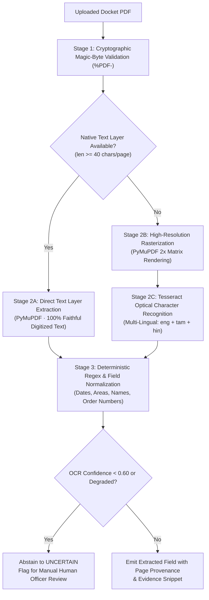

# Form2Fact — OCR and Document Intelligence Architecture

**Document Intelligence Engine:** PyMuPDF + Tesseract OCR Engine  
**Languages Supported:** English (`eng`), Tamil (`tam`), Hindi (`hin`)  
**Pipeline Location:** [`ai_service/app/ocr.py`](file:///d:/projects/form2fact/ai_service/app/ocr.py) & [`server/extraction.ts`](file:///d:/projects/form2fact/server/extraction.ts)

---

## 1. Document Extraction Pipeline Overview

Form2Fact employs a dual-stage extraction pipeline designed for institutional compliance dockets:



---

## 2. Low-Confidence & Degradation Invariant Policy

> [!IMPORTANT]
> **Regulatory Integrity Invariant:**
> Low OCR confidence or text degradation **must NEVER trigger an automatic MISMATCH**.
> Degraded text or illegible scans indicate that evidence cannot be extracted reliably by automated routines; therefore, the engine must abstain to **`UNCERTAIN`** and mandate physical human review.

### Operational Guardrails
1. **Scanned PDF Sentinel:** If a document page has fewer than 40 characters and OCR yields confidence $< 60\%$, the document is flagged `isScannedOrTextPoor = true`.
2. **Abstention Routing:** Pairwise comparisons involving degraded or missing text trigger the abstention policy (`ai_service/ml/preprocessing/pipeline.py`), returning `UNCERTAIN` with `requires_human_review = true`.
3. **Evidence Snippet Binding:** Every extracted field record retains the exact source snippet, character offset, and page number for audit traceability.

---

## 3. Multi-Lingual Document Processing (English & Tamil)

Institutional land deeds, revenue records, and encumbrance certificates in states like Tamil Nadu routinely contain Tamil or mixed English-Tamil scripts.

### Language Resolution Mechanism
In [`ai_service/app/ocr.py`](file:///d:/projects/form2fact/ai_service/app/ocr.py), the `get_ocr_lang()` utility dynamically negotiates available languages:
```python
def get_ocr_lang() -> str:
    preferred = os.environ.get("FORM2FACT_OCR_LANG", "eng+tam")
    try:
        available = pytesseract.get_languages()
        parts = [p.strip() for p in preferred.split("+")]
        valid = [p for p in parts if p in available]
        if valid:
            return "+".join(valid)
        if "eng" in available:
            return "eng"
    except Exception:
        pass
    return "eng"
```

### Container Packaging
In [`ai_service/Dockerfile`](file:///d:/projects/form2fact/ai_service/Dockerfile), Tesseract language packs are installed at container build time:
```dockerfile
RUN apt-get update && apt-get install -y --no-install-recommends \
    tesseract-ocr \
    tesseract-ocr-tam \
    tesseract-ocr-hin \
    && rm -rf /var/lib/apt/lists/*
```

---

## 4. Evaluation of OCR Engines (PaddleOCR vs Tesseract)

| Dimension | Tesseract OCR (Current Implementation) | PaddleOCR (Evaluated Alternative) |
| :--- | :--- | :--- |
| **Footprint** | Lightweight C++ library (~50 MB installed) | Heavy deep learning dependencies (PaddlePaddle, Python, ~1.2 GB) |
| **CPU Latency** | ~200–400 ms per 2x rasterized page | ~1.5–3.5 s per page on CPU |
| **Tamil Language Support** | Native `tam.traineddata` available in Debian/Ubuntu | PP-OCRv3/v4 has limited Tamil script support compared to Devanagari/English |
| **Deployment Simplicity** | Packaged via standard `apt-get` | Requires custom CUDA/C++ builds for production scaling |
| **Confidence Scoring** | Per-word confidence scores via `image_to_data` | Box-level probability output |
| **Audit Recommendation** | **Retain Tesseract** for primary lightweight extraction with PyMuPDF native text-layer bypass. | Suitable for future dedicated GPU microservice if complex tabular OCR is needed. |

---

## 5. Field Extraction & Normalization Contracts

Extracted fields are standardized across 4 statutory domains:
1. **Dates:** Normalized to standard ISO-8601 (`YYYY-MM-DD`) via [`normalizeDate()`](file:///d:/projects/form2fact/server/rulesEngine.ts). Supports slash, hyphen, and natural English formats (e.g., "31 March 2054").
2. **Land Extent:** Normalized to decimal acres (converting hectares and square meters using statutory conversion factors).
3. **Legal Entity Names:** Normalized by stripping legal suffixes ("Pvt Ltd", "Educational Trust", "Society") and case/punctuation variance.
4. **Approval Numbers:** Exact alphanumeric string preservation with whitespace trimming.

