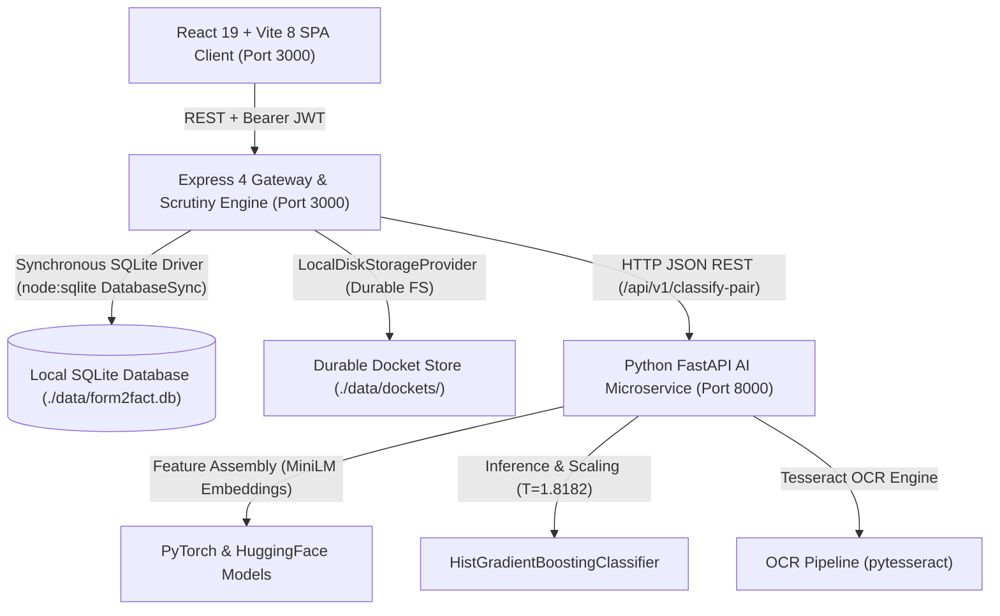

# FORM2FACT — ARCHITECTURE INTEGRITY REPORT

**Audit Date:** 2026-11-06  
**Auditor:** Principal Software Architect & DevOps Lead  
**Repository:** [https://github.com/shinchxn/form2fact.git](https://github.com/shinchxn/form2fact.git)  
**Evaluated Branch:** `audit/post-release-verification` (commit `435b1c2`)  
**Scope:** Core system topology, microservice decoupling, domain extensibility, persistence adapters, and execution flows.

---

## 1. System Topology & Component Decoupling

Form2Fact is engineered as an evidence-first institutional document intelligence platform. The runtime decouples user-facing orchestration and regulatory scrutiny from computationally intensive neural pairwise inference:



### Component Breakdown
1. **Frontend Client (`src/`):** React 19 single-page application built with Vite 8.3 and Tailwind CSS 4.3. Communicates via authenticated REST endpoints (`src/services/api.ts`).
2. **Scrutiny Engine Gateway (`server/`):** Node.js 24 runtime executing Express. Hosts authentication, tenant enforcement, statutory rule engine, pairwise dispatch, document processing, and audit ledger persistence.
3. **AI Microservice (`ai_service/`):** Python 3.12 FastAPI service (`ai_service/app/main.py`). Hosts semantic embedding extraction, numerical feature synthesis, calibrated tabular gradient boosting inference, and OCR extraction.
4. **Durable Persistence Layer:** Local synchronous SQLite via Node 24 native `node:sqlite` module and hierarchical docket filesystem storage.

---

## 2. Pluggable Domain Pack Architecture

To maintain domain independence, Form2Fact isolates regulatory authority logic into discrete pluggable domain packs (`server/domains/types.ts`):

```typescript
export interface DomainPack {
  id: string;
  name: string;
  version: string;
  category: string;
  description: string;
  documentTypes: DomainDocumentType[];
  fieldDefinitions: DomainFieldDefinition[];
  rules: Rule[];
}
```

### AICTE Reference Pack (`server/domains/aicte/index.ts`)
- **Domain Identity:** `aicte` (AICTE Institutional Approval & Compliance Scrutiny, v1.2.0).
- **Recognized Documents:** Registered Land Lease Deed, Land Ownership Title Deed, Building Safety Certificate, Fire Safety NOC, Society/Trust Registration Certificate, AICTE Prior Approval Order.
- **Rule Decoupling:** Rules specify statutory references (e.g., *Approval Process Handbook Ch. 1 Sec. 4.2*), category bindings, and explicit parameter thresholds (e.g., minimum 30-year lease duration).
- **Extensibility:** New regulatory domains (e.g., UGC, NBA, Medical Council) require only registering a corresponding `DomainPack` instance without altering core gateway or ML inference pipelines.

---

## 3. Storage Provider Architecture & Reality

Document ingestion and retrieval operate via the `IStorageProvider` contract defined in `server/core/storage/index.ts`:

```typescript
export interface IStorageProvider {
  save(applicationId: string, docId: string, buffer: Buffer, mimeType?: string): Promise<StorageMetadata>;
  getStream(storageKey: string): Promise<fs.ReadStream>;
  getBuffer(storageKey: string): Promise<Buffer>;
  delete(storageKey: string): Promise<boolean>;
  exists(storageKey: string): Promise<boolean>;
  getAbsolutePath(storageKey: string): string;
}
```

### Forensic Implementation Reality
- **`LocalDiskStorageProvider` (Active Implementation):** Persists dockets under `./data/dockets/${applicationId}/${docId}.pdf`. Implements directory containment checks to prevent path traversal attacks. Computes SHA-256 integrity checksums upon write.
- **S3 / MinIO Status:** The interface contract `IStorageProvider` is architected for cloud object storage, but **only `LocalDiskStorageProvider` is implemented** in the current codebase. No native S3/MinIO SDK is installed in `package.json`.

---

## 4. Job Queue & Processing Pipeline Reality

The codebase provides an asynchronous job queue abstraction in `server/core/jobs/index.ts` featuring `IJobQueue` and `InMemoryJobQueue` with job statuses (`queued`, `processing`, `completed`, `failed`), progress metrics, and retry policies.

### Operational Reality
- The `InMemoryJobQueue` infrastructure is fully implemented and tested.
- In current operational workflows, document extraction and pairwise inference are executed synchronously inside Express route handlers (`server/api.ts`) to provide immediate synchronous feedback to scrutiny officers during interactive review.
- The asynchronous queue is exposed via `GET /api/v1/jobs/:id` for deferred background recalculations.

---

## 5. Persistence Driver Architecture (SQLite vs. PostgreSQL Reality)

### Active Driver: Native Node 24 SQLite (`node:sqlite DatabaseSync`)
- Implemented in `server/db.ts` utilizing `DatabaseSync` from Node.js 24 standard library.
- Zero third-party binary C++ binding dependencies (`better-sqlite3` eliminated), guaranteeing cross-platform deterministic operation without compilation toolchains.
- Uses Write-Ahead Logging (WAL) and foreign key constraint enforcement (`PRAGMA foreign_keys = ON;`).
- Transactions are managed synchronously using native transaction blocks (`BEGIN IMMEDIATE ... COMMIT/ROLLBACK`).

### PostgreSQL Enterprise Profile Reality:
- PostgreSQL schemas and migration scripts are maintained under `infrastructure/db/init.sql`.
- In `docker-compose.yml`, the `enterprise` profile launches a PostgreSQL 16 container and initializes the schema.
- **Runtime Driver Audit:** The Node.js application **does not have a PostgreSQL client driver** (e.g., `pg`, `postgres`) installed in `package.json`, and `server/db.ts` does not contain connection logic for PostgreSQL. The application runtime exclusively uses SQLite. PostgreSQL serves currently as a schema migration target rather than an active dual driver.

---

## 6. Gateway-to-AI Microservice Protocol & Fallback Controls

The communication bridge between Express Gateway (`server/modules/verification/pairwiseEngine.ts`) and Python AI microservice (`ai_service/app/main.py`) operates via HTTP/1.1 REST:

1. **Endpoint:** `POST /api/v1/classify-pair` on port 8000.
2. **Feature Pipeline:**
   - 384-dimensional dense semantic vectors using `all-MiniLM-L6-v2`.
   - 160 structural tabular features synthesized into 1,544-element feature vector.
   - `HistGradientBoostingClassifier` executes multi-class classification.
   - Temperature scaling ($T = 1.8182$) calibrates posterior probabilities.
   - Confidence threshold evaluator enforces 0.60 cutoff: below 0.60, classification yields `UNCERTAIN`.
3. **Explicit Fallback & Strict Mode Controls:**
   - When the Python microservice is offline or returns HTTP 503:
     - In strict mode (`ALLOW_DETERMINISTIC_FALLBACK=false` or `REQUIRE_ML_INFERENCE=true`), the gateway returns `UNCERTAIN` with `modelStatus: 'unavailable'`, `fallbackApplied: false`, and `modelVersion: 'form2fact-ml-unavailable'`.
     - In permissive mode, the gateway falls back to deterministic token screening, but explicitly flags `inferenceSource: 'deterministic_fallback'`, `modelStatus: 'unavailable'`, `fallbackApplied: true`, and prefixes the explanation with `[FALLBACK: ML service offline]`.
   - Fast-path exact matches are tagged `inferenceSource: 'fast_path'` with `modelStatus: 'bypassed'`.
   - Successful ML predictions are tagged `inferenceSource: 'calibrated_ml'` with `modelStatus: 'available'`.

---

## 7. Zero Autonomous Decision Invariant

Form2Fact enforces an architectural invariant across all layers:
- The AI inference engine and deterministic rules engine **never** mutate application approval status to `Approved` or `Rejected`.
- All automated outputs are persisted as `findings` with initial state `Open`.
- Transitioning an institutional application status requires an explicit, authenticated, role-authorized human POST to `/api/v1/applications/:id/decision` by an authorized reviewer.
- Every decision captures reviewer identity, cryptographic timestamp, and statutory rationale in the append-only `application_decisions` and `audit_events` tables.

---

## 8. Summary Assessment

The architecture satisfies high cohesion and low coupling principles. Interface boundaries cleanly separate concerns, with explicit fallback tracking and strictly enforced human-in-the-loop decision boundaries.
