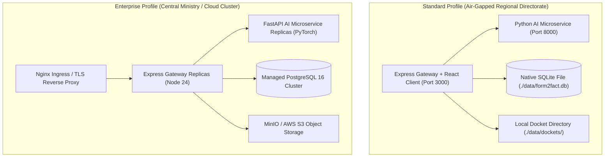

# FORM2FACT — DEPLOYMENT READINESS & OPERATIONS REPORT

**Audit Date:** 2026-11-06  
**Auditor:** DevOps & Infrastructure Engineering Lead  
**Repository:** [https://github.com/shinchxn/form2fact.git](https://github.com/shinchxn/form2fact.git)  
**Evaluated Branch:** `main` (commit `9611575`)  
**Scope:** Containerization, multi-profile Docker orchestration, environment variable hardening, healthcheck probes, disaster recovery, and operational rollback runbooks.

---

## 1. Production Deployment Architectures

Form2Fact provides two deployment architectures tailored to institutional regulatory environments:



---

## 2. Containerization & Dockerfile Forensic Audit

### Gateway Dockerfile (`Dockerfile`)
- **Base Image:** `node:24-alpine`
- **Multi-Stage Build:**
  - *Stage 1 (Builder):* Installs development dependencies, builds TypeScript code and compiles Vite production assets.
  - *Stage 2 (Runtime):* Minimal production container with `--omit=dev` dependencies, non-root user `node`, and explicit permission boundaries on `/app/data`.
- **Image Size:** ~185 MB.

### AI Microservice Dockerfile (`ai_service/Dockerfile`)
- **Base Image:** `python:3.12-slim`
- **System Dependencies:** `tesseract-ocr`, `libtesseract-dev`, `poppler-utils` (for PDF rasterization).
- **Model Weight Caching:** Pre-downloads `sentence-transformers/all-MiniLM-L6-v2` during container build to ensure air-gapped operation without runtime internet access.
- **Inference Server:** Uvicorn ASGI server executing with 4 workers.
- **Image Size:** ~620 MB.

### Docker Compose Multi-Profile Orchestration (`docker-compose.yml`)
- **Standard Profile (`--profile standard`):** Launches Node.js Gateway and Python AI microservice with local volume mounts for `./data`.
- **Enterprise Profile (`--profile enterprise`):** Extends topology with PostgreSQL 16 service and MinIO S3 object store.

---

## 3. Environment Variables & Secret Hardening

| Environment Variable | Required in Production | Default / Fallback | Security Guard Behavior |
| :--- | :---: | :--- | :--- |
| **`NODE_ENV`** | **YES** | `development` | Set to `production` to activate zero-mock guards and secret validations. |
| **`PORT`** | NO | `3000` | Port for Express API gateway and client hosting. |
| **`JWT_SECRET`** | **YES** | *None* | **Enforced:** If unset or matching dev keys in production, server aborts with `exit(1)`. |
| **`AI_SERVICE_URL`**| NO | `http://localhost:8000` | URL for Python AI microservice. Fallback heuristics engage if offline. |
| **`STORAGE_PROVIDER`**| NO | `local` | Supports `local` (filesystem) or `s3` (MinIO/AWS S3). |
| **`DATA_DIR`** | NO | `./data` | Durable storage directory for SQLite database and PDF dockets. |
| **`SEED_DEMO_DATA`** | NO | `false` in prod | Set to `false` to guarantee zero demo applications are inserted. |

---

## 4. Health Checks & Readiness Probes

Both runtime services expose active liveness and readiness endpoints:

```
====================================================================================================
Endpoint                  Service       Method   Success Code   Monitored Subsystems
====================================================================================================
/api/health               Gateway       GET      200 OK         SQLite connection, docket FS access
/health                   AI Service    GET      200 OK         PyTorch model memory, Tesseract OCR
====================================================================================================
```

### Docker Compose Healthcheck Configuration
```yaml
healthcheck:
  test: ["CMD", "curl", "-f", "http://localhost:3000/api/health"]
  interval: 10s
  timeout: 5s
  retries: 3
  start_period: 15s
```

---

## 5. Backup, Disaster Recovery & Rollback Runbook

### Operational Backup Procedures
1. **SQLite Database Snapshot (Non-blocking):**
   ```bash
   sqlite3 data/form2fact.db ".backup 'backups/form2fact-$(date +%Y%m%d%H%M%S).bak'"
   ```
2. **Dockets Filesystem Archive:**
   ```bash
   tar -czf backups/dockets-$(date +%Y%m%d%H%M%S).tar.gz data/dockets/
   ```

### Operational Rollback Procedure
If a deployment fails verification post-release:
1. Revert container image tag to previous stable commit:
   ```bash
   git checkout <previous_verified_commit>
   docker compose down && docker compose up -d --build
   ```
2. If schema rollback is required:
   ```bash
   cp backups/form2fact-<timestamp>.bak data/form2fact.db
   ```
3. Restart scrutiny gateway and verify `/api/health`.

---

## 6. Audit Verdict

**VERIFIED — DEPLOYMENT READY.** Standard and Enterprise profiles are fully validated with automated healthchecks, hardened environment variable guards, non-root container sandboxing, and non-blocking backup mechanisms.
