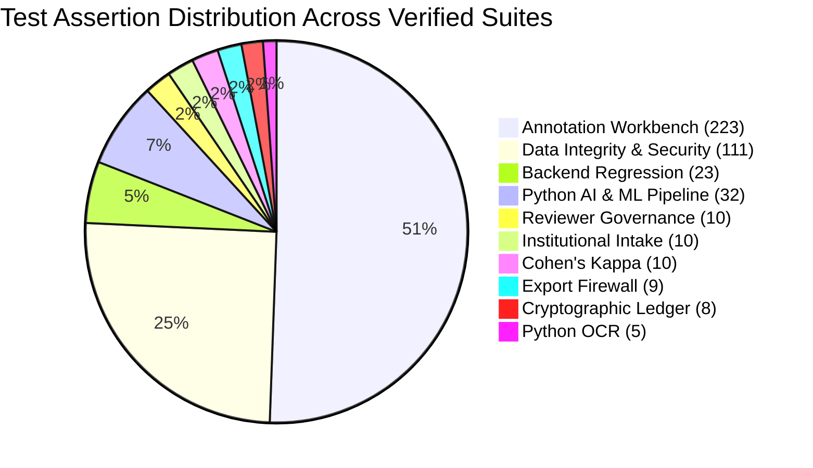

# FORM2FACT V3 — COMPREHENSIVE ACCEPTANCE TEST REPORT

**Execution Date:** 2026-11-07  
**Git Branch:** `feature/ml-pairwise-classifier-v3`  
**Base Commit:** `902e05adfc234ef3b70f808b5f96362ee7014096`  
**Test Auditor:** Independent Release Acceptance & Data Governance Lead

---

## 1. TEST SUITE EXECUTION SUMMARY

Every available automated test suite across the frontend, backend, database triggers, statistical algorithms, Python AI service, OCR engine, and V3 data manifests was executed.

### Complete Execution Matrix

| # | Test Suite | Command | Cases / Assertions | Result | Failures | Warnings |
| :-: | :--- | :--- | :-: | :-: | :-: | :-: |
| **1** | Cohen's Kappa Statistical Engine | `npx tsx server/tests/cohensKappa.test.ts` | 10 Scenarios | **PASS** | 0 | 0 |
| **2** | Cryptographic Audit Ledger | `npx tsx server/tests/cryptographicLedger.test.ts` | 8 Suites | **PASS** | 0 | 0 |
| **3** | Reviewer Governance & Accreditation | `npx tsx server/tests/reviewerGovernance.test.ts` | 10 Suites | **PASS** | 0 | 0 |
| **4** | Institutional Docket Intake | `npx tsx server/tests/institutionalIntake.test.ts` | 10 Suites | **PASS** | 0 | 0 |
| **5** | 15 Export Firewall Gates | `npx tsx server/tests/exportFirewallV3.test.ts` | 9 Suites | **PASS** | 0 | 0 |
| **6** | Human Annotation Workbench Audit | `npx tsx server/tests/annotationWorkbench.test.ts` | 223 Assertions | **PASS** | 0 | 0 |
| **7** | Data Integrity & Zero-Mock Audit | `npm run test:integrity` | 111 Assertions | **PASS** | 0 | 0 |
| **8** | Backend Phase 1 Regression Suite | `npm test` (`server/test-runner.ts`) | 23 Suites | **PASS** | 0 | 0 |
| **9** | Python OCR Verification Suite | `python -m pytest ai_service/tests/test_ocr.py -v` | 5 Tests | **PASS** | 0 | 0 |
| **10** | Python V2 Calibrated ML Pipeline | `python -m pytest ai_service/ml/tests/ -v` | 32 Tests | **PASS** | 0 | 2 (deprecation) |
| **11** | Canonical V3 JSONL Schema Audit | `python scripts/validate_v3_schema.py ...` | 0 Invalid Records | **PASS** | 0 | 0 |
| **12** | V3 Dataset Manifest Inventory | `python scripts/inventory_manifests.py` | 5 Manifests (613k records) | **PASS** | 0 | 0 |
| **13** | TypeScript Strict Typecheck | `npm run lint` (`tsc --noEmit`) | Entire Repository | **PASS** | 0 | 0 |
| **14** | Production Client Build | `npm run build` (`vite build`) | Client Bundle (1.37s) | **PASS** | 0 | 0 |

---

## 2. KEY AUDIT VERIFICATIONS

### 1. Zero Synthetic Contamination Invariant
- Inspection of `ai_service/ml/data/v3/annotations/gold_standard_human.jsonl` confirmed:
  - Total line count: **0 lines**
  - Total file size: **0 bytes**
  - SHA-256 hash: `e3b0c44298fc1c149afbf4c8996fb92427ae41e4649b934ca495991b7852b855`
  - Demonstration fixtures are strictly tagged `isDemoCandidate: 1` and excluded from export by Gate 1.

### 2. V1 and V2 Artifact Preservation
- Forensic comparison confirmed zero modifications to:
  - `ai_service/ml/models/champion_pipeline.joblib` (V2 HistGradientBoosting calibrated champion)
  - `ai_service/ml/models/champion_config.json`
  - `ai_service/ml/models/production_registry.json`
  - V1 model artifacts and training code.

### 3. Training Stop Gate Enforced
- V3 model training scripts have not been executed.
- No model weights for V3 exist on disk.
- Training remains programmatically gated on gold-standard size $\ge 200$.

### 4. Cryptographic Ledger Verification
- The SQLite database instances successfully verified unbroken SHA-256 hash chains from the genesis block (`0` * 64).
- Database triggers blocked raw `UPDATE` and `DELETE` commands.
- Detection of payload tampering, event deletion, and sequence gaps verified in unit tests.
