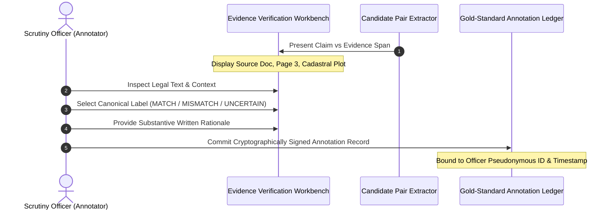

# FORM2FACT — V3 AICTE INSTITUTIONAL DATA COLLECTION & HUMAN ANNOTATION PLAN

**Document ID:** `PLAN-V3-AICTE-COLLECTION-01`  
**Date:** November 7, 2026  
**Auditor Roles:** Senior NLP Researcher, Dataset Acquisition Lead, Privacy Officer  
**Branch:** `feature/ml-pairwise-classifier-v3`  

---

## 1. STRATEGIC OBJECTIVE

Public NLP datasets (SNLI, MultiNLI, FEVER) provide general semantic entailment and contradiction patterns, but **cannot alone establish empirical accuracy in Indian regulatory scrutiny**. Real-world regulatory verification requires domain-specific understanding of:
- Cadastral survey plot notations (e.g., `Survey No. 44/2-A`, `Khasra 102/1`, `Gat No. 15`).
- Statutory lease tenure calculations under the AICTE Approval Process Handbook (e.g., unexpired duration $\ge 30$ continuous years).
- Trust registration deed linguistics (e.g., distinguishing between educational non-profit societies registered under Societies Registration Act 1860 vs commercial corporate entities under Companies Act 2013).
- Fractional land acreage conversions (e.g., hectares, square meters, gunthas, bighas to standard statutory acres).

This plan establishes a privacy-compliant, legally defensible protocol for acquiring authentic regulatory disclosures and executing rigorous human expert annotation.

---

## 2. LEGALLY COMPLIANT PUBLIC DATA SOURCES

Only publicly disclosed, non-confidential, gazetted documents and statutory portals are eligible for ingestion:

| Source Authority | Portal URL | Document Category | Regulatory Relevance | Permitted Use Conditions |
| :--- | :--- | :--- | :--- | :--- |
| **All India Council for Technical Education (AICTE)** | `https://www.aicte-india.org/` | Approval Process Handbooks (APH 2020-2026) | Baseline statutory rules, mandatory land norms, building ratios, fire safety norms. | Public regulatory guidance. Read-only policy extraction. |
| **AICTE Web Portal** | `https://www.aicte-india.org/bulletins/approved-institutions` | Extension of Approval (EoA) Letters & Public Deficiencies | Publicly published sanction letters confirming approved intake, approved land area, and compliance status. | Public institutional record. Requires redaction of officer signatures. |
| **All India Survey on Higher Education (AISHE)** | `https://dashboard.aishe.gov.in/hedirectory` | Higher Education Institutional Directory | Official institutional names, AISHE codes, affiliate universities, management category (Government/Private/Trust). | Open Government Data (OGD) Platform India. Factual reference. |
| **State Land Registry Portals** (IGR Maharashtra, Meebhoomi AP, Bhulekh UP) | Public Land Records Dashboards | Standard Cadastral Record Templates & Formats | Standardizes vernacular land title terminology (e.g., *7/12 Extract*, *Khatauni*, *Patta*). | Public inspection records. Strictly exclude private citizen title deeds. |
| **Mandatory Institutional Disclosures** | Public URLs on accredited university websites | Section 4 RTI & AICTE Mandatory Disclosures | Land area declarations, fire safety NOC certificates, building approval plans published voluntarily by institutions. | Publicly declared statutory evidence. |

---

## 3. CONFIDENTIALITY, PRIVACY & REDACTION SAFEGUARDS

> [!IMPORTANT] Non-Negotiable Privacy Mandate
> Form2Fact strictly prohibits the ingestion or retention of unredacted private citizen data or confidential legal indentures.

### Redaction Protocol Before Ingestion:
1. **Personally Identifiable Information (PII) Scrubbing:**
   - Signatory Aadhaar numbers, Permanent Account Numbers (PAN), private mobile telephone numbers, and personal residential addresses must be redacted with `[REDACTED_PII]`.
   - Only formal institutional officers (e.g., "The President, Kalyani Educational Foundation", "The Registrar") in their official statutory capacities are retained.
2. **Financial Confidentiality:**
   - Lease consideration amounts, bank account numbers, transaction fees, and monetary stamp duty figures must be replaced with `[REDACTED_FINANCIAL]`.
   - Only statutory parameters relevant to compliance (dates, survey plots, land acreage, tenure duration) are extracted.
3. **Cryptographic Docket Storage:**
   - Ingested PDF dockets are stored with SHA-256 integrity checksums in restricted access directories (`data/dockets/`) with path traversal guards.

---

## 4. INSTITUTIONAL DOCUMENT REPOSITORY STRUCTURE

Authentic regulatory documents collected under this initiative are categorized in the following canonical directory structure under `ai_service/ml/data/v3/raw/institutional/`:

```text
ai_service/ml/data/v3/raw/institutional/
├── regulatory_handbooks/       # AICTE Approval Process Handbooks & Gazette Notifications
├── approval_letters/           # Public Extension of Approval (EoA) Letters & Sanctions
├── deficiency_reports/         # Public AICTE Hearing Notices & Deficiency Memoranda
├── application_reports/        # Publicly disclosed institutional approval applications
├── land_documents/             # Redacted institutional registered lease deeds & title indentures
├── building_documents/         # Certified architect certificates & municipal approved building plans
├── infrastructure_documents/   # Occupancy certificates & barrier-free access audits
└── README.md                   # Access control log and provenance register
```

---

## 5. HUMAN ANNOTATION WORKFLOW SPECIFICATION

To ensure Form2Fact V3 does NOT depend on unverified synthetic data, an institutional annotation workflow is designed for accredited scrutiny officers and regulatory auditors.



### 5.1 Mandatory Annotation Record Schema
Each human-annotated pair must be committed to `ai_service/ml/data/v3/annotations/gold_standard_human.jsonl` matching this exact schema:

```json
{
  "annotation_id": "ann-2026-0001",
  "docket_id": "docket-aicte-wro-2026-0842",
  "institution_id": "inst-1-10492811",
  "field_name": "leaseExpiryDate",
  "field_type": "date",
  "claim": {
    "text": "31/03/2054",
    "context": "Declared lease tenure end date in institutional application form",
    "source_document_id": "doc-app-0842",
    "page": 2,
    "bbox": [120.5, 450.2, 280.0, 470.5]
  },
  "evidence": {
    "text": "31st day of March, Two Thousand Twenty-Eight (31-03-2028)",
    "context": "Clause 4 (Habendum) of Registered Lease Deed",
    "source_document_id": "doc-deed-0842",
    "page": 5,
    "bbox": [85.0, 610.0, 410.5, 635.0]
  },
  "annotation": {
    "label": "MISMATCH",
    "rationale": "Severe date contradiction: Application declares lease expiring in 2054 (30-year tenure), but registered deed explicitly terminates in 2028 (4 years remaining), violating AICTE Clause 4.1.",
    "annotator_id": "auditor-officer-wro-12",
    "adjudication_timestamp": "2026-11-07T08:30:00Z",
    "review_status": "audited"
  },
  "provenance": {
    "data_origin": "authentic_human_adjudication",
    "is_synthetic": false,
    "is_human_annotated": true
  }
}
```

### 5.2 Quality Control & Inter-Annotator Agreement (IAA)
1. **Double-Blind Review on 20% Sample:**
   - 20% of all claim/evidence pairs will be independently annotated by two scrutiny officers.
   - Inter-Annotator Agreement must satisfy Cohen's Kappa $\kappa \ge 0.85$.
2. **Adjudication of Discrepancies:**
   - Any pair where annotators diverge between `MATCH` and `MISMATCH` is automatically escalated to a Senior Regulatory Committee for consensus ruling.
3. **No Synthetic Conflation:**
   - Records annotated by human experts carry `is_human_annotated: true`, `is_synthetic: false`. Synthetic training expansions will strictly maintain `is_human_annotated: false`, `is_synthetic: true`.

---
*Plan certified by Senior NLP Researcher, Dataset Acquisition Lead & Privacy Officer.*
