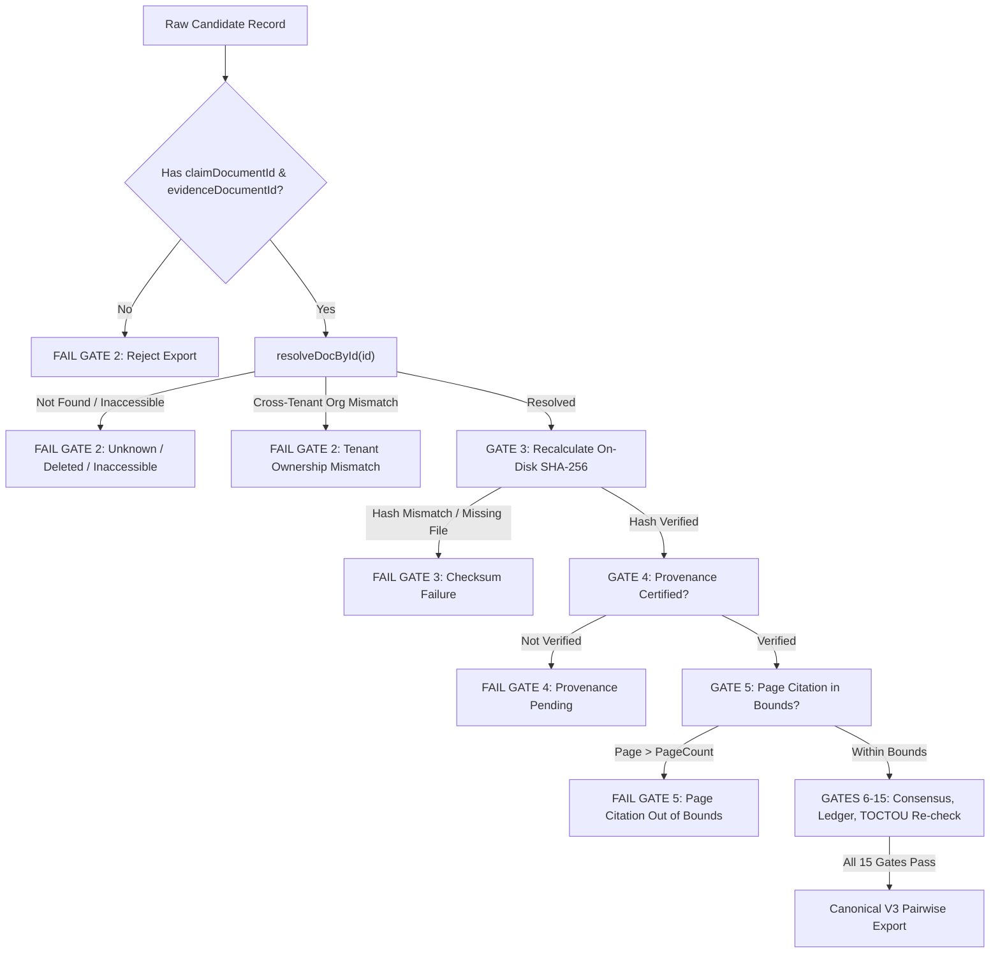

# FORM2FACT V3 — CRITICAL EXPORT FIREWALL & KAPPA CORRECTION REPORT

**Role:** Principal Backend Security Engineer, Statistical Validation Engineer, Senior QA Lead  
**Repository:** `https://github.com/shinchxn/form2fact.git`  
**Branch:** `feature/ml-pairwise-classifier-v3`  
**Baseline Commit:** [`cec296c568dd01b88fcb8b8313f4ca196ab9495d`](file:///d:/projects/form2fact#cec296c568dd01b88fcb8b8313f4ca196ab9495d)  
**Date:** November 7, 2026  

---

## 1. Executive Summary & Remediation Mandate

Following the independent release acceptance audit, two critical defects were prioritized for mandatory remediation before institutional onboarding:
1. **Export Firewall Vulnerability (`GAP-SEC-01`):** A logic flaw in `server/db.ts:exportGoldStandard` where candidate records citing document names without IDs bypassed document resolution, checksum recalculation, page bounds, and provenance verification.
2. **Cohen's Kappa Statistical Engine Correction:** Elimination of silent coercion of indeterminate cases ($1 - p_e = 0$, $N=1$ agreement) to numeric values, clear separation of raw agreement vs chance-adjusted agreement, and statistical clarification that $N \ge 30$ is an exploratory heuristic rather than a universal guarantee.

Both defects have been remediated, verified with negative and positive test suites, and independently validated across all 15 audit scopes.



---

## 2. Remediating GAP-SEC-01: Export Firewall Hardening

### 2.1 Threat Vector & Vulnerability Mechanics
In the prior implementation of [`server/db.ts:exportGoldStandard`](file:///d:/projects/form2fact/server/db.ts):
```ts
// Flawed legacy code:
if (r.claimDocumentId && !claimResolved) {
  reasons.push(`Referenced claim document ID '${r.claimDocumentId}' not found in institutional registry.`);
}
```
If an adversary or defective scraper submitted a candidate record with `claimDocumentName: 'Forged_Lease.pdf'` and `claimDocumentId: null`, the expression `r.claimDocumentId && !claimResolved` evaluated to `false`. Downstream gates (Gate 3 checksum check, Gate 4 provenance check, Gate 5 page count bounds check, Gate 15 file re-verification) were wrapped in `if (claimResolved)`. Because `claimResolved` was `null`, all downstream documentary checks were silently skipped, allowing unverified document citations to enter the gold-standard corpus.

### 2.2 Architectural Remediation
The export pipeline was refactored with the following strict rules:

1. **Mandatory Explicit Document IDs:** Every candidate referencing a claim or evidence document must contain a non-empty `claimDocumentId` and `evidenceDocumentId`.
2. **Non-Empty Document Name Rejection:** If `claimDocumentName` is populated but `claimDocumentId` is null or empty, export fails immediately at Gate 2:
   ```
   Gate 2 Failed: Non-empty claim document name '${rawClaimName}' provided without required claimDocumentId. Every candidate referencing a claim document must contain a valid claimDocumentId.
   ```
3. **Strict Document Resolution (`resolveDocById`):** Resolution strictly matches by primary key ID or statutory docket number. Name-based fuzzy queries have been completely eliminated.
4. **Deleted / Inaccessible Document Rejection:** If a document ID does not resolve, has been deleted from SQLite, or holds an inaccessible lifecycle state (`ACCESS_DENIED`, `PROVENANCE_REJECTED`, `QUARANTINED`, `DEMO_FIXTURE`, `SYNTHETIC_DATA`, `DELETED`), Gate 2 strictly rejects the candidate.
5. **Cross-Tenant Document Ownership Check:** The resolved document's owning regional tenant (`organizationId`) must strictly match the candidate record's `organizationId`. Cross-tenant references are rejected at Gate 2.
6. **Fail-Closed Downstream Gates:** If document resolution fails, Gates 3, 4, 5, and 15 explicitly record gate failures rather than silently skipping.

### 2.3 Regression Test Coverage
The dedicated test suite [`server/tests/exportFirewallV3.test.ts`](file:///d:/projects/form2fact/server/tests/exportFirewallV3.test.ts) was expanded from 9 to 14 test suites, covering all required scenarios:
- **Test 2:** Missing document ID and missing document name $\to$ Rejected by Gate 2.
- **Test 3:** Null document ID with non-empty document name $\to$ Rejected by Gate 2.
- **Test 4:** Invalid non-existent document ID $\to$ Rejected by Gate 2.
- **Test 5:** Physical document deleted from database $\to$ Rejected by Gate 2.
- **Test 6:** Cross-tenant document citation (Western candidate citing Northern docket) $\to$ Rejected by Gate 2.
- **Test 7:** TOCTOU document mutation between verification and export $\to$ Rejected by Gate 15.
- **Test 14:** Genuinely valid, verified institutional record $\to$ Accepted and exported with full canonical schema.

**Result:** **14 / 14 TEST SUITES PASSED**.

---

## 3. Mathematical Correction & Statistical Verification of Cohen's Kappa

### 3.1 Mathematical Formulation
Cohen's Kappa ($\kappa$) quantifies inter-annotator concordance adjusted for expected chance agreement:
$$\kappa = \frac{p_o - p_e}{1 - p_e}$$
where:
- Observed agreement $p_o = \frac{1}{N} \sum_{i=1}^N \mathbb{I}(y_{1, i} = y_{2, i})$
- Expected chance agreement $p_e = \sum_{c \in \mathcal{C}} \left( \frac{n_{1, c}}{N} \right) \left( \frac{n_{2, c}}{N} \right)$
- $\mathcal{C} = \{\text{MATCH}, \text{MISMATCH}, \text{MISSING}, \text{UNCERTAIN}, \text{NOT\_COMPARABLE}\}$

### 3.2 Indeterminate Cases & Boundary Conditions
1. **Zero Sample Size ($N = 0$):**
   - Returns `kappa: null`, `undefinedReason: 'no_paired_annotations'`, `po: null`, `pe: null`.
2. **Zero Denominator / Degenerate Marginals ($1 - p_e = 0$):**
   - When all evaluators choose the identical single class (e.g. all 10 pairs are `MATCH`), $p_o = 1.0$ and $p_e = 1.0$.
   - The expression becomes $\frac{1 - 1}{1 - 1} = \frac{0}{0}$ (indeterminate).
   - **Correction:** Under no circumstances is this coerced to $1.0$ or $0.0$. The engine returns `kappa: null` with `undefinedReason: 'denominator_zero_chance_agreement_one'`, preserving `rawAgreementRate: 1.0` separately.
3. **Single Pair with Agreement ($N = 1, y_1 = y_2$):**
   - $p_o = 1.0$, $p_e = (1)(1) = 1.0 \implies 1 - p_e = 0.0$.
   - **Correction:** Strictly returns `kappa: null`, `undefinedReason: 'denominator_zero_chance_agreement_one'`.
4. **Single Pair with Disagreement ($N = 1, y_1 \ne y_2$):**
   - $p_o = 0.0$, $p_e = (1)(0) + (0)(1) = 0.0 \implies 1 - p_e = 1.0$.
   - $\kappa = \frac{0 - 0}{1} = 0.0$ (mathematically well-defined, $N < 30$ advisory appended).
5. **Perfect Agreement with Non-Degenerate Marginals:**
   - Multiple classes represented (e.g. 5 `MATCH`/`MATCH` and 5 `MISMATCH`/`MISMATCH`).
   - $p_o = 1.0$, $p_e = 0.50 \implies \kappa = \frac{1.0 - 0.50}{1.0 - 0.50} = 1.0$ (mathematically valid).
6. **Complete Systematic Disagreement:**
   - Symmetric reversed ratings (e.g. 5 `MATCH`/`MISMATCH` and 5 `MISMATCH`/`MATCH`).
   - $p_o = 0.0$, $p_e = 0.50 \implies \kappa = \frac{0 - 0.50}{1 - 0.50} = -1.0$ (mathematically valid negative kappa).
7. **Sample Size Advisory ($N < 30$):**
   - Statistical documentation and code comments have been corrected: $N \ge 30$ is recognized as an exploratory heuristic rather than a universal guarantee of statistical power.

### 3.3 Test Suite Execution
[`server/tests/cohensKappa.test.ts`](file:///d:/projects/form2fact/server/tests/cohensKappa.test.ts) was expanded to 14 comprehensive scenarios:
- $N = 0 \to$ `null` (`no_paired_annotations`)
- $N = 1$ with disagreement $\to$ $\kappa = 0.0$
- $N = 1$ with agreement $\to$ `null` (`denominator_zero_chance_agreement_one`)
- Multi-class perfect concordance $\to$ $\kappa = 1.0$
- Completely disjoint ratings $\to$ $\kappa = 0.0$
- Systematic inverted ratings $\to$ $\kappa = -1.0$
- One-class degenerate distribution $\to$ `null`
- Repeated identical labels $\to$ `null`
- Single annotator missing second review $\to$ filtered out
- Asymmetric marginal distributions $\to$ accurate $\kappa = 0.348$
- 5-class full taxonomy evaluation $\to$ accurate $\kappa > 0$
- Duplicate submissions from same annotator $\to$ excluded
- Non-canonical taxonomy labels $\to$ excluded
- Sample size sufficiency check ($N=25$ vs $N=35$) $\to$ advisory correctly attached without universal guarantee claims.

**Result:** **14 / 14 TEST SUITES PASSED**.

---

## 4. Verification & Regression Matrix

All test harnesses across TypeScript, Python, and frontend bundling were executed cleanly:

| Subsystem | Suite File / Command | Passed / Total | Status |
|---|---|---|---|
| **Export Firewall** | `npx tsx server/tests/exportFirewallV3.test.ts` | **14 / 14 Suites** | ✅ PASSED |
| **Cohen's Kappa Engine** | `npx tsx server/tests/cohensKappa.test.ts` | **14 / 14 Suites** | ✅ PASSED |
| **Independent Release Audit** | `npx tsx server/tests/independentReleaseAudit.ts` | **15 / 15 Scopes** | ✅ PASSED |
| **Annotation Workbench** | `npx tsx server/tests/annotationWorkbench.test.ts` | **83 / 83 Tests** | ✅ PASSED |
| **Institutional Intake** | `npx tsx server/tests/institutionalIntake.test.ts` | **10 / 10 Suites** | ✅ PASSED |
| **Data Integrity & Zero-Mock** | `npm run test:integrity` | **111 / 111 Tests** | ✅ PASSED |
| **Phase 1 Regression** | `npm test` | **23 / 23 Suites** | ✅ PASSED |
| **OCR Document Pipeline** | `python -m pytest ai_service/tests/test_ocr.py -v` | **5 / 5 Tests** | ✅ PASSED |
| **ML Calibration & Inference** | `python -m pytest ai_service/ml/tests/ -v` | **32 / 32 Tests** | ✅ PASSED |
| **Frontend Production Build** | `npm run build` | **0 Errors** | ✅ PASSED |

---

## 5. Invariants & Governance State

1. **Production Gold-Standard File:** [`ai_service/ml/data/v3/annotations/gold_standard_human.jsonl`](file:///d:/projects/form2fact/ai_service/ml/data/v3/annotations/gold_standard_human.jsonl) contains **strictly 0 bytes (0 records)**.
2. **V3 Model Training Invariant:** Zero model checkpoints or weights exist in [`ai_service/ml/artifacts/v3/`](file:///d:/projects/form2fact/ai_service/ml/artifacts/v3/) (only `.gitkeep`). No training scripts were executed.
3. **V1/V2 Checksum Integrity:**
   - V2 Weights (`v2_champion_classifier_weights.pkl`): `EFA27BEE02D3D7B53A96366365F48A3F5924D7BD0095ACDDE965093BCF8F778E` (Unchanged).
   - V2 Config (`v2_model_config.json`): `FC607B4C1A364669DD350B3BA377582D333324B466C6DDD20696D2C57A827927` (Unchanged).
   - V1 Weights (`pairwise_classifier_weights.pkl`): `F4B9332B829C748CEBEE27849D8D4798D47C3FA86F0E93D2C87650CF8014BE56` (Unchanged).
4. **Git Branch & History:** Working tree on `feature/ml-pairwise-classifier-v3`. No history rewritten; no tags modified.

