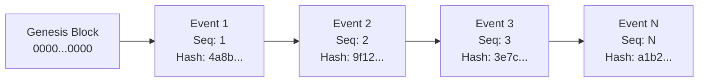

# FORM2FACT V3 — CRYPTOGRAPHIC AUDIT LEDGER SPECIFICATION

**Status:** IMPLEMENTED AND TESTED  
**Specification Version:** 1.0.0  
**Implementation Modules:** [`server/ledger/cryptographicLedger.ts`](file:///d:/projects/form2fact/server/ledger/cryptographicLedger.ts), [`server/db.ts`](file:///d:/projects/form2fact/server/db.ts)  
**Verification Suite:** [`server/tests/cryptographicLedger.test.ts`](file:///d:/projects/form2fact/server/tests/cryptographicLedger.test.ts) (8/8 Passed).

---

## 1. ARCHITECTURAL OVERVIEW

The Form2Fact Cryptographic Audit Ledger provides mathematical tamper-evidence for all lifecycle transitions, reviewer evaluations, administrative accreditations, and regulatory adjudications. Every event recorded in the system is cryptographically chained to its predecessor using SHA-256 digests.



---

## 2. BLOCK STRUCTURE & HASHING MATHEMATICS

Each ledger event contains:
1. `sequenceNumber`: Monotonically increasing positive integer ($1, 2, 3, \dots, N$).
2. `previousHash`: The `currentHash` of event $N-1$ (for $N=1$, `previousHash = "0" * 64`).
3. `payloadHash`: Deterministic SHA-256 hash of the event's business payload.
4. `currentHash`: SHA-256 hash over the entire canonical block header.

### Mathematical Formulations

#### 1. Payload Hash
The payload hash guarantees that the before/after state transitions and reviewer notes cannot be modified post-facto.
$$\text{payloadHash} = \text{SHA256}\Big(\text{CanonicalJSON}\big(\{\text{afterValue}, \text{beforeValue}, \text{entityReference}, \text{entityType}, \text{note}\}\big)\Big)$$
Keys are canonically sorted in ASCII order before serialization to ensure deterministic cross-platform parity.

#### 2. Event Block Hash
The block header binds the event's identity, timestamp, actor credentials, action, and payload hash to the previous block:
$$\text{blockHeader} = \text{seq} \parallel \text{prevHash} \parallel \text{id} \parallel \text{timestamp} \parallel \text{actorId} \parallel \text{actorRole} \parallel \text{orgId} \parallel \text{action} \parallel \text{payloadHash}$$
$$\text{currentHash} = \text{SHA256}(\text{blockHeader})$$

---

## 3. IMMUTABILITY ENFORCEMENT & APPLICATION DEFENSES

### SQLite Append-Only Database Triggers
To prevent application bugs or rogue SQL queries from modifying or deleting existing events, two database-level triggers are permanently installed in SQLite:

```sql
CREATE TRIGGER IF NOT EXISTS audit_events_no_update
BEFORE UPDATE ON audit_events
BEGIN
  SELECT RAISE(FAIL, 'Cryptographic Ledger Invariant: audit_events table is strictly append-only. Modifying existing events is prohibited.');
END;

CREATE TRIGGER IF NOT EXISTS audit_events_no_delete
BEFORE DELETE ON audit_events
BEGIN
  SELECT RAISE(FAIL, 'Cryptographic Ledger Invariant: audit_events table is strictly append-only. Deleting events is prohibited.');
END;
```

---

## 4. VERIFICATION ALGORITHM & TAMPER DETECTION

The verification engine ([`verifyLedgerChain()`](file:///d:/projects/form2fact/server/ledger/cryptographicLedger.ts)) processes the full ledger from genesis to the latest record and asserts:
1. **Genesis Linkage:** Event 1 has `previousHash === "0" * 64`.
2. **Sequence Continuity:** $\text{seq}_i = \text{seq}_{i-1} + 1$ (detects event deletion and insertion).
3. **Cryptographic Linkage:** $\text{previousHash}_i = \text{currentHash}_{i-1}$ (detects event deletion and reordering).
4. **Payload Integrity:** $\text{payloadHash}_i = \text{RecomputedPayloadHash}(\text{event}_i)$ (detects in-place payload alteration).
5. **Block Integrity:** $\text{currentHash}_i = \text{RecomputedEventHash}(\text{event}_i)$ (detects block tampering).

If any assertion fails, the ledger verification reports `isValid = false`, records the exact index and event ID of the rupture, and halts gold-standard exports.

---

## 5. SECURITY LIMITATIONS & FUTURE MITIGATIONS

> [!IMPORTANT]
> **Tamper-Evidence vs. Absolute Immutability**  
> A hash chain alone **does not** prevent a privileged database administrator with raw disk access from rewriting SQLite files and recomputing a replacement chain. It guarantees **tamper-evidence** (unauthorized changes break the chain unless completely recomputed), not absolute immutability.

### Planned Operational Controls:
1. **Periodic Signed Checkpoints:** External anchoring of the latest `currentHash` into a trusted, time-stamped public transparency log or WORM (Write Once Read Many) storage.
2. **Offsite Backup Replication:** Real-time append-only streaming to immutable S3 Object Lock storage.
3. **Hardware Security Module (HSM):** Digital signatures over exported manifest hashes using an AICTE-controlled PKI key.
