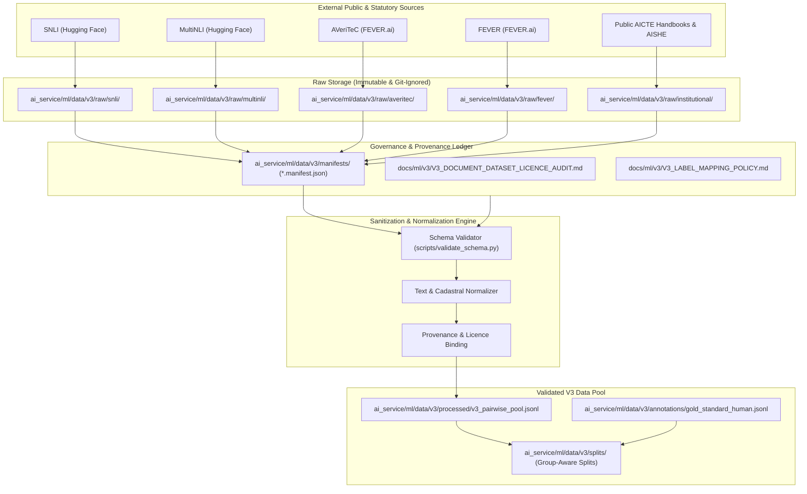

# FORM2FACT — V3 FORENSIC ML PIPELINE & COMPONENT AUDIT

**Audit Date:** November 7, 2026  
**Auditor Roles:** Senior ML Research Engineer, Dataset Acquisition Engineer, MLOps Engineer  
**Branch:** `feature/ml-pairwise-classifier-v3`  
**Base Commit:** `31f2873fc58f70a296aebbc86760dbdd868ca465`  
**Current HEAD:** `f1307510cc75c41e3979241bb18e9f80948d7b12`  

---

## 1. EXECUTIVE SUMMARY

Prior to acquiring datasets or authoring training pipelines for Form2Fact V3, a comprehensive forensic inspection of the existing V1 and V2 machine learning infrastructure was performed across `ai_service/ml/`, `docs/ml/`, and related server modules. 

The existing V2 system comprises a production-deployed hybrid pairwise classifier head (`HistGradientBoostingClassifier`, SHA-256: `efa27bee...`) with post-hoc temperature scaling ($T = 1.8182$, SHA-256: `9560d165...`) operating on $1,544$-dimensional input vectors ($1,536$ dense embeddings derived from `sentence-transformers/all-MiniLM-L6-v2` plus $8$ tabular alignment features).

This audit establishes:
1. Exact component reusability guidelines to avoid redundant reimplementation.
2. Strict isolation boundaries ensuring V1 and V2 production models and datasets remain immutable.
3. Architectural gaps and limitations in the V2 training data that V3 must resolve (primarily dependence on synthetic domain expansion and a small held-out test split of $N = 41$).
4. The blueprint for the V3 acquisition and governance architecture.

---

## 2. REPOSITORY ML INVENTORY & CURRENT STATE

### 2.1 Artifacts Directory (`ai_service/ml/artifacts/`)
| Path | Format / Size | Checksum (SHA-256) | Role / Status |
| :--- | :---: | :--- | :--- |
| `model_config.json` | JSON (430 B) | `1c622c68...` | V1 configuration baseline |
| `pairwise_classifier_weights.pkl` | Pickle (31.6 KB) | `f4b9332b...` | V1 LogisticRegression baseline |
| `pairwise_mlp_weights.pkl` | Pickle (2.47 MB) | `2776a0d9...` | V1 MLP baseline model |
| `v2/v2_champion_classifier_weights.pkl` | Pickle (3.18 MB) | `efa27bee02d3d7b53a96366365f48a3f5924d7bd0095acdde965093bcf8f778e` | **V2 Production Champion** (`HistGradientBoostingClassifier`) |
| `v2/v2_calibrated_classifier_weights.pkl` | Pickle (3.18 MB) | `9560d165b8c46078f1d6fcbaf6d09dc1fe5069078272129f6c808b27e786bdba` | **V2 Calibrated Wrapper** ($T = 1.8182$) |
| `v2/v2_model_config.json` | JSON (3.90 KB) | `fc607b4c1a364669dd350b3ba377582d333324b466c6ddd20696d2c57a827927` | V2 model hyperparameter & calibration metadata |
| `v3/.gitkeep` | Empty | — | **V3 New Registry Target** |

### 2.2 Existing Dataset Directories (`ai_service/ml/data/`)
- **`data/raw/`**: Contains `form2fact_pairwise_dataset.jsonl` (70 records, V1 synthetic seed).
- **`data/splits/`**: V1 splits (`train.jsonl` [49 records], `val.jsonl` [10 records], `test.jsonl` [11 records]).
- **`data/processed/`**: Normalized V1 pairwise dataset and `label_map.json`.
- **`data/v2_acquisition/`**:
  - `acquire_datasets.py`: Discovery script for public benchmarks (SNLI, MultiNLI, SROIE, FUNSD, CORD, DocVQA, XFUND).
  - `extract_snli.py`: Streamed 200 SNLI records mapped into V2 candidates.
  - `generate_v2_expansion.py`: Generated 1,250 synthetic domain expansion pairs across AICTE fields.
  - `build_v2_dataset.py`: Merged V1 seeds, SNLI candidates, and synthetic expansion into a 1,320-record pool (`form2fact_v2_candidate_pool.jsonl`).
  - `rigorous_split.py`: Group-stratified split generator producing `train_rigorous.jsonl` (319 records), `val_rigorous.jsonl` (162 records), and `test_rigorous.jsonl` (41 records).

### 2.3 Core Logic Modules
- **`ai_service/ml/models/feature_extractor.py`**: `PairwiseFeatureExtractor` computing 1,536-dimensional vectors:
  $$\mathbf{v}_{\text{dense}} = [\mathbf{u}, \mathbf{v}, |\mathbf{u} - \mathbf{v}|, \mathbf{u} \odot \mathbf{v}]$$
  where $\mathbf{u}, \mathbf{v} \in \mathbb{R}^{384}$ from `all-MiniLM-L6-v2`.
- **`ai_service/ml/inference/engine.py`**: Serving engine supporting dual score representation (`decision_function` with log-score fallback), post-hoc temperature scaling ($T = 1.8182$), and $0.60$ confidence abstention routing to `UNCERTAIN`.
- **`ai_service/ml/preprocessing/pipeline.py`**: Text normalization, ISO date conversion, numeric extraction, cadastral plot normalization.
- **`ai_service/ml/training/train_classifier.py`**: Trains baseline and boosted tree classifiers.
- **`ai_service/ml/evaluation/calibrate_model.py`**: Temperature optimization on validation negative log-likelihood.

---

## 3. COMPONENT REUSABILITY & IMMUTABILITY MATRIX

| Component | Repository Location | Action for V3 | Technical Justification |
| :--- | :--- | :---: | :--- |
| **V2 Model Artifacts** | `ai_service/ml/artifacts/v2/*` | **STRICTLY IMMUTABLE** | Serves live production inference in `server/api.ts` and Express gateway. Must never be overwritten. |
| **V1/V2 Datasets** | `ai_service/ml/data/splits/*`, `ai_service/ml/data/v2_acquisition/*` | **STRICTLY IMMUTABLE** | Preserved for benchmark provenance, historical auditability, and regression testing. |
| **5-Class Label Map** | `ai_service/ml/data/processed/label_map.json` | **REUSE AS CANONICAL** | Serving contracts and UI components strictly bind to `MATCH (0)`, `MISMATCH (1)`, `MISSING (2)`, `UNCERTAIN (3)`, `NOT_COMPARABLE (4)`. |
| **Dense Feature Backbone** | `ai_service/ml/models/feature_extractor.py` | **REUSE AS BASELINE** | SentenceTransformer (`all-MiniLM-L6-v2`) provides rapid, deterministic, lightweight CPU inference (~7 ms). |
| **Tabular Alignment Logic** | `ai_service/ml/inference/engine.py` | **REUSE & EXTEND** | 8 tabular features (Levenshtein, date diff, plot overlap) are domain-proven. V3 should add multi-page cadastral and deed duration features. |
| **Inference Engine Serving Contract** | `ai_service/ml/inference/engine.py` | **STRICTLY UNCHANGED** | Production API endpoint `/api/v1/verification/pairwise` must remain backwards-compatible during V3 R&D. |
| **V3 Dataset Acquisition** | `ai_service/ml/data/v3/*` | **INDEPENDENT IMPLEMENTATION** | V3 requires verified external download manifests, SHA-256 tracking, and real-world institutional collection. |
| **V3 Data Schema & Validation** | `ai_service/ml/data/v3/scripts/*` | **NEW IMPLEMENTATION** | Need explicit schema validation, rejection logging, and synthetic-vs-human metadata flags. |
| **V3 Split Generator** | `ai_service/ml/data/v3/scripts/` | **NEW IMPLEMENTATION** | Must support multi-document group leakage prevention and scalable sample pools ($N > 5,000$). |

---

## 4. EXISTING SCHEMA ANALYSIS & COMPATIBILITY

### V1 Schema (`form2fact_pairwise_dataset.jsonl`):
```json
{
  "pair_id": "f2f-001",
  "field_name": "leaseExpiryDate",
  "field_type": "date",
  "domain": "aicte",
  "claim": { "raw_value": "2054-03-31", "context": "...", "document_type": "...", "extraction_confidence": 0.99 },
  "evidence": { "raw_value": "2054-03-31", "context": "...", "document_type": "...", "extraction_confidence": 0.98 },
  "label": "MATCH",
  "data_origin": "synthetic",
  "annotation_status": "reviewed",
  "reviewer_rationale": "..."
}
```

### V2 Schema (`train_rigorous.jsonl`):
```json
{
  "pair_id": "v2-pair-01170",
  "domain": "aicte",
  "category": "Institution Identity & Sponsoring Body",
  "field_name": "trustName",
  "field_type": "entity_name",
  "claim": { "raw_value": "...", "context": "...", "document_type": "...", "extraction_confidence": 0.93 },
  "evidence": { "raw_value": "...", "context": "...", "document_type": "...", "extraction_confidence": 0.99 },
  "label": "MISMATCH",
  "reviewer_rationale": "...",
  "data_origin": "v2_synthetic_expansion",
  "annotation_status": "audited_and_reviewed"
}
```

### Incompatibilities and Gaps Identified:
1. **Lack of Page Provenance:** V1/V2 records do not include structured document page numbers or bounding coordinate metadata in `evidence`.
2. **Coarse Licensing & Source Provenance:** `data_origin` is a generic string (`v2_synthetic_expansion`, `snli_public_augmentation`) without source commit hash, licence URL, or cryptographic download manifest reference.
3. **Missing Synthetic-vs-Real Transparency:** No dedicated boolean flag (`is_synthetic: bool`) or quality review verification stage.
4. **V3 Canonical Schema Mandate:** V3 records must encapsulate formal provenance, explicit quality verification, and group identifiers (`institution_id`, `docket_id`, `source_document_id`).

---

## 5. RISKS OF MIXING V1, V2, AND V3 DATASETS

1. **Synthetic-to-Real Contamination:**
   V2 contains 1,250 rule-generated synthetic pairs. If merged without strict origin labeling into V3 evaluation splits, real empirical generalization cannot be verified.
2. **Data Leakage Across Splits:**
   In V2, slight text variations of the same institutional entities exist across synthetic records. A random or unconstrained split would cause memorization of entity names between train and test.
3. **Label Semantic Drift:**
   External NLP datasets (SNLI, MultiNLI) use 3-class entailment/neutral/contradiction. Directly treating `contradiction` as an institutional `MISMATCH` introduces domain errors (e.g., lexical negation in natural language vs statutory regulatory mismatch).
4. **Licence Contamination:**
   Certain research datasets (FUNSD, CORD, XFUND) carry non-commercial research licences (`CC BY-NC 4.0`). Mixing these records into production model training sets would contaminate commercial distribution rights.

---

## 6. RECOMMENDED V3 ACQUISITION & GOVERNANCE ARCHITECTURE



---
*Report certified by Senior ML Research Engineer, Dataset Acquisition Engineer & MLOps Auditor.*

