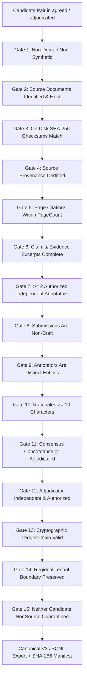

# FORM2FACT V3 — GOLD-STANDARD EXPORT FIREWALL POLICY

**Status:** IMPLEMENTED AND TESTED  
**Policy Version:** 3.0.0  
**Enforcement Engine:** [`exportGoldStandard()`](file:///d:/projects/form2fact/server/db.ts)  
**Verification Suite:** [`server/tests/exportFirewallV3.test.ts`](file:///d:/projects/form2fact/server/tests/exportFirewallV3.test.ts) (9/9 Passed).

---

## 1. PURPOSE

The Gold-Standard Export Firewall is a non-negotiable server-side validation gateway. It enforces 15 programmatic verification gates that every candidate annotation record must pass before it can be exported into the canonical Form2Fact V3 training corpus (`gold_standard_human.jsonl`).

No manual override, bypass flag, or administrative exemption is permitted.

---

## 2. THE 15 ACCEPTANCE FIREWALL GATES



### Detailed Gate Specifications

| Gate # | Name | Verification Condition | Rejection Outcome |
| :---: | :--- | :--- | :--- |
| **1** | Non-Demo Candidate | `isDemoCandidate === 0` and `sourceProvenance` does not contain 'demo', 'synthetic', or 'mock'. | Rejected as illustrative fixture. |
| **2** | Document Existence | Referenced `claimDocumentId` and `evidenceDocumentId` exist in registry (`institutional_dockets` or `documents`). | Rejected: Referenced document not found in registry. |
| **3** | Checksum Recalculation | Physical document file exists on disk and its SHA-256 recalculation strictly matches registered checksum. | Rejected: Document checksum verification failed. |
| **4** | Provenance Verification | Document `provenanceStatus === 'PROVENANCE_VERIFIED'`. | Rejected: Document source provenance is pending/unverified. |
| **5** | Page Boundary Check | Cited `claimPage` and `evidencePage` are positive integers $\le$ document verified `pageCount`. | Rejected: Cited page exceeds document page count. |
| **6** | Reference Completeness | Non-empty `claimFieldName`, `claimText`, and `evidenceText`. | Rejected: Evidence reference incomplete. |
| **7** | Authorized Annotators | At least 2 submissions; all annotator authorizations are active and not revoked. | Rejected: Insufficient independent review / revoked evaluator. |
| **8** | Non-Draft Submissions | Submissions have `isDraft === 0`. | Rejected: Draft annotations cannot be exported. |
| **9** | Distinct Annotator IDs | Submissions must originate from distinct evaluating user accounts. | Rejected: Duplicate annotator submissions. |
| **10** | Substantive Rationale | Both submissions have written rationale $\ge 10$ characters. | Rejected: Submission lacks substantive rationale. |
| **11** | Consensus or Adjudication | If agreed, labels must be identical. If disputed, status must be `adjudicated` with `finalLabel` set. | Rejected: Unresolved disputes cannot enter gold standard. |
| **12** | Adjudicator Independence | Adjudicator must be authorized and must not have submitted an evaluation on the same task. | Rejected: Adjudicator conflict of interest. |
| **13** | Cryptographic Ledger | Entire audit ledger SHA-256 hash chain verifies unbroken (`isValid === true`) and record audit count $> 0$. | Rejected: Cryptographic audit ledger verification failed. |
| **14** | Regional Tenant Isolation | Record and documents belong to the authorized regional directorate (`organizationId`). | Rejected: Cross-tenant regional violation. |
| **15** | Quarantine Exclusion | Neither the candidate record nor the source documents are in `QUARANTINED` status. | Rejected: Candidate or source document is quarantined. |

---

## 3. CANONICAL EXPORT SCHEMA (V3.0)

Every accepted record is serialized deterministically into `gold_standard_human.jsonl` matching the canonical Pydantic V3 schema:

```json
{
  "record_id": "gold-rec-001",
  "schema_version": "3.0",
  "group_id": "inst-pune-eng-01::dkt-001",
  "claim": {
    "text": "Campus Land Area: 10 Acres demarcated for educational institution.",
    "field_name": "land_area_acres",
    "source_document_id": "DKT-FW-CLAIM-001",
    "page": 3
  },
  "evidence": {
    "text": "Registered Lease Deed confirms 10 Acres demarcated for educational institution.",
    "source_document_id": "DKT-FW-EVID-001",
    "page": 2
  },
  "comparison": {
    "source_label": null,
    "label": "MATCH",
    "field_type": "numeric",
    "normalization_applied": ["regulatory_standardization"],
    "ocr_quality": "high"
  },
  "provenance": {
    "dataset": "form2fact_v3_aicte_human_gold",
    "source_url": "https://www.aicte-india.org/bulletins/approved-institutions",
    "licence": "Public Regulatory Inspection Disclosure",
    "annotation_status": "human_annotated"
  },
  "quality": {
    "is_synthetic": false,
    "is_human_annotated": true,
    "review_status": "audited"
  }
}
```

---

## 4. SHA-256 DATASET MANIFEST SPECIFICATION

Simultaneously with dataset export, an accompanying manifest is written to `ai_service/ml/data/v3/manifests/gold_standard_human.manifest.json` containing:
- Exact record count and rejection count.
- Relative file path and byte size.
- Exact SHA-256 checksum of the exported JSONL file.
- Quality invariants: `is_synthetic: false`, `is_human_annotated: true`, `fifteen_firewall_gates_enforced: true`, `ledger_hash_chain_verified: true`.
