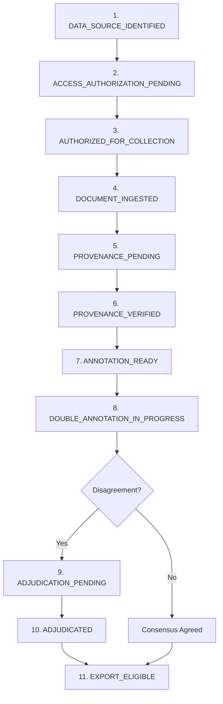

# FORM2FACT V3 — INSTITUTIONAL DATA COLLECTION OPERATIONAL GUIDE

**Status:** IMPLEMENTED AND OPERATIONAL (WORKBENCH READY)  
**Classification:** Standard Operating Procedure (SOP)  
**Intended Audience:** Data Collectors, Regional Scrutiny Officers, Reviewers, and Systems Administrators.

---

## 1. PURPOSE AND SCOPE

This guide specifies the statutory procedure for ingesting, certifying, annotating, and adjudicating genuine AICTE regulatory approval dossiers in Form2Fact V3. It establishes strict procedural safeguards ensuring that no unauthorized, fabricated, unverified, or confidential documents contaminate the V3 training corpus.

---

## 2. STATUTORY INTAKE LIFECYCLE

Every institutional dossier processed by Form2Fact transitions through an 11-stage state machine recorded in the cryptographic audit ledger:

### Lifecycle Stage Definitions

1. `DATA_SOURCE_IDENTIFIED`: Institutional filing identified from official AICTE public gazettes or bulletins.
2. `ACCESS_AUTHORIZATION_PENDING`: Institutional permission or statutory disclosure clearance requested.
3. `AUTHORIZED_FOR_COLLECTION`: Document cleared for regulatory scrutiny intake under statutory mandate.
4. `DOCUMENT_INGESTED`: Binary file stored in durable storage with SHA-256 checksum and page count extracted.
5. `PROVENANCE_PENDING`: Ingested document awaiting formal provenance inspection by an authorized Reviewer.
6. `PROVENANCE_VERIFIED`: Provenance certified against regional public gazette registers.
7. `ANNOTATION_READY`: Dissected claim/evidence pairs staged in double-blind annotation queue.
8. `DOUBLE_ANNOTATION_IN_PROGRESS`: Two independent accredited annotators evaluating candidate pair in isolation.
9. `ADJUDICATION_PENDING`: Evaluator labels diverge (e.g. MATCH vs MISMATCH); routed to independent Adjudicator.
10. `ADJUDICATED`: Disagreement resolved with binding statutory rationale by independent third evaluator.
11. `EXPORT_ELIGIBLE`: Candidate satisfies all 15 export firewall gates for inclusion in the gold standard.

### Quarantine and Rejection States
- `ACCESS_DENIED`: Authorization refused; document deleted or permanently barred.
- `PROVENANCE_REJECTED`: Provenance could not be verified; document cannot enter annotation queue.
- `DEMO_FIXTURE`: Illustrative synthetic scenario; permanently barred from gold standard.
- `QUARANTINED`: Suspicious, corrupted, or disputed dossier isolated from all active workflows.

---

## 3. DOSSIER INGESTION PROCEDURE

### Step 1: Batch Metadata Registration
Data collectors must register statutory dockets via `POST /api/v1/intake/dockets` with the following mandatory fields:
- `docketNumber`: Unique statutory identifier (e.g., `AICTE-WRO-2026-DOC-001`).
- `institutionId`: Official AICTE Permanent Institute ID (PID).
- `institutionName`: Registered legal name of the educational institution.
- `sourceOrganization`: Issuing directorate (e.g., `AICTE Western Regional Directorate`).
- `sourceUrl`: Official public disclosure URL.
- `retrievalDate`: ISO-8601 retrieval date (`YYYY-MM-DD`).
- `authorizationReference`: Legal gazette or disclosure reference.
- `documentPath`: Relative path inside secure document store (Path traversal strings such as `../` are blocked).
- `mimeType`: Strictly `application/pdf`.
- `pageCount`: Exact physical page count.
- `documentChecksum`: 64-character hex SHA-256 checksum of the file binary.

### Step 2: Provenance Certification
Before any candidate task citing this docket can be exported, an authorized Reviewer or Administrator must inspect the document and record certification via:
`POST /api/v1/intake/dockets/:id/verify-provenance`
- Status: `PROVENANCE_VERIFIED`
- Notes: Substantive statutory review notes ($\ge 10$ characters) documenting source verification.

---

## 4. DOUBLE-BLIND ANNOTATION PROTOCOL

1. **Independent Evaluation:** Annotators only see the claim text, evidence text, document names, and page citations. They **never** see the evaluation or rationale of any peer annotator.
2. **Substantive Rationales:** Every submission must include a detailed technical rationale of at least 10 characters explaining why the evidence supports or contradicts the claim.
3. **Consensus Automatic Promotion:** If both independent submissions assign identical labels, the record transitions to `agreed` and sets `finalLabel`.
4. **Disagreement Isolation:** If labels diverge, the record transitions to `disputed`. Neither annotator can modify their submission.

---

## 5. THIRD-PARTY ADJUDICATION PROTOCOL

1. **Strict Independence:** The Adjudicator **must not** have participated as an evaluating annotator on the same task. Any attempt by an annotator to adjudicate their own dispute throws a conflict of interest violation.
2. **Statutory Justification:** Adjudication requires a formal statutory rationale ($\ge 10$ characters) citing regulatory norms (e.g. AICTE Approval Process Handbook clauses).
3. **Immutability:** Once adjudicated, the record is locked against further edits.

---

## 6. DATA SECURITY & PRIVACY CONTROLS

- **Tenant Isolation:** Users in the Western Directorate cannot view, annotate, adjudicate, or export documents belonging to the Northern Directorate.
- **Draft Privacy:** Draft annotations are strictly private to the creating annotator and are never exposed via API or UI to peers or administrators.
- **Physical Document Storage:** Documents are stored in secure subdirectories segregated by application ID with access restricted via JWT authentication.
