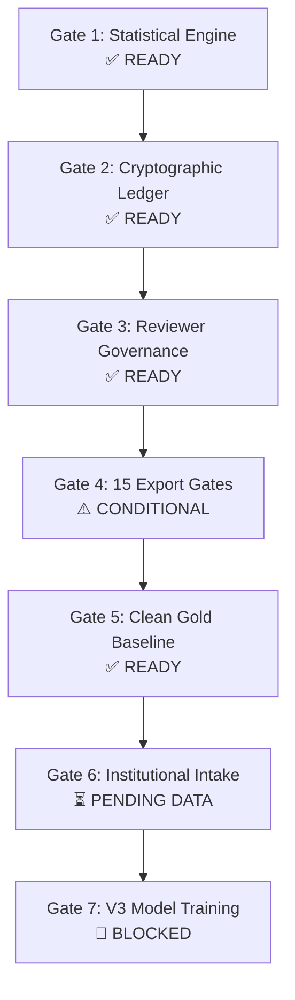

# FORM2FACT V3 — RELEASE READINESS CHECKLIST

**Target Release:** Form2Fact V3.0.0-Pilot  
**Commit:** [`cec296c568dd01b88fcb8b8313f4ca196ab9495d`](https://github.com/shinchxn/form2fact/commit/cec296c568dd01b88fcb8b8313f4ca196ab9495d)  
**Branch:** `feature/ml-pairwise-classifier-v3`  
**Audit Standard:** Pre-Pilot Institutional Onboarding Readiness Verification

---

## 1. READINESS GATE MATRIX

---

## 2. DETAILED CHECKLIST BY SUBSYSTEM

### A. Statistical & Metrics Engine
| Item | Verification Requirement | Status | Evidence / Notes |
| :--- | :--- | :---: | :--- |
| **A.1** | Cohen's Kappa boundary $N=0$ returns `null` with `'no_paired_annotations'` | **VERIFIED** | Unit tested in `server/tests/cohensKappa.test.ts`. |
| **A.2** | Zero variance ($p_e = 1.0$) returns `null` with `'denominator_zero_chance_agreement_one'` | **VERIFIED** | Unit tested; prevents silent 0.0/1.0 coercion. |
| **A.3** | Raw percentage agreement preserved separately from Kappa | **VERIFIED** | `rawAgreementRate` reported independently in API. |
| **A.4** | Sample size warning triggered when $N < 30$ | **VERIFIED** | `isSampleSizeSufficient = false` + advisory label. |
| **A.5** | Multi-class balanced concordance yields exact $\kappa = 1.0$ | **VERIFIED** | Unit tested; matches theoretical formulation. |

### B. Cryptographic Audit Ledger
| Item | Verification Requirement | Status | Evidence / Notes |
| :--- | :--- | :---: | :--- |
| **B.1** | Deterministic SHA-256 canonical payload hashing with sorted keys | **VERIFIED** | Implemented in `server/ledger/cryptographicLedger.ts`. |
| **B.2** | Event block chaining from genesis (`GENESIS_PREVIOUS_HASH = "0" * 64`) | **VERIFIED** | Verified unbroken across 20+ sequential events. |
| **B.3** | SQLite triggers block raw `UPDATE` on `audit_events` | **VERIFIED** | Trigger `audit_events_no_update` throws on SQL update. |
| **B.4** | SQLite triggers block raw `DELETE` on `audit_events` | **VERIFIED** | Trigger `audit_events_no_delete` throws on SQL delete. |
| **B.5** | Automated detection of payload tampering, event deletion, and reordering | **VERIFIED** | Verified in `server/tests/cryptographicLedger.test.ts`. |

### C. Reviewer Authorization & Governance
| Item | Verification Requirement | Status | Evidence / Notes |
| :--- | :--- | :---: | :--- |
| **C.1** | Administrative authorization registry (`reviewer_authorizations`) | **VERIFIED** | Full statutory metadata tracked per reviewer. |
| **C.2** | Administrator self-approval strictly prohibited | **VERIFIED** | Rejected with HTTP 400. |
| **C.3** | Substantive rationale ($\ge 10$ chars) enforced on revocation | **VERIFIED** | Short rationales strictly rejected. |
| **C.4** | Revoked reviewers blocked from non-demo institutional annotations | **VERIFIED** | Server-side validation throws on revoked status. |
| **C.5** | Adjudicator conflict-of-interest prevention | **VERIFIED** | Adjudicator barred if previously an annotator on task. |

### D. Document Authenticity & Export Firewall
| Item | Verification Requirement | Status | Evidence / Notes |
| :--- | :--- | :---: | :--- |
| **D.1** | Gate 1: Rejection of demo, synthetic, mock, or quarantined records | **VERIFIED** | Illustrative fixtures strictly barred from export. |
| **D.2** | Gate 2: Source documents identified and exist in registry | **CONDITIONAL** | GAP-SEC-01: Document name without ID must be tightened. |
| **D.3** | Gate 3: Physical file on disk SHA-256 recalculated at export | **VERIFIED** | Recalculated from binary bytes; catches TOCTOU. |
| **D.4** | Gate 4: Document source provenance certified (`PROVENANCE_VERIFIED`) | **VERIFIED** | Pending/unverified provenance rejected. |
| **D.5** | Gate 5: Page citations within document verified `pageCount` | **VERIFIED** | Positive integers $\le \text{pageCount}$ enforced. |
| **D.6** | Gate 6: Evidence references resolve to actual content | **VERIFIED** | Non-empty fields and text excerpts verified. |
| **D.7** | Gate 7–10: Double-blind independent submissions with substantive rationales | **VERIFIED** | $\ge 2$ distinct authorized raters, rationales $\ge 10$ chars. |
| **D.8** | Gate 11–12: Consensus concordance or independent adjudication | **VERIFIED** | Disagreements require independent adjudicator. |
| **D.9** | Gate 13: Cryptographic ledger chain verifies unbroken | **VERIFIED** | Broken chain halts export. |
| **D.10** | Gate 14: Regional multi-tenant isolation enforced | **VERIFIED** | Cross-tenant exports return 0 records. |
| **D.11** | Gate 15: No candidate or source document quarantined | **VERIFIED** | Quarantined records strictly barred from export. |

### E. Corpus Governance & Model Safety
| Item | Verification Requirement | Status | Evidence / Notes |
| :--- | :--- | :---: | :--- |
| **E.1** | Production `gold_standard_human.jsonl` contains exactly 0 records | **VERIFIED** | Clean baseline maintained (0 bytes, 0 rows). |
| **E.2** | Test exports executed to dedicated paths without production contamination | **VERIFIED** | Verified during audit and test suites. |
| **E.3** | Existing V1 and V2 model artifacts unchanged | **VERIFIED** | Exact registered SHA-256 checksums verified. |
| **E.4** | V3 model training strictly stopped and blocked | **ENFORCED** | Zero V3 model weights exist on disk. |

### F. Institutional Dependencies (Pre-Pilot Milestones)
| Item | Operational Milestone | Status | Responsible Entity |
| :--- | :--- | :---: | :--- |
| **F.1** | Bilateral Data Sharing Agreements with AICTE Regional Offices | **PENDING** | Legal & AICTE Directorate |
| **F.2** | Scrutiny Officer Nomination & Platform Accreditation ($\ge 4$ Reviewers) | **PENDING** | AICTE Scrutiny Board |
| **F.3** | Staged Ingestion of Initial 50 Real Regulatory Dossiers | **PENDING** | Data Intake Bureau |
| **F.4** | Double-Blind Human Annotation of $\ge 200$ Pairs ($\kappa \ge 0.70$) | **PENDING** | Accredited Scrutiny Panel |
| **F.5** | Independent Model Training Authorization Audit | **PENDING** | Independent Review Board |

---

## 3. RELEASE DECISION & CONDITIONS

- **Readiness Classification:** **CONDITIONAL ACCEPTANCE**
- **Action Permitted:** Safe for deploying the annotation workbench to begin controlled onboarding and intake of authorized institutional dossiers.
- **Action Prohibited:** **V3 MODEL TRAINING MUST REMAIN BLOCKED** until at least 200 real institutional pairs are double-annotated, provenance-verified, and passed through all 15 export firewall gates.

