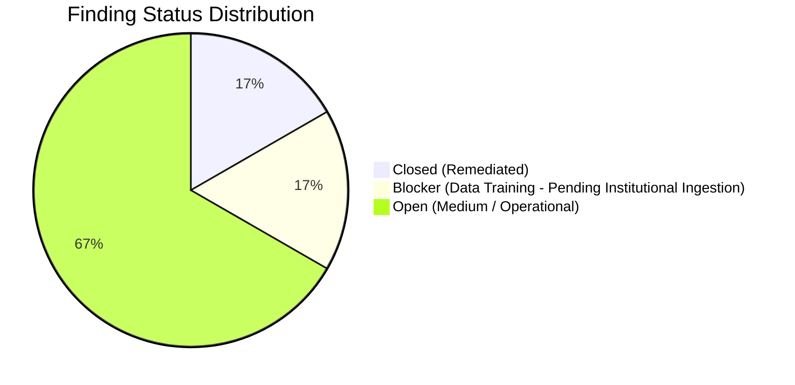

# FORM2FACT V3 — SECURITY AND RELIABILITY GAP REGISTER

**Version:** 3.1.0-REMEDIATED  
**Date:** 2026-11-07  
**Scope:** Architecture, Cryptography, Concurrency, Export Firewall, Cohen's Kappa, and Institutional Provenance.

---

## 1. REGISTER SUMMARY

This register documents all security, reliability, concurrency, and data governance defects identified during the independent forensic audit of Form2Fact V3 (`cec296c`) and tracks their remediation status.



| Finding ID | Severity | Status | Subsystem | Description | Target / Resolution |
|---|---|---|---|---|---|
| **GAP-SEC-01** | **HIGH** | **CLOSED (REMEDIATED)** | Export Firewall | Gate 2 incomplete resolution check on missing document IDs | Remediated in `server/db.ts` with strict ID resolution & fail-closed gates |
| **GAP-SEC-02** | **MEDIUM** | **OPEN** | Provenance Audit | Checksum absent in provenance audit event payload | Target for Phase 3 ingestion rollout |
| **GAP-REL-01** | **MEDIUM** | **OPEN** | Concurrency | SQLite multi-process concurrency / mutex | Target for multi-worker container scaling |
| **GAP-INF-01** | **LOW / OPS** | **OPEN** | Ledger Checkpoints | Absence of external off-site WORM ledger checkpoints | Target for statutory HSM/WORM anchor |
| **GAP-DAT-01** | **BLOCKER (TRAINING)** | **ACTIVE INVARIANT** | Data Governance | Zero genuine institutional dossiers ingested ($N=0$) | Training strictly blocked until $\ge 200$ pairs with $\kappa \ge 0.70$ |
| **GAP-OPS-01** | **MEDIUM** | **OPEN** | Regulatory Privacy | Manual PII redaction responsibility | Target for automated Indian PII NER filter |

---

## 2. DETAILED FINDING INVENTORY

### GAP-SEC-01: Gate 2 Incomplete Resolution Check on Unregistered Document Names
- **Severity:** **HIGH**
- **Status:** **CLOSED (REMEDIATED & INDEPENDENTLY TESTED)**
- **Affected File:** [`server/db.ts`](file:///d:/projects/form2fact/server/db.ts) (lines 3153–3265)
- **Description:** In `exportGoldStandard()`, candidate records may reference source documents via `claimDocumentId` or `claimDocumentName`. When a candidate provided `claimDocumentName` (e.g. `'Nonexistent_Filing.pdf'`) but left `claimDocumentId` unset (`null`), `resolveDoc()` searched by name or returned `null`. Previously, Gate 2 only checked:
```ts
if (r.claimDocumentId && !claimResolved) {
  reasons.push(`Referenced claim document ID '${r.claimDocumentId}' not found in institutional registry.`);
}
```
Because `r.claimDocumentId` was omitted, the check was skipped, and downstream checks (Gates 3, 4, 5, 15) wrapped in `if (claimResolved)` were also skipped.
- **Remediation Implemented:**
  1. Replaced `resolveDoc` with strict `resolveDocById(docId)` that exclusively queries by document ID / docket number. Name fallback is eliminated.
  2. Every candidate referencing a claim document or evidence document is required to have a non-empty `claimDocumentId` and `evidenceDocumentId`.
  3. A non-empty document name with a null/missing document ID is strictly rejected:
     `Gate 2 Failed: Non-empty claim document name '${rawClaimName}' provided without required claimDocumentId. Every candidate referencing a claim document must contain a valid claimDocumentId.`
  4. Missing document ID and missing document name fails Gate 2:
     `Gate 2 Failed: Missing identifiable source document citation for claim (claimDocumentId is missing).`
  5. An unresolvable, deleted, or inaccessible document ID strictly fails Gate 2.
  6. Cross-tenant document references are strictly validated: the document's regional organization must match the candidate's organization.
  7. Downstream physical document checks fail closed: if a document record is unresolved, Gates 3, 4, 5, and 15 explicitly record gate failures.
- **Verification Evidence:**
  Covered by 7 dedicated regression suites in [`server/tests/exportFirewallV3.test.ts`](file:///d:/projects/form2fact/server/tests/exportFirewallV3.test.ts) (14/14 suites passed):
  - Null document ID with non-empty document name (Test 3)
  - Missing document ID and missing document name (Test 2)
  - Invalid non-existent document ID (Test 4)
  - Deleted document (Test 5)
  - Cross-tenant document reference (Test 6)
  - Valid document reference (Test 14)
  - Document replacement before export / TOCTOU (Test 7)

---

### GAP-SEC-02: Lack of Checksum Snapshot in Provenance Certification Audit Events
- **Severity:** **MEDIUM**
- **Affected File:** [`server/db.ts`](file:///d:/projects/form2fact/server/db.ts) (`verifyDocketProvenance()`, line 2085)
- **Description:** When an authorized Reviewer certifies document provenance (`PROVENANCE_VERIFIED`), an audit event is appended to the ledger. However, the audit event's payload only binds `beforeValue: docket.provenanceStatus`, `afterValue: status`, and `entityReference: docketId`. It does not include the physical document's SHA-256 checksum in the canonical payload hash.
- **Evidence:** Lines 2085–2096 in `server/db.ts`.
- **Reproduction Steps:**
  1. Ingest a docket with checksum `C1`.
  2. Verify provenance via `verifyDocketProvenance()`.
  3. Inspect the created `audit_events` row: `beforeValue` is `'PROVENANCE_PENDING'`, `afterValue` is `'PROVENANCE_VERIFIED'`. The checksum `C1` is absent from the audit event payload.
- **Expected Behaviour:** The audit event recording provenance certification should cryptographically bind the verified file's SHA-256 checksum in its payload hash so that any subsequent modification to `institutional_dockets.documentChecksum` is detectable via the ledger.
- **Actual Behaviour:** Checksum is stored only in the mutable `institutional_dockets` table, not in the append-only audit event payload.
- **Recommended Remediation:**
Include the document checksum in the audit payload:
```ts
this.recordAudit({
  actorId: verifier.id,
  actorName: verifier.displayName,
  actorRole: verifier.role,
  organizationId: docket.organizationId,
  action: 'Docket Provenance Verified',
  entityType: 'InstitutionalDocket',
  entityReference: docketId,
  beforeValue: JSON.stringify({ provenanceStatus: docket.provenanceStatus, checksum: docket.documentChecksum }),
  afterValue: JSON.stringify({ provenanceStatus: status, checksum: docket.documentChecksum }),
  note: notes.trim()
});
```

---

### GAP-REL-01: Single SQLite Writer Bottleneck & Multi-Process Concurrency Isolation
- **Severity:** **MEDIUM**
- **Affected File:** [`server/db.ts`](file:///d:/projects/form2fact/server/db.ts) (`recordAudit()`, lines 1510–1546)
- **Description:** In `recordAudit()`, the sequence number and previous event hash are fetched via `SELECT ... ORDER BY sequenceNumber DESC LIMIT 1` followed by an `INSERT`. In a single-threaded Node.js event loop, synchronous calls run sequentially. However, in clustered Node.js deployments (e.g. PM2 with multiple cluster workers) or multi-process containers, concurrent processes attempting simultaneous audit inserts could read the same sequence number, causing sequence collisions or SQLite busy-lock timeouts.
- **Evidence:** Lines 1510–1546 in `server/db.ts` do not use an immediate transaction (`BEGIN IMMEDIATE TRANSACTION`).
- **Reproduction Steps:**
  1. Spawn two independent Node.js processes writing to the same SQLite database file simultaneously.
  2. Observe sequence number race conditions or SQLite locking conflicts.
- **Expected Behaviour:** Ledger writes across multiple workers should execute inside an immediate transaction or be routed through a dedicated single-writer ledger queue.
- **Actual Behaviour:** Synchronous queries execute without process-level mutex or `BEGIN IMMEDIATE`.
- **Recommended Remediation:**
Wrap `recordAudit()` in `BEGIN IMMEDIATE TRANSACTION` ... `COMMIT`, or serialize writes via an in-memory or IPC queue.

---

### GAP-INF-01: Absence of External WORM / Transparency Log Anchoring for Ledger Checkpoints
- **Severity:** **LOW / OPERATIONAL**
- **Affected File:** [`server/ledger/cryptographicLedger.ts`](file:///d:/projects/form2fact/server/ledger/cryptographicLedger.ts)
- **Description:** The cryptographic ledger implements SHA-256 chaining and SQLite triggers prevent SQL `UPDATE` and `DELETE`. However, a privileged system administrator with direct OS root access could delete or rewrite the SQLite database file and recompute the entire hash chain from genesis.
- **Evidence:** Documented in [`docs/ml/v3/V3_CRYPTOGRAPHIC_LEDGER_SPECIFICATION.md`](file:///d:/projects/form2fact/docs/ml/v3/V3_CRYPTOGRAPHIC_LEDGER_SPECIFICATION.md).
- **Reproduction Steps:**
  1. Open SQLite database using external SQLite CLI.
  2. Drop triggers `audit_events_no_update` and rewrite sequence hashes.
- **Expected Behaviour:** Periodic signed checkpoints (e.g. daily root hash signed by AICTE PKI key) should be anchored into immutable external WORM storage (e.g. AWS S3 Object Lock, GCP Bucket Lock, or public transparency logs).
- **Actual Behaviour:** Ledger immutability relies entirely on local software-level cryptographic hashing and SQLite triggers.
- **Recommended Remediation:**
Implement daily external ledger state anchoring and PKI HSM digital signatures for production pilot.

---

### GAP-DAT-01: Zero Genuine Institutional Dossiers Ingested (Empty Gold Standard Baseline)
- **Severity:** **BLOCKER FOR MODEL TRAINING**
- **Affected File:** [`ai_service/ml/data/v3/annotations/gold_standard_human.jsonl`](file:///d:/projects/form2fact/ai_service/ml/data/v3/annotations/gold_standard_human.jsonl)
- **Description:** The system currently contains 0 genuine institutional dossiers ingested, 0 human double-annotations completed, and 0 gold-standard records.
- **Evidence:** `gold_standard_human.jsonl` contains 0 records (0 bytes).
- **Reproduction Steps:**
  1. Inspect `gold_standard_human.jsonl`.
  2. Query `GET /api/v1/intake/dashboard`.
  3. Observe `currentDocuments: 0`, `currentCandidatePairs: 0`, `goldStandardRecordsCount: 0`.
- **Expected Behaviour:** A minimum corpus of 200 double-annotated institutional claim/evidence pairs with $\kappa \ge 0.70$ is required before V3 model training can be initiated.
- **Actual Behaviour:** The workbench is fully functional, but no real institutional data has been collected.
- **Recommended Remediation:**
Execute formal bilateral data intake agreements with AICTE Regional Offices (WRO, NRO) and begin staged docket ingestion.

---

### GAP-OPS-01: Manual PII Redaction Responsibility in Institutional Dossiers
- **Severity:** **MEDIUM**
- **Affected File:** [`server/api.ts`](file:///d:/projects/form2fact/server/api.ts) (`/api/v1/intake/dockets`)
- **Description:** Institutional dossiers submitted for regulatory scrutiny may contain sensitive personally identifiable information (PII) such as trustee Aadhaar numbers, personal cell phone numbers, or private residential addresses. The current system relies on manual redaction and scrutiny officer discretion during candidate pair creation.
- **Evidence:** Candidate creation API does not perform automated PII sanitization.
- **Reproduction Steps:**
  1. Ingest a document containing unmasked Aadhaar numbers or personal contact details.
  2. Annotator creates candidate quoting raw excerpt.
- **Expected Behaviour:** Automated regex/NER pre-filtering should detect and redact personal identification numbers before text excerpts are stored in candidate records.
- **Actual Behaviour:** Full responsibility is placed on human evaluators to avoid quoting confidential personal identifiers.
- **Recommended Remediation:**
Introduce an automated pre-intake PII masking scanner for common Indian national identity formats (Aadhaar, PAN, personal mobile numbers).

