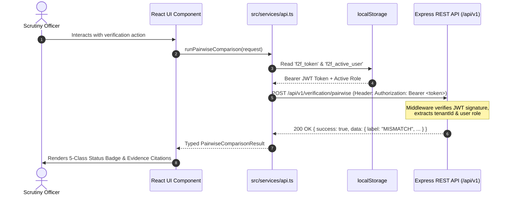

# Form2Fact — Frontend API Integration & Network Protocol Specification

**Project:** Form2Fact — Evidence-First Institutional Document Intelligence & Regulatory Cross-Verification Platform  
**Target:** Frontend Client (`src/services/api.ts`) & Express Backend (`/api/v1`)  
**Owner:** Person 7 (Senior Frontend Architect) in coordination with Person 2 (Backend Security Lead)  
**Security Level:** P0 Compliant (Mandatory JWT, Tenant Isolation, RBAC Enforcement)  

---

## 1. Network Boundary & Security Architecture

All frontend network communication is strictly funneled through `src/services/api.ts`. No raw `fetch()` calls or third-party HTTP clients are permitted in UI view components.



---

## 2. Authentication & JWT Token Protocol

### 2.1 Storage & Token Persistence
- The client persists the active user's JSON Web Token in browser storage under key: `f2f_token`.
- The active user profile is stored under: `f2f_active_user`.
- On application bootstrap, `api.ts` initializes auth headers using `getHeaders()`.

### 2.2 `getHeaders()` Implementation
```typescript
const getHeaders = (isFormData = false): Record<string, string> => {
  const headers: Record<string, string> = {};
  if (!isFormData) {
    headers['Content-Type'] = 'application/json';
  }
  const token = localStorage.getItem('f2f_token');
  if (token) {
    headers['Authorization'] = `Bearer ${token}`;
  }
  return headers;
};
```

### 2.3 Role & Persona Simulation
To support regulatory demonstrations and multi-tenant security verification, officers can switch personas (e.g., Regional Reviewer, Compliance Officer, Super Administrator) via the Header dropdown.
- Switching personas invokes `POST /api/v1/user`.
- The backend derives claims strictly from the persistent user record (role escalation prevention).
- The new signed JWT is saved to `localStorage`, and all subsequent requests carry the updated token claims.

---

## 3. Core API Endpoint Contracts

### 3.1 Pairwise Field Comparison
- **Route:** `POST /api/v1/verification/pairwise`
- **Auth:** Mandatory JWT Bearer Token (`Reviewer`, `Compliance Officer`, `Administrator`)
- **Request Payload:**
  ```json
  {
    "claimField": {
      "fieldName": "landAreaAcres",
      "fieldLabel": "Declared Land Area",
      "rawValue": "7.50"
    },
    "evidenceField": {
      "fieldName": "landAreaAcres",
      "fieldLabel": "Title Deed Land Area",
      "rawValue": "6.00"
    },
    "comparisonType": "numeric"
  }
  ```
- **Response Payload:**
  ```json
  {
    "success": true,
    "data": {
      "label": "MISMATCH",
      "confidence": 1.0,
      "explanation": "Numeric deficit detected: Claimed '7.50' vs Evidence '6.00' (Deficit: 1.50).",
      "requiresHumanReview": true
    }
  }
  ```

### 3.2 Secure Binary Document Streaming & Download
- **Route:** `GET /api/v1/applications/:appId/documents/:docId/download`
- **Auth:** Mandatory JWT Bearer Token with Regional Tenant Verification
- **Client Method:** `downloadDocument(applicationId, docId, originalFilename)`
- **Behavior:**
  - Streams binary PDF octet-stream securely.
  - Automatically handles browser blob URL creation and triggers direct file download with original filename.
  - Path traversal and unauthorized cross-tenant downloads are blocked with `400` or `403` status codes.

### 3.3 Rule Validation Execution
- **Route:** `POST /api/v1/applications/:id/validate`
- **Auth:** Mandatory JWT Bearer Token
- **Behavior:** Evaluates deterministic statutory AICTE rules (Lease tenure >= 30 yrs, Land area aggregation without double-counting, Trust concordance) and generates evidence-linked findings in SQLite.

### 3.4 Deep Scrutiny Synthesis
- **Route:** `POST /api/v1/applications/:id/deep-scrutiny`
- **Auth:** Mandatory JWT Bearer Token
- **Behavior:** Uses AI service to synthesize multi-document discrepancy explanations, citing page-level bounding boxes and regulatory provisions.

### 3.5 Discrepancy Adjudication & Field Correction
- **Adjudicate Finding:** `POST /api/v1/findings/:id/review`
  - Body: `{ status: "Confirmed" | "Dismissed" | "Unable to Determine", reason: string }`
- **Correct OCR Extraction:** `POST /api/v1/fields/:id/correct`
  - Body: `{ correctedValue: string, reason: string }`
  - Creates immutable audit log entry and flags field as human-verified.

---

## 4. Error Handling Strategy & Recovery Workflow

1. **HTTP 401 Unauthorized:**
   - Clears stale tokens from `localStorage`.
   - Prompts user to re-authenticate or switch to a valid seed persona.
2. **HTTP 403 Forbidden:**
   - Indicates cross-tenant access attempt or role deficit.
   - UI displays alert: "Access Denied: You do not have permissions for this regional jurisdiction."
3. **HTTP 500 / Network Disconnection:**
   - Caught in `App.tsx` error state.
   - Renders top-level amber warning banner with explicit "Retry Connection" button.
   - Prevents silent failures or corrupted local state.
