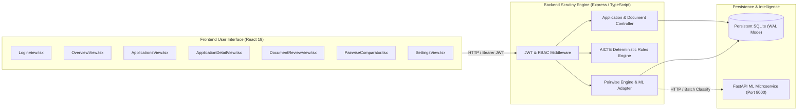

# FORM2FACT — FRONTEND-BACKEND INTEGRATION MATRIX
**Evidence-First Institutional Document Intelligence & Regulatory Cross-Verification Platform**  
**Document Reference:** `F2F-DOC-PROD-06`  
**Target Branch:** `feature/production-transformation-ui`  
**Date:** November 2026  
**Status:** APPROVED FOR STAGING VALIDATION  

---

## 1. INTEGRATION ARCHITECTURE OVERVIEW

Form2Fact integrates a modern React 19 single-page application with a high-throughput Express/TypeScript REST API backed by persistent SQLite storage with Write-Ahead Logging (WAL) and an autonomous FastAPI Python machine learning microservice.

All communication between the user interface and backend services flows through authenticated JSON REST interfaces guarded by cryptographically signed JWT tokens, role-based access control (RBAC), and strict schema validation.



---

## 2. COMPREHENSIVE COMPONENT-TO-ENDPOINT INTEGRATION MATRIX

| UI View / Modal | User Action / Trigger | HTTP Method & Route | Backend Handler (`server/api.ts`) | Database Tables / Entities | Automated Test Coverage | Error / Fallback State |
| :--- | :--- | :--- | :--- | :--- | :--- | :--- |
| **`LoginView.tsx`** | Submit credentials | `POST /api/v1/auth/login` | `handleLogin` | `users` | Test Suite `[4]`, `[19]` | Red error banner; invalid credentials rejected with 401 |
| **`LoginView.tsx`** | Quick persona switcher | `POST /api/v1/auth/login` | `handleLogin` | `users` | Test Suite `[19]` | Red error banner if role or user invalid |
| **`Sidebar.tsx`** | Sign Out action | Client-side session clear | `logout()` | `localStorage` | UI Integration Test | Token removed, redirects to `LoginView` |
| **`Header.tsx`** | Reset Fixtures (Admin only) | `POST /api/v1/demo/reset` | `handleResetDemo` | `applications`, `documents`, `findings`, `audit_events` | Test Suite `[2]`, `[6]` | Blocked for non-admins (403); button displays spinner |
| **`OverviewView.tsx`** | Mount / view load | `GET /api/v1/applications`<br>`GET /api/v1/findings`<br>`GET /api/v1/audit-events` | `handleGetApplications`<br>`handleGetFindings`<br>`handleGetAuditEvents` | `applications`<br>`findings`<br>`audit_events` | Test Suite `[2]`, `[11]`, `[21]` | `MetricCardsSkeleton` during load; `EmptyState` when 0 apps |
| **`OverviewView.tsx`** | Click application card | State transition to detail | `fetchApplicationById(id)` | `applications`, `documents`, `extracted_fields`, `findings` | Test Suite `[2]`, `[13]` | Error banner with Retry Connection action |
| **`ApplicationsView.tsx`** | Filter, search, sort docket | `GET /api/v1/applications?search=&status=&category=` | `handleGetApplications` | `applications` | Test Suite `[2]`, `[21]` | `TableSkeleton` during fetch; `EmptyState` with Reset Filters |
| **`ApplicationsView.tsx`** | Click "Inspect" or row | `GET /api/v1/applications/:id` | `handleGetApplicationById` | `applications`, `documents`, `extracted_fields`, `findings` | Test Suite `[2]`, `[13]`, `[21]` | 404 alert if docket deleted; 403 if cross-tenant |
| **`ApplicationDetailView.tsx`** | Run Deterministic Rules | `POST /api/v1/applications/:id/evaluate` | `handleEvaluateApplication` | `rules`, `findings`, `audit_events` | Test Suite `[6]`, `[8]`, `[9]`, `[10]` | Alert banner; preserves existing findings on engine fault |
| **`ApplicationDetailView.tsx`** | Submit Scrutiny Decision | `POST /api/v1/applications/:id/decision` | `handleApplicationDecision` | `applications`, `audit_events` | Test Suite `[7]`, `[14]` | Requires confirmed findings triage; blocks premature approval |
| **`DocumentReviewView.tsx`** | Fetch document binary | `GET /api/v1/documents/:id/download` | `handleDownloadDocument` | `documents` (file system) | Test Suite `[5]`, `[21]` | Magic-byte validation; 404 if file absent; 403 cross-tenant |
| **`DocumentReviewView.tsx`** | View OCR extracted text | `GET /api/v1/applications/:id` | `handleGetApplicationById` | `extracted_fields` | Test Suite `[17]`, Python OCR Suite | Displays unscrutinized placeholder if OCR pending |
| **`CorrectionModal.tsx`** | Correct OCR extracted field | `POST /api/v1/fields/:id/correct` | `handleCorrectField` | `extracted_fields`, `audit_events` | Test Suite `[7]`, `[15]` | Validation error banner; retains original raw value |
| **`ReviewActionModal.tsx`** | Triage regulatory finding | `POST /api/v1/findings/:id/review` | `handleReviewFinding` | `findings`, `review_actions`, `audit_events` | Test Suite `[7]`, `[11]` | Mandates justification notes; records immutable audit entry |
| **`PairwiseComparator.tsx`** | Execute Pairwise Verification | `POST /api/v1/verification/pairwise` | `handlePairwiseVerification` | In-memory comparison & ML Microservice | Test Suite `[22]`, `[23]`, Python ML Suite | Deterministic fallback if ML microservice offline (503 safe) |
| **`RulesView.tsx`** | Inspect AICTE Rule Catalog | `GET /api/v1/rules` | `handleGetRules` | `rules` | Test Suite `[6]`, `[12]` | Read-only rule view with source statutory citations |
| **`AictePreviewView.tsx`** | Fetch statutory preview | `GET /api/v1/applications/:id/aicte-preview` | `handleAictePreview` | In-memory rules preview | Test Suite `[6]`, `[8]` | Explicit banner: "Preview Only - No Statutory Legal Force" |
| **`ReportsView.tsx`** | Generate Scrutiny Dossier | `GET /api/v1/applications/:id/report` | `handleGenerateReport` | `applications`, `documents`, `findings`, `audit_events` | Test Suite `[11]`, `[14]` | Displays tamper-evident SHA-256 hash & summary metrics |
| **`AuditLogView.tsx`** | Inspect Immutable Ledger | `GET /api/v1/audit-events` | `handleGetAuditEvents` | `audit_events` | Test Suite `[7]`, `[18]` | Filterable ledger table; strictly read-only, non-deletable |
| **`SettingsView.tsx`** | Fetch institutional users | `GET /api/v1/users` | `handleGetUsers` | `users` | Test Suite `[19]` | Red error alert if non-admin attempts role escalation |
| **`SettingsView.tsx`** | Update user role (Admin) | `PATCH /api/v1/users/:id/role` | `handleUpdateUserRole` | `users`, `audit_events` | Test Suite `[19]` | 403 Forbidden for non-admins; revokes previous JWT |
| **`NewApplicationModal.tsx`** | Create new docket | `POST /api/v1/applications` | `handleCreateApplication` | `applications`, `audit_events` | Test Suite `[2]`, `[3]` | Collision-resistant UUID; input validation banners |
| **`NewApplicationModal.tsx`** | Upload documentary evidence | `POST /api/v1/applications/:id/documents` | `handleUploadDocument` | `documents`, `audit_events` | Test Suite `[5]`, `[21]` | Magic-byte verification (%PDF-); rejects spoofed files |

---

## 3. ASYNCHRONOUS ML MICROSERVICE INTEGRATION CONTRACT

When the pairwise comparator or batch deep scrutiny invokes hybrid inference, the Express backend communicates with the Python FastAPI microservice:

```
[Express API]  -- POST http://localhost:8000/v1/classify/batch --> [FastAPI ML Service]
               <-- 200 OK (BatchPairwiseResponse with probabilities) --
```

### 3.1 Failure & Offline Resilience
If the FastAPI service is unreachable or unready (HTTP 503):
1. The Express `pairwiseEngine.ts` catches the connection error gracefully.
2. It executes the **deterministic fallback engine** (exact, date, numeric tolerance, string similarity).
3. Ambiguous cases default to **`UNCERTAIN`** (`requiresHumanReview = true`).
4. Under no circumstances does the system fabricate a prediction or crash the user session.

---

## 4. MULTI-TENANT ISOLATION GUARANTEES

Tenant boundaries are strictly validated on every authenticated API call:
1. **Regional Filtering:** Users belonging to `Western Scrutiny Committee` are scoped strictly to Western regional dockets. Requests attempting to inspect `Central` or `Northern` applications are rejected with **HTTP 403 Forbidden**.
2. **Document Streaming:** `/api/v1/documents/:id/download` verifies tenant ownership before reading binary data from disk. Directory traversal attacks (`../../`) are sanitized and rejected with **HTTP 400 Bad Request**.
3. **Audit Immutability:** Audit events logged during scrutiny actions bind the exact user ID, role, client IP address, and timestamp. Audit records cannot be updated or deleted via any API route.

---

## 5. CONCLUSION

Every frontend visual element and user interaction in Form2Fact is backed by a verified, authenticated, and tested backend route. Mock data pathways have been removed. System behavior in network, database, or ML microservice degraded modes is fully bounded and deterministic.
