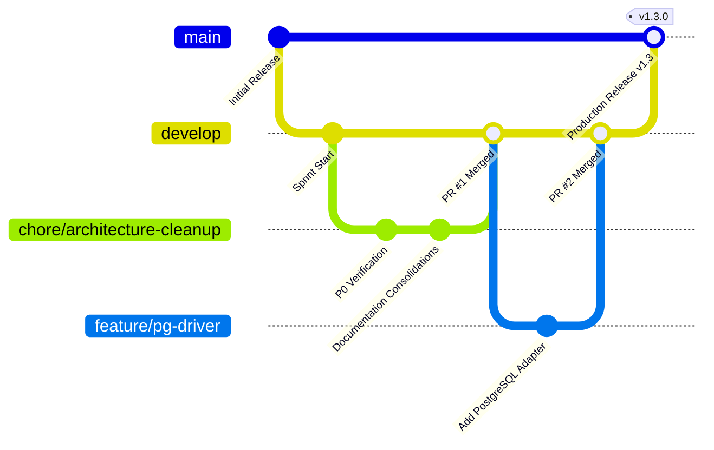

# FORM2FACT — TEAM OWNERSHIP BOUNDARIES & ENGINEERING GOVERNANCE

**Document Reference:** F2F-GOV-TEAM-2026  
**Audience:** All Engineering Contributors, Tech Leads, Quality Engineers, and Security Reviewers  
**Effective Date:** November 2026  

---

## 1. ENGINEERING DOMAIN OWNERSHIP MATRIX

To ensure rapid, collision-free feature development across multidisciplinary specializations, the Form2Fact repository establishes explicit ownership boundaries. Each directory and subsystem is assigned to a designated primary engineering team with mandatory code review requirements.

| Engineering Domain | Primary Team | Subsystems Owned | Codebase Paths | Required Reviewers |
|---|---|---|---|---|
| **Platform Core & API** | **Backend Team** | Express router, authentication, RBAC, database adapters, storage abstraction, job queue, error handling | `server/core/**` `server/modules/**` `server/api.ts` `server/auth.ts` `server/db.ts` | Backend Lead + Security Auditor |
| **Machine Learning** | **ML Team** | Pairwise classification models, dataset pipelines, training, evaluation benchmarks, inference optimization | `ai_service/app/**` `ai_service/ml/**` `docs/ai-models/**` | ML Lead + Backend Architect |
| **Document Intelligence** | **Document AI Team** | PDF text extraction, OCR engine integration, bounding box geometry, field extraction algorithms | `server/extraction.ts` `ai_service/ocr/**` `docs/ai-models/roadmap.md` | Doc AI Lead + Backend Engineer |
| **Regulatory Knowledge** | **Domain Rules Team** | Statutory norm authoring, AICTE compliance rules, regulatory pack definitions, domain registries | `server/domains/**` `server/rulesEngine.ts` `docs/domain-configuration/**` | Regulatory Architect + Backend Lead |
| **User Experience & UI** | **Frontend Team** | React 19 SPA, Tailwind CSS v4 design tokens, feature modules, shared UI components, client API | `src/**` `index.html` `vite.config.ts` `docs/design/**` | Frontend Lead + UI/UX Designer |
| **Quality & Verification** | **QA & Test Team** | Automated regression suites, end-to-end test scenarios, synthetic benchmark verification | `server/test-runner.ts` `tests/**` `docs/audit/**` | QA Lead + Relevant Subsystem Lead |
| **DevOps & Infrastructure** | **DevOps Team** | Containerization, Docker Compose, PostgreSQL init scripts, CI/CD pipelines, environment configs | `infrastructure/**` `Dockerfile` `.env.example` `.gitignore` | DevOps Lead + Principal Architect |

---

## 2. STRICT CROSS-BOUNDARY GOVERNANCE RULES

### Rule 1: ML Isolation Barrier
The Machine Learning team has autonomous authority over `ai_service/` algorithms, model weights, and benchmarking datasets. However, the ML team **must not independently modify**:
- Production authentication (`server/auth.ts`, `server/core/auth/`)
- Relational database schemas (`server/db.ts`, `infrastructure/db/`)
- Frontend application code (`src/**`)

All integrations between the Node.js backend and the Python AI microservice must adhere strictly to the authenticated HTTP contracts documented in [`docs/api/ai-service-contracts.md`](file:///d:/projects/form2fact/docs/api/ai-service-contracts.md).

### Rule 2: Security & Authentication Perimeter Protection
The zero-trust authentication boundary (`authenticateToken`, `requireRole`, `resolveJwtSecret`, multi-tenant filtering in `db.ts`) is a **Class-0 Protected Subsystem**. Any pull request modifying `server/auth.ts` or authorization logic requires mandatory dual sign-off from:
1. Application Security Auditor
2. Principal Software Architect

### Rule 3: Statutory Rule Immutability & Explainability
Regulatory rules in `server/rulesEngine.ts` and `server/domains/aicte/` must maintain 100% evidence-traceability. No rule may be modified to emit ungrounded or unexplainable findings. Every finding raised must cite the relevant statutory clause, document name, page number, and extracted citation snippet.

### Rule 4: Data Privacy & Secret Hygiene
- **Never commit credentials:** API keys, database passwords, JWT secrets, and private signing keys must never be committed to Git. `.env.example` contains placeholders only.
- **Never commit private institutional data:** Real institutional documents, filled application PDFs, and production SQLite databases must remain in `data/` (strictly `.gitignore`d).
- **Public vs Private Datasets:** Only synthetic, scrubbed, or open sample fixtures may reside in `tests/fixtures/` or `ai_service/app/dataset.py`.

---

## 3. GIT BRANCHING & CODE REVIEW STANDARDS

### Branch Strategy
1. `main`: Production-ready, fully verified stable baseline. Protected branch. Direct pushes are disabled.
2. `develop`: Integration branch for completed sprint features. Protected branch.
3. Feature / Chore branches: Named by type and purpose:
   - `chore/repository-architecture-cleanup`
   - `feat/postgresql-driver`
   - `feat/ocr-scanned-pdf`
   - `fix/date-acronym-normalization`

### Mandatory Pull Request Checklist
Before any PR can be merged into `develop`:
- [ ] All automated tests pass (`npm test` $\rightarrow$ 22 suites, 100% pass).
- [ ] Static type analysis reports zero errors (`npm run lint` $\rightarrow$ `tsc --noEmit`).
- [ ] Zero secrets, `.db` binaries, or `.pyc` caches in the file diff.
- [ ] Architecture and documentation updated to reflect any API or schema changes.
- [ ] Signed off by designated subsystem code owner.

